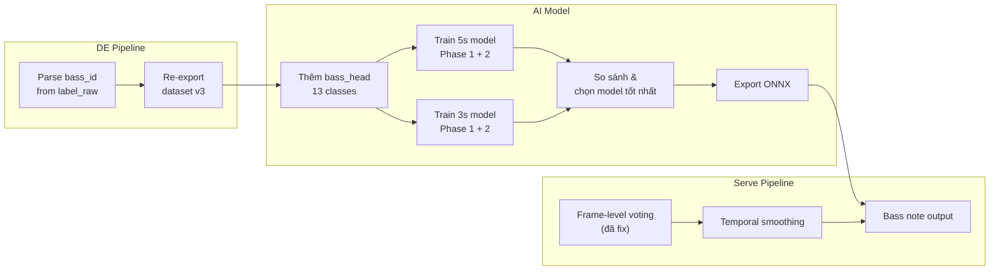
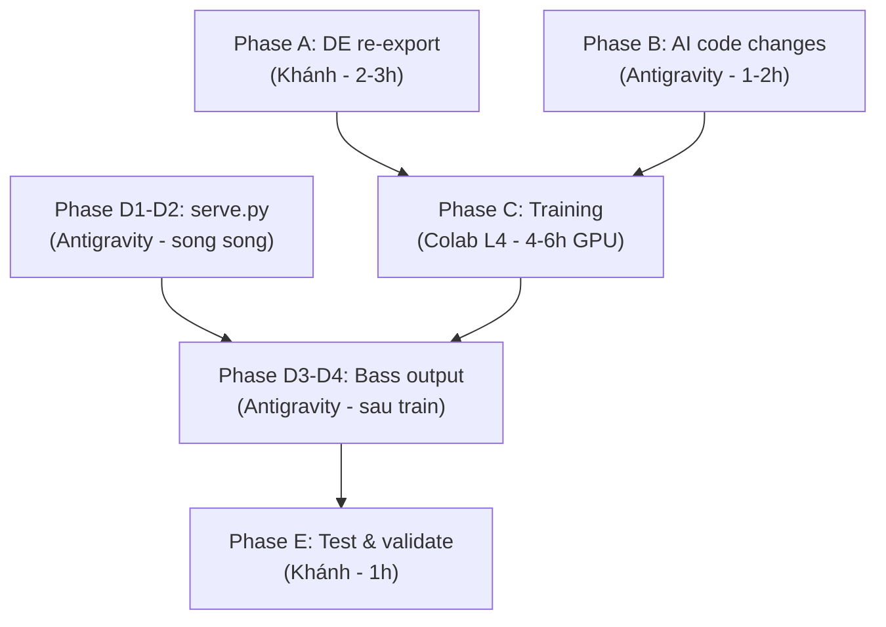

# ChordSense Pro — Improvement Plan v3

> **Mục tiêu:** Thêm slash chord (bass head), cải thiện quality/ext accuracy, train model 3s so sánh 5s, cải thiện serve.py pipeline.

---

## Tổng quan thay đổi



---

## Phase A — DE: Parse bass note & re-export (≈ 2-3h)

### A1. Parse `bass_id` từ `label_raw`

**Hiện trạng:** Dataset có 12,809 slash chord (8.5%) nhưng DE pipeline bỏ qua bass note.

**Format `label_raw`:**
| Pattern | Meaning | Ví dụ | bass_note |
|---------|---------|-------|-----------|
| `D:maj/5` | Root D, interval /5 (perfect 5th) | D → A | A (bass_id=9) |
| `C:maj/3` | Root C, interval /3 (major 3rd) | C → E | E (bass_id=4) |
| `D:min/b3` | Root D, interval /b3 (minor 3rd) | D → F | F (bass_id=5) |
| `D:maj/G` | Root D, bass note G trực tiếp | D/G | G (bass_id=7) |
| Không có `/` | Không có slash | Cmaj | bass = root (bass_id=12) |

**Interval → semitone mapping:**
```python
INTERVAL_SEMITONES = {
    "1": 0,
    "b2": 1, "2": 2, "#2": 3,
    "b3": 3, "3": 4, "#3": 5,
    "4": 5, "#4": 6,
    "b5": 6, "5": 7, "#5": 8,
    "b6": 8, "6": 9, "#6": 10,
    "b7": 10, "7": 11,
}
NOTE_TO_ID = {"C": 0, "C#": 1, "Db": 1, "D": 2, "D#": 3, "Eb": 3,
              "E": 4, "F": 5, "F#": 6, "Gb": 6, "G": 7, "G#": 8,
              "Ab": 8, "A": 9, "A#": 10, "Bb": 10, "B": 11}
```

**Logic:**
```python
def parse_bass_id(label_raw: str, root_id: int) -> int:
    if "/" not in label_raw:
        return 12  # no slash = class "none"

    bass_str = label_raw.split("/")[-1]

    # Try interval first
    if bass_str in INTERVAL_SEMITONES:
        semitones = INTERVAL_SEMITONES[bass_str]
        return (root_id + semitones) % 12

    # Try note name
    if bass_str in NOTE_TO_ID:
        return NOTE_TO_ID[bass_str]

    return 12  # fallback = none
```

### A2. File cần sửa

Tìm script DE mà export `chords.parquet` và thêm cột `bass_id`:

> [!IMPORTANT]
> Cần check file DAG/export script trong `DE/` để biết chính xác file nào generate parquet.
> Khả năng cao là trong [`DE/dags/dag_process_audio.py`](file:///d:/qkhenh/Project/ChordSensePro/DE/dags/dag_process_audio.py) hoặc script riêng.

**Output:** `chords.parquet` thêm cột `bass_id` (int, 0-12)

### A3. Re-export dataset v3

```
DE/data/export/v3/
├── train/
│   ├── audio/           # symlink hoặc copy từ v2
│   └── chords.parquet   # thêm cột bass_id
├── val/
│   └── ...
├── test/
│   └── ...
├── classes.json          # thêm "bass": ["C","C#",...,"B","none"]
└── config.yaml           # cập nhật
```

### A4. Cập nhật `classes.json`

```json
{
  "root": ["C", "C#", "D", "D#", "E", "F", "F#", "G", "G#", "A", "A#", "B"],
  "quality": ["major", "minor", "dominant", "diminished", "sus2", "sus4"],
  "extension": ["none", "b5", "#5", "maj7", "min7", "dom7", "add9", "b9", "nat9", "#9", "nat11", "#11", "nat13", "b13", "alt"],
  "bass": ["C", "C#", "D", "D#", "E", "F", "F#", "G", "G#", "A", "A#", "B", "none"],
  "valid_combo_mask": "...",
  "bass_distribution": {"0": ..., "12": ...}
}
```

---

## Phase B — AI: Model architecture changes (≈ 1-2h code)

### B1. Sửa `config.py` — thêm `n_bass`

```python
@dataclass
class ModelCfg:
    ...
    n_bass: int = 13        # C..B + "none" (= no slash / bass = root)
    bass_head_hidden: int = 128
```

```python
@dataclass
class TrainCfg:
    ...
    loss_weights: list[float] = [0.5, 0.5, 0.0, 0.0]  # [root, quality, ext, bass]
```

### B2. Sửa `model.py` — thêm `head_bass`

**Vị trí trong cascade:** root → quality → extension → **bass**

```python
# Trong ChordModel.__init__:
self.head_bass = ChordHead(
    cfg.hidden_dim + cfg.n_root + cfg.n_quality + cfg.n_ext,
    cfg.bass_head_hidden,
    cfg.n_bass,
)

# Trong forward:
feat_bass = torch.cat([pooled, r_logits.detach(), q_logits.detach(), e_logits.detach()], dim=-1)
b_logits = self.head_bass(feat_bass)
return r_logits, q_logits, e_logits, b_logits
```

> [!NOTE]
> Bass head nhận input từ root + quality + ext logits vì bass note phụ thuộc vào chord type.
> Ví dụ: C/E (3rd inversion) → root=C, quality=maj, bass=E. Model cần biết root để predict bass.

### B3. Sửa `dataset.py` — thêm `bass` label

```python
# Trong __getitem__:
bass = int(row["bass_id"]) if "bass_id" in row else 12  # backward compatible
return {"wav": wav, "root": root, "quality": quality, "ext": ext, "bass": bass}
```

### B4. Sửa `losses.py` — thêm bass loss

```python
class ChordLoss:
    def __init__(self, weights=[0.3, 0.3, 0.3, 0.1], ...):
        self.ce_bass = CrossEntropyLoss(ignore_index=-100)
    
    def forward(self, preds, targets):
        r, q, e, b = preds
        l_root = self.ce_root(r, targets["root"])
        l_qual = self.ce_quality(q, targets["quality"])
        l_ext  = self.focal_ext(e, targets["ext"])
        l_bass = self.ce_bass(b, targets["bass"])
        return w[0]*l_root + w[1]*l_qual + w[2]*l_ext + w[3]*l_bass
```

### B5. Sửa `export_onnx.py` — thêm output thứ 4

```python
output_names = ["root_logits", "quality_logits", "ext_logits", "bass_logits"]
```

### B6. Sửa `train.py` — forward call trả 4 values

```python
r, q, e, b = model(wav)
loss = criterion((r, q, e, b), {"root": root, "quality": quality, "ext": ext, "bass": bass})
```

### B7. Sửa `evaluate.py` — thêm bass accuracy metric

---

## Phase C — Training: 5s + 3s models (≈ 4-6h GPU trên Colab L4)

### C1. Config file cho 4 runs

| Run | `crop_s` | Phase | Config file | Checkpoint |
|-----|----------|-------|-------------|------------|
| 1 | 5 | Phase 1 (frozen MERT) | `configs/v3_5s_p1.yaml` | `results/v3_5s_p1/best.pt` |
| 2 | 5 | Phase 2 (LoRA) | `configs/v3_5s_p2.yaml` | `results/v3_5s_p2/best.pt` |
| 3 | 3 | Phase 1 (frozen MERT) | `configs/v3_3s_p1.yaml` | `results/v3_3s_p1/best.pt` |
| 4 | 3 | Phase 2 (LoRA) | `configs/v3_3s_p2.yaml` | `results/v3_3s_p2/best.pt` |

### C2. Hyperparams so với v2

| Param | v2 (hiện tại) | v3 (đề xuất) | Lý do |
|-------|---------------|---------------|-------|
| `crop_s` | 5 | 5 / **3** | 75% chord < 2s, crop 3s capture chính xác hơn |
| `loss_weights` P1 | [0.5, 0.5, 0.0] | [0.4, 0.3, 0.2, **0.1**] | Train bass từ đầu, ext cũng train sớm hơn |
| `loss_weights` P2 | ? | [0.3, 0.25, 0.25, **0.2**] | Balance hơn giữa 4 heads |
| `epochs` P1 | 14 | **20** | Thêm head cần thêm thời gian |
| `epochs` P2 | 19 | **25** | LoRA cần train lâu hơn |
| `batch_size` | 16 | 16 / **24** (3s) | 3s crop dùng ít VRAM hơn → tăng batch |
| `focal_gamma` | 2.0 | 2.0 | Giữ nguyên |
| `lora.r` | 16 | **32** | Tăng capacity cho thêm 1 head |
| `lora.target_modules` | [q_proj, v_proj] | [q_proj, v_proj, **k_proj**] | Thêm k_proj cải thiện attention quality |

> [!TIP]
> 3s crop → `crop_samples = 3 * 24000 = 72000` → MERT output ngắn hơn → train nhanh hơn ~40%.
> Có thể tăng batch_size lên 24-32 trên L4 (24GB VRAM).

### C3. Thứ tự chạy

```
1. Upload dataset v3 lên Google Drive
2. Run v3_5s_p1 (Phase 1, 5s) → ~1.5h
3. Run v3_5s_p2 (Phase 2, 5s, load p1 ckpt) → ~2h
4. Run v3_3s_p1 (Phase 1, 3s) → ~1h
5. Run v3_3s_p2 (Phase 2, 3s, load p1 ckpt) → ~1.5h
6. So sánh metrics, chọn model tốt nhất
7. Export ONNX
```

### C4. Metrics so sánh

| Metric | Target v3 | Hiện tại v2 |
|--------|-----------|-------------|
| `root_acc` | ≥ 70% | 62.8% |
| `qual_acc` | ≥ 70% | 61.8% |
| `ext_acc` | ≥ 65% | 60.0% |
| `bass_acc` | ≥ 75% | N/A |

---

## Phase D — Serve.py pipeline improvements (≈ 1h code)

### D1. Frame-level voting ✅ (ĐÃ FIX)

Mỗi frame 1s nhận vote từ tất cả window phủ lên → majority vote → merge.

### D2. Temporal smoothing (sau retrain)

Sau voting + merge, nếu có pattern: `X → Y → X` trong 3 frame liên tiếp và Y chỉ xuất hiện 1 frame → ép Y = X.

```python
def _smooth_jitter(results: list[dict], max_jitter_frames: int = 1) -> list[dict]:
    # Nếu chord A -> B -> A, và B chỉ 1 frame, ép B = A
    ...
```

### D3. Bass note output trong `chord_name()`

```python
def chord_name(root_id: int, quality_id: int, ext_id: int, bass_id: int = 12) -> str:
    if root_id < 0:
        return "N"
    name = ROOT_NAMES[root_id] + QUALITY_SUFFIX[QUALITY_NAMES[quality_id]] + EXT_SUFFIX[EXT_NAMES[ext_id]]
    if 0 <= bass_id < 12 and bass_id != root_id:
        name += "/" + ROOT_NAMES[bass_id]
    return name
```

**Output ví dụ:** `Cmaj7/E`, `D/A`, `Bm7/F#`

### D4. Cập nhật `ONNXPredictor.predict()` — 4 outputs

```python
def predict(self, wav_float32):
    r_logits, q_logits, e_logits, b_logits = self.session.run(None, {self.input_name: inp})
    # ... bass argmax
    return root_id, qual_id, ext_id, bass_id, avg_conf
```

---

## Phase E — Testing & validation (≈ 1h)

### E1. Ground truth test set

Chọn 5-10 bài biết chắc chord → test manual:
- Bài có slash chord (e.g., `D/F#`, `C/E`)
- Bài có chord phức tạp (dim7, m7, maj7)
- Bài nhanh (chord đổi mỗi 1-2s)

### E2. Benchmark latency

| Metric | Target | Platform |
|--------|--------|----------|
| Inference/segment | ≤ 30ms | RTX 3050 CUDA |
| Total 3min song | ≤ 5s | RTX 3050 CUDA |

### E3. AB test 3s vs 5s

So sánh trên cùng test set → chọn model tốt nhất → deploy.

---

## Checklist tổng

| # | Việc | File(s) | Ai làm | Status |
|---|------|---------|--------|--------|
| A1 | Parse bass_id logic | `DE/src/.../harte_mapper.py` | AI (Antigravity) | ✅ |
| A2 | Re-export dataset v3 | `DE/scripts/export_dataset_v3.py` | AI (Antigravity) | ✅ |
| A3 | Update classes.json | `DE/data/export/v3/classes.json` | AI (Antigravity) | ✅ |
| B1 | Config thêm n_bass | `AI/src/config.py` | AI (Antigravity) | ✅ |
| B2 | Model thêm head_bass | `AI/src/model.py` | AI (Antigravity) | ✅ |
| B3 | Dataset thêm bass label | `AI/src/dataset.py` | AI (Antigravity) | ✅ |
| B4 | Loss thêm bass loss | `AI/src/losses.py` | AI (Antigravity) | ✅ |
| B5 | Export ONNX 4 outputs | `AI/src/export_onnx.py` | AI (Antigravity) | ✅ |
| B6 | Train.py 4 values | `AI/src/train.py` | AI (Antigravity) | ✅ |
| B7 | Evaluate thêm bass_acc | `AI/src/evaluate.py` | AI (Antigravity) | ✅ |
| C1 | Tạo 4 config YAML | `AI/configs/v3_*.yaml` | AI (Antigravity) | ✅ |
| C2 | Train 5s P1+P2 | Colab L4 | Khánh | ⬜ |
| C3 | Train 3s P1+P2 | Colab L4 | Khánh | ⬜ |
| C4 | So sánh & chọn model | | Khánh | ⬜ |
| C5 | Export ONNX | Colab L4 | Khánh | ⬜ |
| D1 | Frame-level voting | `AI/src/serve.py` | AI (Antigravity) | ✅ |
| D2 | Temporal smoothing | `AI/src/serve.py` | AI (Antigravity) | ✅ |
| D3 | Bass note output | `AI/src/serve.py` | AI (Antigravity) | ✅ |
| D4 | Predictor 4 outputs | `AI/src/serve.py` | AI (Antigravity) | ✅ |
| E1 | Manual test | | Khánh | ⬜ |
| E2 | Benchmark | RTX 3050 CUDA (v2: 89.2ms) | AI / Khánh | ⬜ |

---

## Thứ tự thực hiện



> [!IMPORTANT]
> **Phase A (DE) và Phase B (AI code) làm song song được.**
> Phase C (training) phải đợi cả A + B xong.
> Phase D1-D2 (serve.py voting/smoothing) làm song song với A+B.
> Phase D3-D4 (bass output) phải đợi train xong.
