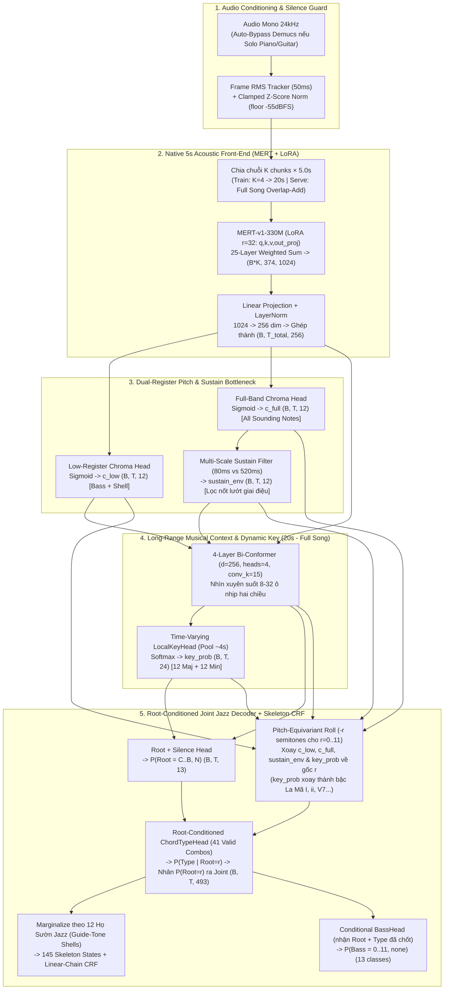

# 70 — Kế Hoạch Kiến Trúc & Huấn Luyện Model v5 (Jazz-Ready: Joint Conditional Heads, Long-Range Key Context & Melody Immunity)

> **Ngày lập:** 2026-11-18 *(Đã tinh chỉnh chốt phạm vi v5.0: Zero Re-crawl, Zero Docker, dùng thẳng `DE/data/export/v3`)*  
> **Vai trò thiết kế:** Senior AI / MIR Engineer  
> **Branch:** `qkhenh`  
> **Môi trường Train:** Google Colab Pro — NVIDIA L4 (24 GB VRAM)  
> **Môi trường Serve:** Local PC — NVIDIA RTX 3050 (4 GB VRAM, ONNX Runtime CUDA)  
> **Đích đến sản phẩm:** Nhận diện hợp âm độ chính xác cao từ Solo Piano đến **Nhạc Jazz phức tạp** trên đúng bộ từ vựng 41 tổ hợp hiện có (không rút gọn, không cần cào lại data, không bật lại Docker).

---

## 0. Tóm Tắt Quyết Định Thiết Kế Đã Chốt (Executive Summary)

1. **Không cào lại data, không bật Docker, không sửa `DE/`, không cần upload lại Google Drive:**
   - Tận dụng **100% bộ dữ liệu `DE/data/export/v3`** đang có sẵn trên cả ổ cứng local lẫn Google Drive (**6.222 bài**: `4.324 train / 1.251 val / 647 test`, `216.216` nhãn hợp âm đã có `bass_id` 13.69% slash chords).
   - Toàn bộ nhãn phụ trợ mới cho v5 (`type_id 0..40`, `skel_id 0..11`, `local_key_id 0..23`, `chroma_mask 12-bit`, và nhãn im lặng `N`) được **tính tự động trong RAM ngay lúc khởi tạo `ChordDataset` (< 1 giây)**.
2. **Giữ nguyên 100% từ vựng 41 `VALID_COMBOS` hiện tại (Không rút gọn, không thêm `6/m6/6-9`, chưa nạp `POP909`):**
   - Giữ đúng `12 Root` + `6 Quality` + `15 Extension` (`41` tổ hợp hợp lệ trong `classes.json`) + `13 Bass` để **đối chứng công bằng 1-đối-1 (apples-to-apples)** với `Model v4` trên tập `test` 647 bài.
3. **Quy tắc Lớp `N` (`No-Sound / Silence`) chặt chẽ:**
   - **Lúc học & suy luận:** Lớp `N` (`root_id = 12`) **chỉ xuất hiện khi không có âm thanh nhạc** (vùng intro/outro/khoảng nghỉ có `rms_db < -45 dBFS` hoặc nhiễu nền phòng thu như `0.00s–1.12s` ở `-68.6 dBFS` trên `TestPIANO.wav`).
   - **Lúc xuất kết quả (`serve.py` / CLI / API):** Mọi đoạn là `N` (`silent` / `root_id == 12` / `root_id < 0`) **được lọc bỏ hoàn toàn khỏi danh sách kết quả đầu ra** (không in dòng `N` ra màn hình; bài `TestPIANO.wav` sẽ bắt đầu in ngay từ `~1.12s` khi đàn thực sự đánh).

### Bảng đối chiếu 4 lỗi thực tế của `v4` và giải pháp triệt để ở `v5`:

| # | Hiện tượng lỗi trên `TestPIANO.wav` | Nguyên nhân gốc rễ đã chứng minh bằng số đo thực nghiệm | Giải pháp triệt để ở **Model v5** |
|---|---|---|---|
| **1** | **Ảo giác `Cm` xuất hiện 4 lần trong bài Tone `C Major`** dù phổ Chroma thực tế chỉ có `E=0.82..0.92`, `Eb=0.00` (`Cmaj9`) | **Marginal Factorized Heads Bug:** 4 head (`root, quality, ext, bass`) dự đoán xác suất biên độc lập. Khi gặp voicing `Cmaj9` (`C + Em7`) hoặc `C6` (`C + Am7`), `head_root` chọn `C (0.53)`, còn `head_quality` cộng dồn `P(Em7) + P(Am7) = 0.51` chọn `min` → ghép thành **`Cm`**. | Thay 4 head biên bằng **Root-Conditioned Joint Head** $P(R, \text{Type}) = P(R) \cdot P(\text{Type} \mid R)$ kết hợp **Relative-Chroma Rotation** (`Roll(-r)`) trên đúng **41 loại hợp âm hợp lệ + lớp `N` (`493` trạng thái)**. |
| **2** | **Mù Tone bài hát & nhảy loạn trưởng/thứ ở đuôi ngân (`56.7s–60.0s`: `A9 → Am7 → A7 → Am`)** | Cửa sổ cắt cụt ở `5s` + `Conv1d(k=5)` chỉ rộng `67ms`, không biết Tone bài hát, không có ràng buộc chuyển tiếp hòa âm lúc train. | Kiến trúc **Chunked MERT (5s) + Song-Level Bi-Conformer (`20s–Full Song`, `d=256`)** + **`LocalKeyHead` (24 giọng biến thiên theo thời gian)** + **145-state Guide-Tone Skeleton CRF** + **Onset-Decay Locking**. |
| **3** | **Nhầm Giai điệu đi nhanh thành Hợp âm (`1.12s–4.47s`: nền `F` + giai điệu `G-D-B-C-D-G` bị bẻ thành `F → Gsus2/F → F` thay vì `Fadd9 → F → Fadd9`)** | Data train đa số đã bị Demucs xóa vocal (xóa đường giai điệu); model không phân tách dải trầm giữ nền với dải cao chạy nốt, không đo **thời lượng ngân (sustain)** của nốt màu. | **Dual-Register Chroma + Pitch Sustain Envelope** (tách nền trầm `<400Hz` khỏi nốt lướt `<350ms`; chỉ bật tension `add9` khi nốt `G` ngân ổn định `≥500ms`) + **`MelodyOverlayAugmenter`** tự tổng hợp câu giai điệu lúc train. |
| **4** | **Đoạn nhiễu/im lặng đầu bài (`0.00s–1.12s`, `-68.6 dBFS`) bị đoán thành `C (0.57)`** | `_rms_gate` xét cả cửa sổ `5s`, z-score normalize khuếch đại nhiễu `-68 dB` lên `2,700×`, và model thiếu lớp im lặng `N`. | Thêm lớp thứ 13 **`N` (Silence)** vào `RootHead` + **Soft-Clamped Normalization** (sàn `-55 dBFS`) + **Frame Silence Gate (`50ms`)** + **Ẩn hoàn toàn các đoạn `N` khi trả output**. |

---

## 1. Kiến Trúc Tổng Thể Model v5 (`ChordModelV5`)

### 1.1. Sơ đồ luồng kiến trúc 2 tầng (Acoustic Chunk Encoder → Full-Context Jazz Decoder)

Thiết kế tách luồng giữa **Acoustic Encoder (5s native chunks)** và **Musical Context Decoder (20s–Full Song)** giữ MERT ở đúng miền pretrain 5s (không tràn VRAM trên cả Colab L4 lẫn RTX 3050 4GB) nhưng mở rộng tầm nhìn ngữ cảnh hòa âm lên **20s lúc train và Toàn Bài Hát lúc serve**.

---

## 2. Đặc Tả Toán Học: "Chuẩn Sườn Trước – Màu Sau" Cho Nhạc Jazz

### 2.1. Không gian Trạng thái Đồng thời 493 Lớp (Giữ nguyên 41 `VALID_COMBOS` + Lớp `N`)

Từ bảng `valid_combo_mask` (`6 × 15`) sẵn có trong [`DE/data/export/v3/classes.json`](file:///d:/qkhenh/Project/ChordSensePro/DE/data/export/v3/classes.json), ta đánh chỉ số cố định cho **41 cặp `(quality_id, ext_id)` hợp lệ** (`type_id ∈ {0..40}`):
- `major` (9): `""`, `b5`, `aug (#5)`, `maj7`, `add9`, `maj9`, `maj11`, `maj7#11`, `maj13`
- `minor` (10): `m`, `m(maj7)`, `m7`, `madd9`, `m7b9`, `m9`, `m11`, `m7#11`, `m13`, `m7b13`
- `dominant` (11): `7b5`, `7#5`, `7`, `7b9`, `9`, `7#9`, `11`, `7#11`, `13`, `7b13`, `7alt`
- `diminished` (3): `dim`, `m7b5`, `dim7`
- `sus2` (3): `sus2`, `maj7sus2`, `7sus2`
- `sus4` (5): `sus4`, `maj7sus4`, `7sus4`, `9sus4`, `13sus4`

Kết hợp với `Root ∈ {0..11 (C..B), 12 (N = Silence)}`:
$$\mathcal{Y}_{\text{joint}} = \{\text{N}\} \cup \{(r, m) \mid r \in \{0..11\},\; m \in \{0..40\}\}, \quad |\mathcal{Y}_{\text{joint}}| = 1 + 12 \times 41 = \mathbf{493\text{ trạng thái}}$$

- **Tương thích ngược 100%:** Mỗi `type_id` ánh xạ 1-1 ngược lại `(quality_id, ext_id)`, nên toàn bộ hàm `compute_metrics()` trong `evaluate.py` và schema API JSON hoạt động liền mạch không lệch một chỉ số nào.

---

### 2.2. Bảng Phân Cấp "12 Họ Sườn Hòa Âm Jazz" (Guide-Tone Skeleton Families)

Để model khóa chắc **cái sườn** trước khi chọn **màu**, 41 `ChordType` được phân hoạch thành **12 Họ Sườn (`SkeletonFamily 0..11`)** dựa trên Guide-Tones (`3rd, 5th, 7th`):

| `skel_id` | Tên Họ Sườn (Guide-Tone Shell) | Các `ChordType` con thuộc họ (Tổng = 41) | Vai trò hòa âm trong Jazz & Pop |
|---:|---|---|---|
| `0` | **`MAJ_SHELL`** (1-3-5) | `""` (maj), `add9` | Bậc `I`, `IV` nền trưởng (`F` và `Fadd9` nằm chung 1 sườn!) |
| `1` | **`MAJ7_SHELL`** (1-3-7) | `maj7`, `maj9`, `maj11`, `maj7#11`, `maj13` | `Imaj7`, `IVmaj7#11` trong Jazz |
| `2` | **`DOM7_NAT`** (1-3-b7) | `7`, `9`, `11`, `13` | `V7` tự nhiên, Blues dominant |
| `3` | **`DOM7_ALT`** (1-3-b7 + alt) | `7b5`, `7#5`, `7b9`, `7#9`, `7#11`, `7b13`, `7alt` | Dominant biến âm (`V7alt → i`), Tritone sub (`bII7#11`) |
| `4` | **`MIN_SHELL`** (1-b3-5) | `m`, `madd9` | Bậc `i`, `vi` nền thứ |
| `5` | **`MIN7_SHELL`** (1-b3-b7) | `m7`, `m9`, `m11`, `m7#11`, `m13`, `m7b9`, `m7b13` | Bậc `ii7`, `iii7`, `vi7` trong Jazz |
| `6` | **`MIN_MAJ7`** (1-b3-7) | `m(maj7)` | Tonic minor Jazz / line cliché |
| `7` | **`HDIM_SHELL`** (1-b3-b5-b7) | `m7b5` | Bậc `iiø7` trong `iiø7 - V7alt - i` giọng thứ |
| `8` | **`DIM_SHELL`** (1-b3-b5-bb7) | `dim`, `dim7` | Passing diminished (`#iv°7`, `vii°7`) |
| `9` | **`AUG_SHELL`** (1-3-#5 / b5) | `aug`, `b5` | Hợp âm tăng / biến âm bậc 5 |
| `10` | **`SUS2_SHELL`** (1-2-5) | `sus2`, `maj7sus2`, `7sus2` | Treo bậc 2 thực sự (vắng quãng 3) |
| `11` | **`SUS4_SHELL`** (1-4-5) | `sus4`, `maj7sus4`, `7sus4`, `9sus4`, `13sus4` | Dominant treo (`V7sus4 → V7`) / Modal Jazz (`9sus4`) |

Xác suất của mỗi Họ Sườn tại ứng viên Root $r$ chính là tổng xác suất của các hợp âm màu con thuộc họ đó:
$$P(R_t = r, \text{Skel}_t = S \mid X) = P(R_t = r \mid X) \sum_{m \in S} P(\text{Type}_t = m \mid R_t = r, X)$$

Không gian **Linear-Chain CRF** khóa Sườn có đúng **`1 + 12 × 12 = 145` trạng thái** (`state 0 = N (Silence)`, `states 1..144 = 12 Roots × 12 Skeletons`).

---

### 2.3. Phép Xoay Tương Đối Theo Gốc (`Roll(-r)`) — Diệt Tận Gốc Lỗi `Cm` & Nhân 12× Dữ Liệu Jazz Hiếm

Tại mỗi frame $t$, với mọi ứng viên Root $r \in \{0..11\}$, ta xoay tròn các vector 12 chiều về gốc $r$:
$$u^{(r)}_t = \Big[\, W_z z_t + E_{\text{root}}[r],\; \text{Roll}_{12}(\hat{c}^{\text{low}}_t, -r),\; \text{Roll}_{12}(\hat{c}^{\text{full}}_t, -r),\; \text{Roll}_{12}(s_t, -r),\; \text{Roll}_{12}(\hat{k}^{\text{maj}}_t, -r),\; \text{Roll}_{12}(\hat{k}^{\text{min}}_t, -r) \,\Big] \in \mathbb{R}^{188}$$

1. **Triệt tiêu 100% lỗi `Cm` ở Tone `C Major`:**
   - Khi xét ứng viên `r = C` tại `8.60s` (`{C, E, G, B, D}`): sau khi xoay về `C`, quãng `3 trưởng (E) = 0.82`, quãng `b3 (Eb) = 0.00`, và `Roll(k_maj, 0)[0] = 0.96` (báo hiệu `C` là chủ âm bậc `I` của giọng Trưởng) → $P(\text{Cmaj9} \mid R=C) \gg 0$, còn $P(\text{Cm} \mid R=C) \approx 0$.
   - Không bao giờ còn hiện tượng lấy `Root = C` của `Cmaj9` ghép nhầm với `Quality = min` của `Em7/Am7`.
2. **Học hợp âm Jazz hiếm nhanh gấp 12 lần (0ms CPU pitch-shift):**
   - Vì `ChordTypeHead` (`188 → 192 → 41`) nhìn theo **quãng tương đối so với Root**, học được `G7alt` hay `Dm7b5` ở một giọng là tự động nhận diện được `7alt` và `m7b5` trên cả 12 giọng!

---

### 2.4. Bộ Lọc `MultiScaleSustainLayer` & `MelodyOverlayAugmenter` (Xử Lý `F` + Giai Điệu `G-D-B-C-D-G` → `Fadd9 → F → Fadd9`)

1. **Trong Mạng (`MultiScaleSustainLayer`):**
   - So sánh hoạt động Chroma ngắn hạn (`~80ms`, `kernel = 7` frames) với độ bền ngân trung hạn (`~520ms`, `kernel = 39` frames, dùng soft-minimum pooling để chỉ đạt giá trị cao khi nốt **ngân liên tục ≥ 0.5 giây**).
   - Các nốt giai điệu đi nhanh ở giữa câu (`D - B - C - D`, mỗi nốt `150–300ms`) có `sustain_env ≈ 0`, trong khi `c_low` giữ vững nền trầm `F - C` → CRF khóa cứng Sườn ở **`(Root=F, MAJ_SHELL)`** xuyên suốt `1.12s – 4.47s`, tuyệt đối không nhảy sang `Gsus2/F`.
   - Tại đầu câu (`1.12s`) và cuối câu (`3.80s–4.47s`), nốt `G` ngân dài nhất (`≥ 500ms`) làm `sustain_env[G]` vượt ngưỡng → trong nội bộ họ `(F, MAJ_SHELL)`, `Fadd9` thắng `F` → xuất chuẩn **`Fadd9 → F → Fadd9`**!
2. **Trong Lúc Train (`MelodyOverlayAugmenter` trong `AI/src/augment.py`):**
   - Với xác suất `p = 0.50`, tổng hợp trực tiếp câu giai điệu đơn âm (âm sắc Piano/Guitar harmonics có ADSR tự nhiên, tốn `< 2ms` CPU) trộn lên đoạn audio 20s:
     - **80% trường hợp (Fast Passing Melody):** Chạy nốt móc đơn/móc kép (`120–300ms`/nốt) theo âm giai của `local_key_id` ở quãng `C4–C6`, **giữ nguyên nhãn hợp âm gốc** → ép model học cách bỏ qua giai điệu nhanh.
     - **20% trường hợp (Sustained Tension Note trên Triad trơn):** Ngân dài 1 nốt bậc `9` hoặc `maj7` (`≥ 800ms`) trên hợp âm `maj`/`min` trơn và **nâng nhãn đích tương ứng** (`F → Fadd9`, `C → Cmaj7`) → dạy trực tiếp ranh giới nhân quả giữa nốt giai điệu lướt và nốt màu ngân dài!

---

### 2.5. Hàm Mất Mát Phân Tầng 5 Thành Phần (`ChordLossV5`)

$$\mathcal{L}_{\text{total}} = 0.40\,\mathcal{L}_{\text{Skel-CRF}} + 0.25\,\mathcal{L}_{\text{WithinSkel-Focal}} + 0.15\,\mathcal{L}_{\text{Bass-Focal}} + 0.12\,\mathcal{L}_{\text{Chroma-BCE}} + 0.08\,\mathcal{L}_{\text{LocalKey-CE}}$$

- **`L_Skel-CRF` (`0.40`):** Linear-Chain CRF trên `145` trạng thái Sườn ở bước thời gian `53.3ms` (`crf_stride = 4` frames MERT → chuỗi 20s chỉ còn `374` bước DP, tính forward-backward loss mất `< 2ms`). Hỗ trợ đầy đủ cả mẫu `partial` (ví dụ `C6` trong DB thiếu `ext_id` nhưng vẫn biết chắc `Root=C, Skel=MAJ_SHELL` → trước đây v4 phải bỏ phí `ext`, nay v5 tận dụng 100% để dạy Sườn!).
- **`L_WithinSkel-Focal` (`0.25`):** Focal Loss ($\gamma = 2.0$ + smoothed weights) phân biệt các màu bên trong đúng Họ Sườn thật $P(\text{Type} = m^* \mid R = r^*, \text{Skel} = S^*)$. Kèm asymmetric label smoothing nhẹ (`0.12`) trên các triad trơn để khoan dung với trường hợp người chép nhạc bỏ sót nốt `add9`.
- **`L_Bass-Focal` (`0.15`):** Focal Loss ($\gamma = 2.0$, `none_weight = 0.25`) cho 13 lớp Bass.
- **`L_Chroma-BCE` (`0.12`):** Giám sát trực tiếp `c_low` (nốt gốc + bass + guide tones) và `c_full` (toàn bộ tập nốt nhạc lý trích từ `label_raw`).
- **`L_LocalKey-CE` (`0.08`):** Cross-Entropy 24 lớp Giọng cục bộ (với smoothing `0.1` giữa cặp giọng song song `C Major ↔ A Minor`).

---

## 3. Tiền Tính Toán Nhãn Tự Động Từ `DE/data/export/v3` (0% Đụng Tới DE / Docker)

Trong `AI/src/dataset.py` (tách helper gọn vào `AI/src/music_theory.py`), ngay khi load `{split}/chords.parquet` của `v3`:
1. **`type_id (0..40)` & `skel_id (0..11)`:** Ánh xạ vector hóa từ `(quality_id, ext_id)`. Các dòng `partial` có `root_id, quality_id` hợp lệ vẫn được gán `skel_id` để học Sườn!
2. **`local_key_id (0..23)`:** Trượt cửa sổ 12 giây trên timeline hợp âm của từng bài trong `chords.parquet`, chấm điểm khớp Krumhansl-Kessler + Diatonic Triad/7th weight → gán giọng cục bộ cho mọi đoạn (toàn bộ 4.324 bài chạy hết `~0.35s` khi khởi động train).
3. **`shell_chroma` & `full_chroma` (12-bit):** Sinh từ `(root_id, quality_id, ext_id, bass_id)` và các quãng trong `label_raw`.
4. **Nhãn im lặng `N` (`root_id = 12`):**
   - Mở biên lấy mẫu của `ChordDataset` ra toàn bộ chiều dài file `.npy` `[0, audio_len]` (thay vì khóa cứng `[first_ms, last_ms]` như v4).
   - Trong `__getitem__`, tính RMS từng frame MERT *trước* khi normalize: mọi frame có **`rms_db < -45.0 dBFS`** (không có âm thanh) được gán cứng `root = 12 (N), skel = 0 (N), type = -100, bass = -100`. Các khoảng lặng không nhãn nhưng có tiếng ồn lớn (`rms_db >= -45 dBFS`) giữ `-100` (ignore) để không dạy nhầm nhạc không nhãn thành im lặng!
   - Thêm xác suất `15%` trong `Augmenter` chèn đoạn đầu/cuối im lặng (`0.5s – 2.0s` nhiễu phòng rất nhỏ `-65..-50 dBFS`) vào cửa sổ train với nhãn `root = 12 (N)` để model học chắc chắn biên vào nhạc (entry onset) như `TestPIANO.wav`.

---

## 4. Quy Trình Huấn Luyện 3 Pha & Xuất ONNX Cho RTX 3050 (4 GB)

### 4.1. Huấn luyện 3 Pha trên Google Colab L4 (24 GB VRAM)

| Pha | Config | Mục tiêu | Cửa sổ & Batch | Thời gian (L4) |
|---|---|---|---|---|
| **Phase 1** | `configs/v5_20s_p1.yaml` | Đóng băng MERT; hội tụ nhanh `Bi-Conformer` + `Chroma/Sustain` + `LocalKey` + `JointHead` + `145-state CRF`. | `20s` (`4 × 5s` chunks), `batch_size = 4` bài (`16` chunks no-grad), `epochs = 15`, `lr_head = 3e-4` | ~1.0 – 1.2 giờ |
| **Phase 2** | `configs/v5_20s_p2.yaml` | Mở **LoRA `r=32`** (`q_proj, k_proj, v_proj, out_proj`) + bật `MelodyOverlayAugmenter` & `SilenceIntroAugment`. | `20s` (`4 × 5s` chunks), `batch_size = 2` bài (`8` chunks có grad = đúng VRAM v4) + `grad_accum = 2`, `fp16=true`, `lr_lora = 3e-5`, `lr_head = 1.5e-4`, `epochs = 20` | ~3.0 giờ |
| **Phase 3** | `configs/v5_fullsong_p3.yaml` | **Full-Song Sequence Polish:** Cache vector `256-dim` từ MERT+LoRA cho toàn bài; tinh chỉnh `Bi-Conformer + LocalKey + JointHead + CRF` trên cả bài dài `60s – 180s` (cực tốt cho bài Jazz dài của JAAH). | `60s – 180s`, `batch_size = 16` bài (trên embedding cache), `epochs = 15`, `lr_head = 5e-5` | **~15 phút** |

### 4.2. Xuất Cặp ONNX & Quy Tắc Output Sạch Trong `serve.py`

1. **Gộp LoRA (`merge_and_unload()`) & Xuất 2 file ONNX gọn nhẹ:**
   - `model_v5_encoder.onnx`: nhận chunk `5.0s` `(B, 120000)` → trả `emb_256` `(B, 374, 256)`.
   - `model_v5_decoder.onnx` (~12 MB): nhận chuỗi `song_emb` `(1, T_song, 256)` của **toàn bộ bài hát** → trả `skel_emissions`, `crf_transitions`, `joint_type_logprobs`, `bass_logprobs`, `local_key_probs`, `sustain_chroma` trong `< 8 ms` trên RTX 3050.
2. **4 Quy tắc Tiền/Hậu xử lý trong `serve.py` v5:**
   - **Auto-Bypass Demucs cho Solo Instrument:** Tự phát hiện bản thu độc tấu Piano/Guitar không có trống & vocal để bỏ qua Demucs (`22.3s → 0.08s`).
   - **Soft-Clamped Normalization (`denom = max(wav.std(), 1.8e-3)`):** Không bao giờ khuếch đại tiếng xì nền `-68 dB` thành tín hiệu biên độ lớn.
   - **Giải mã 2 bước (`145-state Skeleton CRF` + `Onset-Decay Lock` → `Sustain Tension Resolver`):** Khóa cứng Sườn toàn bài trước, sau đó chọn màu trong họ Sườn dựa trên độ bền ngân `≥ 500ms`, rồi chuẩn hóa tên `#` / `b` theo `local_key_probs(t)`.
   - **Ẩn hoàn toàn nhãn `N` ở đầu ra cuối cùng (Suppress `N` on Output):**
     Sau khi merge và cắt tỉa đoạn ngắn, **mọi segment có `silent == True` hoặc `root_id == 12` (`N`) hoặc `root_id < 0` đều được loại bỏ khỏi mảng `results` trả về** (chỉ giữ lại các đoạn thực sự có hợp âm vang lên, kèm `start_ms` / `end_ms` chính xác của từng hợp âm). Thêm cờ tùy chọn `--show-silence` / `include_silence: bool = False` (mặc định `False`) phòng khi cần debug.

---

## 5. Danh Sách File Thay Đổi Cụ Thể (100% Nằm Gọn Trong `AI/`)

| File | Hành động | Nội dung chi tiết |
|---|---|---|
| `AI/src/music_theory.py` *(Mới)* | Tạo mới | Bảng 41 `VALID_COMBOS` ↔ `type_id (0..40)`, 12 `SKELETON_FAMILIES`, parser trích `shell_chroma` & `full_chroma` 12-bit từ `label_raw`, thuật toán tính `local_key_id (0..23)` trượt 12s, bảng xoay tròn `ROLL_INDICES (12, 12)`. |
| `AI/src/conformer.py` *(Mới)* | Tạo mới | `BiConformerBlock` (`d=256, heads=4, conv_k=15`, Relative Sinusoidal PE) + `MultiScaleSustainLayer` (80ms vs 520ms sustain filter, 100% ONNX-safe). |
| `AI/src/crf.py` *(Mới)* | Tạo mới | `LinearChainCRF(num_tags=145)` vector hóa PyTorch (`forward_loss` + `viterbi_decode` NumPy/Torch dùng chung cho train & serve). |
| [`AI/src/config.py`](file:///d:/qkhenh/Project/ChordSensePro/AI/src/config.py) | Cập nhật | Thêm các trường cấu hình `arch_version: int = 5`, `context_dim`, `conformer_layers`, `crf_stride`, `grad_accum_steps`, `melody_overlay_prob`, `silence_intro_prob` (mặc định giữ nguyên tương thích mọi config `v2/v3/v4` cũ). |
| [`AI/src/model.py`](file:///d:/qkhenh/Project/ChordSensePro/AI/src/model.py) | Cập nhật | Thêm `ChordModelV5` (Chunked MERT 5s → `BiConformer` → `DualChroma + Sustain` → `LocalKeyHead` → `Roll(-r) RootConditionedTypeHead` → `145-state CRF` + `BassHead`) và `merge_lora()`. |
| [`AI/src/losses.py`](file:///d:/qkhenh/Project/ChordSensePro/AI/src/losses.py) | Cập nhật | Thêm `ChordLossV5` (5 thành phần: `Skel-CRF`, `WithinSkel-Focal`, `Bass-Focal`, `Chroma-BCE`, `LocalKey-CE`). |
| [`AI/src/augment.py`](file:///d:/qkhenh/Project/ChordSensePro/AI/src/augment.py) | Cập nhật | Thêm `MelodyOverlayAugmenter` (chế độ *Fast Passing Melody* giữ nhãn + *Sustained Tension* nâng nhãn `maj → add9/maj7`) và `SilenceIntroAugment`. |
| [`AI/src/dataset.py`](file:///d:/qkhenh/Project/ChordSensePro/AI/src/dataset.py) | Cập nhật | Đọc thẳng `DE/data/export/v3`, tự tính `type_id, skel_id, local_key_id, chroma` trong `__init__`; hỗ trợ cửa sổ `20s` (`4 × 5s` chunks), gán `root=12 (N)` cho frame `< -45 dBFS`, Soft-Clamped Norm, và `CachedEmbeddingDataset` cho Phase 3. |
| [`AI/src/train.py`](file:///d:/qkhenh/Project/ChordSensePro/AI/src/train.py) | Cập nhật | Hỗ trợ `arch_version == 5`, `grad_accum_steps`, chế độ xuất cache & train Phase 3 Full-Song, log chi tiết `skel_acc, chord_acc, key_acc, silence_f1`. |
| [`AI/src/evaluate.py`](file:///d:/qkhenh/Project/ChordSensePro/AI/src/evaluate.py) | Cập nhật | Chấm full-song cho cả `v4` và `v5` trên cùng tập `test` 647 bài; bổ sung `skeleton_acc` và `out_of_key_hallucination_rate`. |
| [`AI/src/export_onnx.py`](file:///d:/qkhenh/Project/ChordSensePro/AI/src/export_onnx.py) | Cập nhật | Gộp trọng số LoRA `merge_and_unload()`, xuất `model_v5_encoder.onnx` + `model_v5_decoder.onnx` và verify sai số `< 1e-4`. |
| [`AI/src/serve.py`](file:///d:/qkhenh/Project/ChordSensePro/AI/src/serve.py) & [`AI/test_v3.py`](file:///d:/qkhenh/Project/ChordSensePro/AI/test_v3.py) | Cập nhật | Tự động nhận diện model `v5` (2-stage ONNX) hoặc `v4`, Auto-Bypass Demucs cho Solo Instrument, Soft-Clamped Norm, giải mã `Skeleton CRF + Sustain Tension`, và **mặc định lọc bỏ mọi segment `N` khỏi output**. |
| `AI/configs/v5_*.yaml` & [`colab_train.ipynb`](file:///d:/qkhenh/Project/ChordSensePro/AI/notebooks/colab_train.ipynb) | Tạo mới / Cập nhật | Tạo `v5_20s_p1.yaml`, `v5_20s_p2.yaml`, `v5_fullsong_p3.yaml` dùng sẵn `/content/data_v3` trên Colab (0 phút copy/upload lại data!). |
| `AI/tests/test_v5_model.py` *(Mới)* | Tạo mới | Unit tests kiểm tra phép xoay `Roll(-r)`, `LinearChainCRF`, `MultiScaleSustainLayer`, `MelodyOverlayAugmenter`, dataset `20s`, và lọc bỏ `N` ở `serve.py`. |

---

## 6. Thứ Tự Thực Hiện (Checklist Triển Khai)

- [ ] **Bước 1 — Nền tảng Nhạc lý & Kiến trúc Mạng (`music_theory.py`, `conformer.py`, `crf.py`, `model.py`, `losses.py`):** Xây dựng toàn bộ kiến trúc `ChordModelV5` + `ChordLossV5` và kiểm chứng bằng unit tests.
- [ ] **Bước 2 — Data Pipeline `20s` trên `export/v3` & `MelodyOverlayAugmenter` (`config.py`, `augment.py`, `dataset.py`, `train.py`):** Hoàn thiện nạp dữ liệu trực tiếp từ `v3`, gán `N` cho vùng không âm thanh, thêm `grad_accum_steps` và Phase 3 cache.
- [ ] **Bước 3 — Export ONNX 2-Stage, Evaluation & Serving Lọc Bỏ `N` (`export_onnx.py`, `evaluate.py`, `serve.py`, `test_v3.py`):** Hỗ trợ xuất/chạy ONNX v5, Auto-Bypass Demucs cho Solo Instrument, ẩn hoàn toàn `N` khỏi kết quả hiển thị.
- [ ] **Bước 4 — Configs & Colab Notebook (`v5_20s_p1.yaml`, `v5_20s_p2.yaml`, `v5_fullsong_p3.yaml`, `colab_train.ipynb`):** Sẵn sàng pull code trên Colab L4 chạy thẳng trên `/content/data_v3` đã có sẵn để lấy bảng số liệu thực tế so với `v4`.
