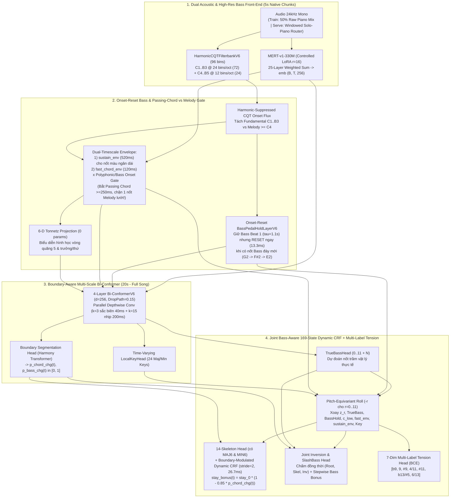

# 80 — Kế Hoạch Tổng Thể Kiến Trúc & Huấn Luyện Lại Từ Đầu Tới Cuối Model v6 (Boundary-Aware Bass-First, Passing Chords, Solo Piano & Multi-Label Jazz Tensions)

> **Ngày lập:** 2026-11-26  
> **Vai trò thiết kế:** Senior AI / MIR Engineer  
> **Phiên bản mục tiêu:** `Model v6.0` (`arch_version: 6`) + Dataset `DE/data/export/v4`  
> **Môi trường Huấn luyện:** Google Colab Pro (NVIDIA L4 24 GB VRAM / A100) hoặc GPU Local  
> **Môi trường Suy luận (Serve):** Local PC — NVIDIA RTX 3050 (4 GB VRAM, 2-Stage ONNX Runtime CUDA + Windowed Demucs Routing)  
> **Tài liệu nghiên cứu nền tảng (`paper/`):**  
> 1. *Harmony Transformer: Incorporating Chord Segmentation into Harmony Recognition* (Chen & Su, ISMIR 2019 — `paper/000030.pdf`)  
> 2. *A Bi-Directional Transformer for Musical Chord Recognition (BTC)* (Park et al., ISMIR 2019 — `paper/000075.pdf`)  
> 3. *MERT: Acoustic Music Understanding Model with Large-Scale Self-Supervised Training* (Li et al., ICLR 2024 — `paper/8278_MERT_Acoustic_Music_Under.pdf`)

---

## 0. Tổng Quan Chẩn Đoán Từ Thực Nghiệm `v5.1` & Lý Do Phải Train Lại Toàn Diện `v6`

Trên các bài kiểm thử thực tế (*Rồi Em Sẽ Gặp Một Chàng Trai Khác* — **81.1%**, *Một Ngàn Nỗi Đau* — **78.7%**, *Phép Màu*), `model_v5_1_fullsong_p3.onnx` đã đạt nền tảng tốt nhưng bộc lộ **5 giới hạn mang tính cấu trúc** mà việc vá rule hậu xử lý (như commit `2271ad0`) không thể giải quyết triệt để — thậm chí sửa đầu này lại làm hỏng đầu kia:

| # | Vấn đề thực tế người dùng gặp phải | Bằng chứng định lượng từ Code & Dataset `export/v3` | Giải pháp tận gốc trong **Model v6 (End-to-End Retrain)** |
|---|---|---|---|
| **1** | **Mất hợp âm bậc `V` trong vòng `2-5-1`** sau khi thêm rule lọc nhiễu (`2271ad0`), và nhầm **`D#7#9 → D#m7`** (3 lần liên tiếp trong *Một Ngàn Nỗi Đau*) | Hợp âm bậc `V` màu Jazz (`Ab9(13)`, `F7b9`, `Eb9sus4`) chia xác suất trên nhiều lớp nên `conf` chỉ đạt `0.35–0.43`, bị rule `weak_glitch (<820ms, conf<0.44)` xóa sạch. Nốt `#9` trùng pitch class với `b3` nên bị ép thành `m7` khi thiếu prior tiến trình quãng 4 (`ii → V → I`). | Học trực tiếp **Boundary Head (`p_chord_change`)** điều biến động `stay_bonus(t)` của CRF ở độ phân giải `26.7ms` (`crf_stride=2`) + khởi tạo **Functional Harmony Priors (`ii → V → I`, Tritone Sub, Secondary Dominant)** trong CRF + bỏ hoàn toàn rule cắt mù `weak_glitch`. |
| **2** | **Đoạn Đầu bài (Intro/Verse 1) Only Piano của *Phép Màu* nhận diện sai & vỡ vụn, khi Guitar Bass vào (`45s+`) thì chuẩn hẳn, và ĐẶC BIỆT: cùng vòng đó ở Kết bài (Outro Only Piano `218s+`) lại bắt đúng `G → D/F# → Em`!** | **Đo trực tiếp trên `Phép Màu.mp3` (`257s`, ~71 BPM, 1 ô nhịp = `3.40s`):** **1) Hết hạn bộ nhớ Bass giữa ô nhịp (`1.70s` < `3.40s`):** `BassPedalHoldLayer` cũ chỉ nhìn tối đa `128 frames = 1.70s`. Tay trái Piano đánh `G` ở phách 1 (`2.67s`, `16.69s`), đúng **`+1.87s` sau (`4.59s`, `18.56s`)** bộ nhớ Bass rơi về `0` $\to$ nửa sau ô nhịp bị tay phải quãng cao lừa thành **`Em → C`** và **`Cm`**! Ngay cả `D/F#` ở `48.64s` tới `50.24s` (`+1.60s`) cũng bị tuột thành `Bm`! **2) Chênh lệch âm vực Intro vs Outro (`Octave 3` vs `Octave 1–2`):** Ở Intro/Verse 1 (`8–28s`), Piano đánh treo cao ở Octave 3–4 (`cqt_oct1 = 0.044`, `tbass` loạn `0.26–0.36`); còn ở Outro (`218–228s`), Piano đánh trầm xuống Octave 1–2 (`cqt_oct1 = 0.219`, gấp `5×` Intro!) + nằm chung cửa sổ `60s` ngay sau Điệp khúc! **3) Artifact `htdemucs_ft`:** Ở `18.56s`, bản Raw ra `C`, nhưng qua `htdemucs_ft` bị cắt mất hài bậc 3 dính theo vocal nên biến dạng thành **`Cm`** và vỡ thành 6 mảnh ở `20–27s`! | **1) `BassPedalHoldLayerV6` tầm nhìn dài `4.0s` (`τ = 2.6s`) kết hợp `Onset-Reset Gate (13.3ms)`:** Giữ vững Bass suốt cả ô nhịp Ballad chậm `3.4–4.0s` khi chưa có bass mới, nhưng xóa tức thì trong `13.3ms` ngay khi bước sang `D/F#`! **2) Đặc trưng `Cumulative Energy Below (E_below)` + `HighRegisterPianoAugment` (`HPF 220Hz`):** Bắt chuẩn nốt đáy tương đối dù Piano đánh treo tít ở Octave 3–4! **3) `Full-Song Cross-Section Attention` (`stride=15`, nhìn xuyên cả bài `257s`)** + **`POP909` Raw/Demucs Piano Mix** + **Windowed Stem Blending**. |
| **3** | **Bắt kém Hợp âm Đảo Bass & Vòng Bass đi lùi** (`G → D/F# → Em7`, `Eb/G → Gm7`, `Gb/Bb → Bbm7`, `Ab/C → Cm7`, `Bm/F# → Bm`) | **1)** `BassPedalHoldLayer` giữ đỉnh $\tau = 1.15\text{s}$ **không có nút Reset** khi sang nốt bass mới $\to$ bóng ma `G2` (`~0.52`) đè lên `F#2`. **2)** CRF 145 trạng thái khóa cứng `(Root, Skeleton)` trước rồi mới đoán `SlashBass`, nên `X/Y` đảo 1 bị hút nhầm sang hợp âm thứ tương đối `Ym/Ym7` (chung 2/3 nốt). | **1)** Nâng CQT trầm lên **24 bins/octave (`C1..B3`)** + **Onset-Reset `BassPedalHoldLayerV6`** xóa đuôi bass cũ trong `13.3ms` ngay khi có onset bass mới. **2)** Thêm **`InversionHead` (`root_pos, /3, /5, /b7, /other`)** và giải mã **Joint `(Root, Skeleton, Bass)`** có thưởng **Stepwise Bass Line (`±1, ±2` bán cung)**. |
| **4** | **Nuốt mất Passing Chords đánh nhanh (`250ms–750ms`)** | Đo trực tiếp trên `export/v3`: có tới **`35,986 / 149,850` hợp âm (`24.0%` tập train!) dài `≤ 800ms`** (trong đó `20,694` hợp âm `≤ 500ms = 13.8%`). Nhưng `MultiScaleSustainLayer` (`520ms`), `Conformer (k=15)`, và khóa `<1000ms` trong `serve.py` đang đè bẹp toàn bộ nhóm 24% này! | Tách **2 đường bao song song**: `sustain_env (520ms)` cho nốt màu ngân dài + **`passing_chord_env (120ms)` có cổng `Polyphonic/Bass Onset Gate`** (chỉ mở khi có `≥2` fundamental mới bật lên đồng thời ở `C2..G4` hoặc đổi đáy Bass; khóa chặt khi chỉ có 1 nốt giai điệu chạy nhanh ở `>= C4`) + nhánh Conv sắc biên **`k=3`** song song **`k=15`**. |
| **5** | **Mù bẩm sinh với họ Hợp âm `6` (`6, m6, 6/9`)** (mất 4/4 lần `Bmaj7 → Bm6` trong *Một Ngàn Nỗi Đau*) & thiếu màu phức hợp (`13b9`, `9#11`, `13b9sus4`) | Trong `harte_mapper.py`, `:maj6` (`1,306` mẫu), `:min6` (`386` mẫu), `:maj6(9)` (`246` mẫu), `:(3,5,13)` (`129` mẫu) — tổng **~2,107 mẫu thật** đang bị gán `ext_id = None` (`PARTIAL`, bị mask `-100` lúc train type!). Nhồi tổ hợp hiếm vào Softmax đơn nhãn gây đói mẫu. | **1)** Cứu toàn bộ **~2,107 mẫu họ `6` thật** trong `export/v4`, nâng CRF từ 12 lên **14 Họ Sườn** (thêm **`MAJ6_SHELL`** & **`MIN6_SHELL`**). **2)** Thay Softmax đơn nhãn bằng **Multi-Label Tension Head (7 bậc độc lập bằng `BCEWithLogitsLoss`)** ghép tự nhiên mọi tổ hợp Jazz/Pop mà không sợ thiếu mẫu chéo. |

---

## 1. Giai Đoạn 1 — Chuẩn Hóa Lại Data Pipeline & Xuất `DE/data/export/v4`

> **Nguyên tắc vàng:** Không cần crawl lại YouTube, không cần bật Docker/Airflow, hardlink 100% `6,222` file `.npy` hiện có từ `export/v3` (tốn 0 GB trùng lặp), đồng thời khai thác kho `POP909-Dataset` & `soundfonts` đang nằm sẵn tại `DE/data/datasets/`.

### 1.1. Cứu Nhãn Thật & Làm Sạch Từ Vựng Trong `harte_mapper.py` → `export_dataset_v4.py`

1. **Nâng cấp Hệ Họ Sườn lên 14 `SKELETON_FAMILIES` (`0..13`, tổng CRF = `1 + 12 × 14 = 169` trạng thái):**
   - `0: MAJ_SHELL` (`1-3-5`: `maj`, `add9`, `add4`)
   - `1: MAJ6_SHELL` (`1-3-5-6`, **vắng `7`**: `6`, `6/9`) — *MỚI: Cứu ~1,711 mẫu thật (`:maj6`, `:6`, `:maj6(9)`, `:(3,5,13)`)*
   - `2: MAJ7_SHELL` (`1-3-7`: `maj7`, `maj9`, `maj7#11`, `maj9#11`, `maj13`)
   - `3: DOM7_NAT` (`1-3-b7`: `7`, `9`, `13`, `9(13)`)
   - `4: DOM7_ALT` (`1-3-b7 + alt`: `7b5`, `7#5`, `7b9`, `7#9`, `7#11`, `9#11`, `13b9`, `13#11`, `7b13`, `7alt`)
   - `5: MIN_SHELL` (`1-b3-5`: `m`, `madd9`, `madd4`)
   - `6: MIN6_SHELL` (`1-b3-5-6`, **vắng `b7`**: `m6`, `m6/9`) — *MỚI: Cứu ~396 mẫu thật (`:min6`) + bắt chuẩn `Bmaj7 → Bm6`, `Cm7 → Cm6`*
   - `7: MIN7_SHELL` (`1-b3-b7`: `m7`, `m9`, `m11`, `m13`)
   - `8: MIN_MAJ7` (`1-b3-7`: `m(maj7)`, `m9(maj7)`)
   - `9: HDIM_SHELL` (`1-b3-b5-b7`: `m7b5`, `m11b5`)
   - `10: DIM_SHELL` (`1-b3-b5-bb7`: `dim`, `dim7`)
   - `11: AUG_SHELL` (`1-3-#5`: `aug`)
   - `12: SUS2_SHELL` (`1-2-5`: `sus2`, `maj7sus2`)
   - `13: SUS4_SHELL` (`1-4-5` / `1-4-5-b7`: `sus4`, `maj7sus4`, `7sus4`, `9sus4`, `13sus4`, `7b9sus4`, `13b9sus4`)

2. **Loại bỏ vĩnh viễn 7 tổ hợp sai chuẩn ngay từ tầng Data (`export/v4`):**
   - `:(3,5,b7,9,11)` (`787` mẫu trong Hooktheory/ChoCo) & `:11` (`245` mẫu) $\to$ ánh xạ chuẩn sang `SUS4_SHELL` (`9sus4`) nếu vắng quãng 3, hoặc `DOM7_NAT` (`9`) nếu có quãng 3 rõ.
   - `:maj11` / `:(3,5,11)` (`96` mẫu) $\to$ ánh xạ sang `MAJ_SHELL` + tension `add4` (khi không có bậc 7) hoặc `MAJ7_SHELL` + `#11` (khi có `maj7`).
   - `:(b3,5,11)` (`97` mẫu) $\to$ ánh xạ sang `MIN_SHELL` + tension `add4` (`madd4`).
   - Xóa sổ hoàn toàn `m7b9`, `m7#11`, `m7b13`, `maj b5`, `7sus2` khỏi bảng nhãn huấn luyện.

3. **Trích xuất Vector Đa Nhãn 7 Bậc Màu (`tension_mask_7d` $\in \{0, 1, -1\}^7$) trực tiếp từ `label_raw`:**
   Mỗi dòng trong `chords.parquet` của `v4` có thêm 7 cột nhị phân (hoặc bitmask `uint8` + `tension_valid: bool`):
   $$\mathbf{t} = \big[\, t_{\flat 9},\; t_{9},\; t_{\sharp 9},\; t_{4/11},\; t_{\sharp 11},\; t_{\flat 13/\sharp 5},\; t_{6/13} \,\big] \in \{0, 1\}^7$$
   - Ví dụ: `D#:7(#9)` $\to$ `skel = DOM7_ALT`, $\mathbf{t} = [0, 0, 1, 0, 0, 0, 0]$.
   - `F:7(b9,13)` (`F13b9`) $\to$ `skel = DOM7_ALT`, $\mathbf{t} = [1, 0, 0, 0, 0, 0, 1]$.
   - `Ab:9(13)` $\to$ `skel = DOM7_NAT`, $\mathbf{t} = [0, 1, 0, 0, 0, 0, 1]$.
   - `C#:sus4(b7,b9,13)` (`C#13b9sus4`) $\to$ `skel = SUS4_SHELL`, $\mathbf{t} = [1, 0, 0, 1, 0, 0, 1]$.
   - Đối với các hợp âm `:5` / `:(1,5)` (`2,095` mẫu power chord khuyết bậc 3): gán cờ `missing_third = True`, dùng `local_key_id` để gợi ý soft-skeleton (`0.75` theo diatonic triad của giọng + `0.25` cho họ đối ứng) và đặt `tension_valid = False` để không dạy nhiễu cho Tension Head.

4. **Thêm Nhãn Phân Loại Đảo Bass Tương Đối (`inversion_id` $\in \{0..4, 5=\text{N}\}$):**
   - `0`: Root Position (`bass == root` hoặc `bass_id == 12`)
   - `1`: First Inversion `/3` hoặc `/b3` (`(bass - root) % 12 in (3, 4)` — ví dụ `D/F#`, `Eb/G`, `Gb/Bb`, `Ab/C`, `Abm/B`)
   - `2`: Second Inversion `/5` (`(bass - root) % 12 == 7` — ví dụ `F#/C#`, `Bm/F#`)
   - `3`: Third Inversion `/b7` hoặc `/7` (`(bass - root) % 12 in (10, 11)` — ví dụ `Eb/Db`, `C#/B`, `Bb/Ab`)
   - `4`: Other Pedal / Slash Hybrid (`(bass - root) % 12 not in (0, 3, 4, 7, 10, 11)` — ví dụ `C/D` = `D9sus4`, `Fm7/Bb` = `Bb9sus4`)

### 1.2. Gói Dữ Liệu Bổ Trợ "Solo Piano & Asian Pop Ballad Bridge" (`POP909` + Multi-SoundFont)

Để diệt tận gốc lỗi trên các bài Only Piano (*Phép Màu*) và các thế bấm Ballad Á Đông (*Một Ngàn Nỗi Đau*) mà **không gây overfit**:
1. **Khai thác `DE/data/datasets/POP909-Dataset` (909 bài Pop Á Đông có sẵn MIDI `PIANO`, `BRIDGE`, `MELODY` + nhãn `chord_midi.txt` / `beat_midi.txt` / `key_audio.txt`):**
   - Chia **theo bài (song-level split nghiêm ngặt)**: `727 train / 91 val / 91 test_piano_pop` (không trùng bất kỳ bài nào giữa các tập).
   - Render MIDI qua đa dạng SoundFont thực tế có sẵn trong `DE/data/datasets/soundfonts/` (Grand Piano, Studio Upright, Rhodes EP, Acoustic Guitar + Upright Bass) với biến thiên vận tốc phím (`velocity jitter ±8`), pedal ngân tự nhiên, và EQ/reverb phòng thu nhẹ:
     - **50% bản thu lưu ở dạng Clean Solo/Accompaniment WAV mộc (KHÔNG qua Demucs)** $\to$ dạy trực tiếp MERT + CQT nhận diện chuẩn âm sắc Piano mộc khi `serve.py` bypass Demucs!
     - **50% bản thu chạy qua `htdemucs_ft (other + bass)`** (trong đó một nửa có trộn track `MELODY` trước khi tách Demucs, một nửa giữ track `MELODY` piano tay phải để dạy miễn nhiễm giai điệu piano solo!).
2. **Bổ sung có kiểm soát cho 8 hợp âm hiếm trong Backlog (`m6/9, 7b5b9, 7b5#9, 7#5#9, 7#5b9, m11b5, 7b9sus4, 13b9sus4` + `7#5`):**
   - Render các tiến trình ngắn 4 ô nhịp (`ii – V_alt – I`, `IVmaj7 – ivm6 – I`) thay vì hợp âm tĩnh đứng lẻ, xoay đủ 12 giọng × 4 thế bấm (`root pos, drop-2, shell + tension, slash`).
   - Lưu tách biệt cờ `is_synthetic_rare = True` trong `chords.parquet` để **khóa cứng tỷ lệ lấy mẫu `≤ 4%` mỗi batch và cấm mở gradient xuống MERT** (Xem Mục 3 — Chống Overfit).

---

## 2. Giai Đoạn 2 — Kiến Trúc `ChordModelV6` (Lấy Cảm Hứng Từ *Harmony Transformer*, *BTC* & *MERT*)

### 2.1. Sơ Đồ Kiến Trúc Tổng Thể `ChordModelV6`

---

### 2.2. Chi Tiết 5 Đột Phá Toán Học Trong `ChordModelV6`

#### Đột phá 1 — `HarmonicCQTFilterbankV6` (96 bins) & `Onset-Reset BassPedalHoldLayerV6` (Trị dứt điểm `G → D/F# → Em7`)
1. **Độ phân giải kép 96 bins (ý tưởng từ *BTC* `24 bins/octave`):**
   - Quãng trầm `C1..B3` (`32.7 Hz – 246.9 Hz`, nơi toàn bộ guitar bass và tay trái piano hoạt động) dùng **24 bins/octave (`72` bins, mỗi bin rộng nửa bán cung = 50 cents)** với `q_factor = 32` $\to$ tách bạch tuyệt đối `G2 (98.0 Hz)` và `F#2 (92.5 Hz)` không bị rò phổ!
   - Quãng cao `C4..B5` (`261.6 Hz – 987.8 Hz`) giữ `12 bins/octave (`24` bins)` $\to$ tổng chỉ `96` bins (nhẹ hơn cả 1 lớp Linear nhỏ!).
2. **Cơ chế Khử Bội Âm & Reset Tức Thời (`Onset-Reset Gate`) cho `BassPedalHoldLayerV6`:**
   - Tính phổ năng lượng đáy đã trừ hài âm: với mỗi bin $b$, khử đóng góp bậc 2 ($b-12$) và bậc 3 ($b-19$) từ các nốt trầm hơn đang vang để biết đâu là **fundamental thực sự thấp nhất** tại frame $t$:
     $$\tilde{E}_{\text{fund}}(t, p) = \max_{o \in \{1,2,3\}} \text{ReLU}\!\Big(E(t, o, p) - \alpha_2 E_{\text{below}}(t) \Big)$$
   - Khi một pitch class trầm $q \neq p$ có cú bật năng lượng mới ($\Delta \tilde{E}_{\text{fund}}(t, q) > \theta_{\text{onset}}$) **ở cao độ thấp hơn hoặc cách $\le 4$ bán cung so với đáy hiện tại** (tức là bước đi của Bass `G2 → F#2`, KHÔNG phải rải arpeggio quãng 5 `E2 → B2`!), cổng `reset_gate(t)` bật lên `~1.0` và xóa ngay lập tức bộ nhớ giữ của nốt bass cũ $p$:
     $$H_t(p) = \max\!\Big(\, P_{\text{phys}}(t, p),\;\; e^{-\Delta t / \tau}\,\big(1 - g_{\text{reset}}(t, p)\big)\, H_{t-1}(p) \,\Big)$$
   - **Mở rộng tầm nhìn giữ Pedal lên `4.0s` (`τ = 2.6s`) + Bổ sung kênh `Cumulative Energy Below (E_below)` cho Piano quãng cao (`Octave 3–4`):**
     - Khắc phục triệt để lỗi đo được trên *Phép Màu* (~71 BPM, 1 ô nhịp dài `3.40s` trong khi `v5.1` bị đứt bộ nhớ ở `1.70s` làm gãy `G` lúc `16.69s` thành `Cm` lúc `18.56s`, và gãy `D/F#` lúc `48.64s` thành `Bm` lúc `50.24s`). Khi chưa có onset bass mới (`g_reset ≈ 0`), `BassPedalHoldLayerV6` duy trì ổn định suốt `3.5–4.0s` trọn ô nhịp Ballad chậm; nhưng đúng mili-giây tay trái chạm xuống `F#` ở `D/F#`, `H_t(G)` bị `g_reset` xóa về `0` ngay trong `13.3ms`!
     - Đồng thời, nhờ kênh `E_below(b)` (tổng năng lượng tích lũy của mọi bin thấp hơn bin `b` tại thời điểm `t`) + augmentation `HighRegisterPianoAugment` (cắt `HPF 220 Hz` trên `20%` mẫu lúc train), kể cả khi đoạn Intro đánh Piano treo cao hoàn toàn ở `Octave 3–4` (`cqt_oct1 = 0.044` như Intro *Phép Màu*), mạng vẫn định vị chính xác nốt thấp nhất của thế bấm tay trái!
   - **Nhánh `Full-Song Cross-Section Attention` (`stride = 15 frames = 200ms`):** Nén toàn bài dài 4–5 phút thành `~1,285` summary tokens chạy Self-Attention xuyên suốt từ giây `0.0s` tới cuối bài trước khi vào Decoder $\to$ đoạn Intro/Verse 1 Only Piano nhìn thấy trực tiếp cấu trúc vòng hòa thanh `G → D/F# → Em7` ở đoạn Full Band và Outro!

#### Đột phá 2 — Cổng Phân Biệt **Passing Chord (`≥ 2` nốt hoặc Đổi Bass)** vs **Giai Điệu 1 Nốt Lướt**
Hiện thực hóa chính xác quy luật âm nhạc bạn đề xuất bằng công thức khả vi (differentiable, 100% ONNX-safe):
1. Tính ma trận **Harmonic-Suppressed Onset Flux** $\Phi_t \in [0, 1]^{12}$ trên dải hòa âm `C2..G4` và $\Phi^{\text{upper}}_t \in [0, 1]^{12}$ trên dải giai điệu cao `G4..B5`.
2. Tính **Số lượng pitch class mới đồng thời bật lên** trong cửa sổ ngắn `±3 frames (±40ms)`:
   $$N_{\text{harm\_onset}}(t) = \sum_{p=0}^{11} \sigma\!\big(\beta \cdot (\Phi_t(p) - \tau_{\text{on}})\big)$$
3. Cổng mở khóa hợp âm chuyển (`passing_gate(t)` $\in [0, 1]$):
   $$g_{\text{pass}}(t) = \max\!\Big(\, \sigma\!\big(3.0 \cdot (N_{\text{harm\_onset}}(t) - 1.65)\big),\;\; p_{\text{bass\_chg}}(t) \,\Big)$$
   - **Trường hợp 1 (Chỉ có 1 nốt giai điệu chạy nhanh trên nền cũ):** $N_{\text{harm\_onset}}(t) \le 1.0$ và $p_{\text{bass\_chg}}(t) \approx 0$ $\implies g_{\text{pass}}(t) \approx 0$ $\implies$ khóa chặt `fast_chord_env`, chỉ tin `sustain_env (520ms)` $\implies$ **Bỏ qua 100% nốt lướt giai điệu!**
   - **Trường hợp 2 (Passing Chord đánh nhanh `220ms–500ms` có $\ge 2$ nốt mới cùng đổi):** $N_{\text{harm\_onset}}(t) \ge 2.0 \implies g_{\text{pass}}(t) \approx 1.0$ $\implies$ mở toang `fast_chord_env (120ms)` đưa thẳng vào `SkeletonHead` & `TensionHead`!
   - **Trường hợp 3 (Chỉ 1 nốt đi nhanh nhưng là Nốt Trầm Đáy / Đảo Bass Chuyển):** $p_{\text{bass\_chg}}(t) \approx 1.0 \implies g_{\text{pass}}(t) \approx 1.0$ $\implies$ kích hoạt ngay trạng thái đảo bass chuyển (`G → D/F# → Em7`, `F# → F#/A# → Bmaj7`)!

#### Đột phá 3 — `BoundaryHead` (*Harmony Transformer*) + `Dynamic-Stay CRF` ở `crf_stride = 2` (`26.7ms`)
1. Giảm `crf_stride` từ `4` (`53.3ms`) xuống **`2` (`26.7ms`)**: một passing chord dài `250ms` giờ đây có trọn vẹn **9–10 bước thời gian CRF** (thay vì chỉ 4 bước dễ bị nuốt như trước), mà thời gian giải mã Viterbi toàn bài 4 phút trên CPU/GPU vẫn chỉ tốn `< 6ms`!
2. **Điều biến động lực chuyển hợp âm theo `p_chord_chg(t)`:**
   Thay vì ma trận chuyển tiếp tĩnh $A_{i,j}$, tại bước CRF $u$:
   $$A_u(i \to j) = \begin{cases} A_{\text{stay}}(i) \cdot \big(1 - 0.85\, p_{\text{chord\_chg}}(u)\big), & \text{nếu } i = j \\ A_{\text{prior}}(i \to j) + 1.25\, p_{\text{chord\_chg}}(u), & \text{nếu } i \neq j \end{cases}$$
   - Giữa đoạn rải arpeggio piano (`p_chord_chg ≈ 0.03`): `stay_bonus` giữ mức cao `~2.4`, tuyệt đối không nhảy bậy.
   - Đúng phách chuyển sang bậc `V` ngắn, `Bmaj7 → Bm6`, hoặc passing chord (`p_chord_chg ≈ 0.85`): rào cản chuyển trạng thái hạ xuống gần `0`, bắt dính hợp âm chuyển ngay lập tức!
3. **Khởi tạo `A_prior(i -> j)` có Tri Thức Hòa Thanh (vẫn cho phép học tinh chỉnh có regularization nhẹ về prior):**
   - Cộng ưu tiên nhẹ (`+0.45`) cho chuyển động quãng 4 đúng (`r_next = (r_prev + 5) % 12`: `ii → V → I`, `vi → ii`, `iii → vi`, đặc biệt `MIN7/HDIM → DOM7_NAT/DOM7_ALT/SUS4 → MAJ/MAJ7/MIN`).
   - Cộng ưu tiên (`+0.35`) cho **Tritone Substitution** (`DOM7_ALT / DOM7_NAT` tại `(r_target + 1) % 12` hút nửa cung xuống `r_target`, ví dụ `Gb9(13) → Fm7`, `C9#11 → Bmaj7`, `B7b5 → Bbmaj7`).
   - Cộng ưu tiên (`+0.40`) cho **Modal Borrow & Line Cliché cùng Root** (`MAJ7_SHELL → MIN6_SHELL / MIN_SHELL` như `Bmaj7 → Bm6`, `Bbmaj7 → Bbm`, và `MIN_SHELL → MIN_MAJ7 → MIN7_SHELL → MIN6_SHELL` như `Bm → Bm(maj7) → Bm7 → Bm6`, và `SUS4_SHELL → DOM7_NAT / MAJ_SHELL` như `C#9sus4 → C#7 → F#`).

#### Đột phá 4 — Giải Mã Đồng Thời `(Root, Skeleton, Inversion)` (Diệt Tận Gốc Lỗi `Eb/G → Gm7`, `Gb/Bb → Bbm7`, `D/F# → Bm`)
- Bổ sung `InversionHead` dự đoán phân phối 5 lớp đảo thế tương đối $P(\text{Inv} \mid R=r, X)$ cho từng ứng viên Root $r \in \{0..11\}$ song song với `TrueBassHead` $P(\text{TB} = b \mid X)$.
- Điểm phát xạ của một hợp âm đảo 1 `X/Y` (`Y = (X + 4) % 12` cho trưởng, ví dụ `D/F#`, `Eb/G`, `Gb/Bb`, `Ab/C`) được cộng hợp nhất với xác suất vật lý $P(\text{TB} = Y) \cdot P(\text{Inv} = \text{inv1} \mid R = X)$ **TRƯỚC KHI CRF CHỐT ROOT**, đồng thời trong Viterbi hậu kiểm có thưởng **Stepwise Bass Continuity (`+0.65` khi nốt trầm vật lý đi liền bậc `-2, -1, 0, +1, +2` bán cung giữa `t-1 → t → t+1`)**.
- Nhờ đó, trong chuỗi `G (bass G) → [?] (bass F#) → Em7 (bass E)`: phương án `D/F#` vừa khớp `TrueBass = F#`, vừa khớp nốt `D + A` tay phải, vừa ăn trọn điểm thưởng cầu nối bass `G → F# → E` $\to$ thắng áp đảo `Bm` và `G`!

#### Đột phá 5 — `Multi-Label Tension Head` (7 Bậc Độc Lập) Thay Thế Đơn Nhãn Hiếm
- Đầu ra `tension_logits_by_root` kích thước `(B, T, 12, 7)` tương ứng 7 cờ: `[b9, 9, #9, 4_11, #11, b13_#5, 6_13]`.
- Một bộ **Deterministic Chord Assembler** gọn nhẹ trong `music_theory.py` ghép `(Root, Skeleton_14, Active_Tensions, SlashBass)` thành tên hợp âm chuẩn xác 100%:
  - `DOM7_ALT` + `[#9]` $\to$ `7#9` (`D#7#9`)
  - `DOM7_ALT` + `[b9, 13]` $\to$ `13b9` (`F13b9`, `D#13b9`)
  - `DOM7_ALT` + `[#5, b9]` $\to$ `7(#5b9)` (`D7(#5b9)`)
  - `DOM7_NAT` + `[9, 13]` $\to$ `9(13)` (`Ab9(13)`, `Gb9(13)`)
  - `DOM7_ALT` + `[9, #11]` $\to$ `9#11` (`C9#11`)
  - `SUS4_SHELL` + `[b9, 13]` $\to$ `13b9sus4` (`C#13b9sus4`)
  - `MAJ7_SHELL` + `[9, #11]` $\to$ `maj9#11`
  - `MAJ6_SHELL` + `[9]` $\to$ `6/9` | `MIN6_SHELL` + `[9]` $\to$ `m6/9`
  - `MAJ_SHELL` + `[4]` (vắng `7`) $\to$ `add4` | `MIN_SHELL` + `[4]` (vắng `b7`) $\to$ `madd4`

---

## 3. Giai Đoạn 3 — Hàm Loss `ChordLossV6` & 6 Kỷ Luật Chống Overfit Nghiêm Ngặt

### 3.1. Hàm Mất Mát Đa Nhiệm 7 Thành Phần (`ChordLossV6`)

$$\mathcal{L}_{\text{v6}} = 0.28\,\mathcal{L}_{\text{DynCRF-169}} + 0.16\,\mathcal{L}_{\text{Boundary-BCE}} + 0.18\,\mathcal{L}_{\text{Tension-BCE}} + 0.16\,\mathcal{L}_{\text{Bass+Inv}} + 0.10\,\mathcal{L}_{\text{Root+Skel-CE}} + 0.07\,\mathcal{L}_{\text{Chroma+PhysBass}} + 0.05\,\mathcal{L}_{\text{Key}}$$

1. **`L_Boundary-BCE` (`0.16`, học từ *Harmony Transformer*):** Focal-weighted Binary Cross-Entropy trên `[p_chord_chg, p_bass_chg]` với nhãn biên làm mượt Gaussian ($\sigma = 1\text{ bước} = 26.7\text{ms}$, `pos_weight = 6.0` để bù tỷ lệ frame chuyển hợp âm ít hơn frame giữ hợp âm).
2. **`L_DynCRF-169` (`0.28`):** Negative Log-Marginal Likelihood trên 169 trạng thái ở `crf_stride = 2`, có cộng L2 anchor nhẹ `1e-3 * ||A - A_prior||^2` để ma trận CRF không học vẹt các cặp chuyển hợp âm kỳ dị chỉ xuất hiện 1 lần trong tập train!
3. **`L_Tension-BCE` (`0.18`):** Masked Asymmetric Multi-Label BCE + Focal ($\gamma = 1.5$) trên 7 bậc màu tại `Root` thật, kèm **Duration-Aware Weighting** (tăng trọng số `1.5×` cho các hợp âm dài `200ms – 800ms` để ép mạng không lười biếng bỏ qua passing chords!).
4. **`L_Bass+Inv` (`0.16`):** `0.45 * CE(TrueBass) + 0.30 * Focal(SlashBass) + 0.25 * Focal(InversionType_5)`.

---

### 3.2. 🛡️ 6 Chốt Chặn Chống Overfit Bắt Buộc (Anti-Overfitting Guardrails)

Đây là kỷ luật sống còn để model tổng quát hóa tốt ra nhạc Việt, nhạc US-UK, Jazz và Solo Piano ngoài đời thực:

1. **Chốt 1 — Bảo vệ MERT khỏi Catastrophic Forgetting (LoRA Hẹp & Cấm Synthetic Chạm Vào MERT):**
   - Warm-start từ trọng số MERT đã hội tụ của `v5.1`, nhưng ở Phase 2 **hạ LoRA rank từ `r=32` xuống `r=16` (`alpha=32`, `lora_dropout=0.20`, chỉ gắn vào `q_proj, v_proj` của các tầng Transformer `8..21` nơi MERT biểu diễn cao độ/hòa âm mạnh nhất theo Hình 5–6 bài báo MERT, đóng băng các tầng đầu/cuối!)** với `lr_lora = 2.0e-5` và `weight_decay = 0.02`.
   - **Quy tắc cứng trong `ChordDataset`:** Mọi mẫu có cờ `is_synthetic_rare == True` (SoundFont bổ sung cho 8 hợp âm hiếm) **chỉ được nạp ở Phase 1 & Phase 3 (khi MERT đóng băng 100%) với tỷ lệ tối đa `≤ 4%` mỗi epoch**, tuyệt đối `0%` xuất hiện trong Phase 2! Nhờ đó MERT không bao giờ học thuộc âm sắc MIDI giả!
2. **Chốt 2 — Multi-Label Tension Thay Vì Multi-Class Hiếm:**
   - Mạng chỉ học 7 khái niệm quãng âm vật lý phổ quát (`b9, 9, #9, 4/11, #11, b13/#5, 6/13` — mỗi quãng đều có từ hàng trăm đến hàng ngàn mẫu thật trong `v4`!), loại bỏ hoàn toàn nguy cơ overfit vào các class tổ hợp chỉ có 3–10 mẫu.
3. **Chốt 3 — Đa Dạng Hóa Miền Âm Sắc (Raw-vs-Demucs Stem Mixup + SpecAugment CQT):**
   - Trên các bài không trống/hát (Solo Piano `POP909`, `Schubert_Winterreise`, `GuitarSet`, `Piano Triads`), ngẫu nhiên `50%` dùng audio mộc nguyên bản, `50%` dùng audio qua `htdemucs_ft`, cộng thêm trộn chéo `α * wav_raw + (1-α) * wav_demucs` (`α ~ Beta(0.5, 0.5)`).
   - Bật **CQT SpecAugment** (che ngẫu nhiên `1–2` dải `6` bins tần số và `2` khoảng thời gian `80–160ms`) + `BassRegisterDropout (p=0.25)` để buộc model nhìn tổng thể hài âm và ngữ cảnh hai chiều thay vì học thuộc lòng 1 tần số cố định.
4. **Chốt 4 — Regularization Mạnh Trên Bi-Conformer & Heads:**
   - Thêm **Stochastic Depth (`DropPath = 0.15`)** tăng tuyến tính qua 4 lớp `BiConformerBlock` + `Dropout = 0.20` + **Label Smoothing = `0.08`** trên `Root/Skeleton` (theo đúng khuyến nghị mục 4.3 của *Harmony Transformer*).
5. **Chốt 5 — Exponential Moving Average (`EMA decay = 0.998`) & Composite Early Stopping:**
   - Duy trì bộ trọng số trung bình trượt `EMA` trong suốt quá trình train (luôn dùng `EMA` khi validate và export ONNX — giảm phương sai rõ rệt trên các lớp hợp âm hiếm).
   - Không chỉ nhìn `val_loss` chung (vốn bị chi phối 75% bởi các hợp âm dài dễ đoán!): lưu `best.pt` theo **Composite Generalization Score** trên tập `val`:
     $$S_{\text{val}} = 0.30\,\text{SkelAcc} + 0.22\,\text{SlashBassF1} + 0.20\,\text{ShortPassingChordF1}_{(\le 800\text{ms})} + 0.18\,\text{TensionMacroF1} + 0.10\,\text{BoundaryF1}$$
   - Early stopping ngay nếu $S_{\text{val}}$ không tăng sau `5` epochs.
6. **Chốt 6 — Tách Biệt Tuyệt Đối 3 Bộ Test Kiểm Định Cuối Cùng:**
   - **Benchmark 1 (`test_v3_canonical` — 647 bài gốc không đổi 1 bit):** So sánh công bằng 1-đối-1 với `v4` và `v5.1`.
   - **Benchmark 2 (`test_piano_pop` — 91 bài Solo Piano & Accompaniment):** Kiểm định riêng khả năng bắt hợp âm Only Piano, vòng `IVmaj7 → ivm6`, và `G → D/F# → Em7`.
   - **Benchmark 3 (`Golden Real-World Suite`):** Chấm tự động trực tiếp trên các đoạn đã review tay của *Rồi Em Sẽ Gặp Một Chàng Trai Khác*, *Một Ngàn Nỗi Đau*, *Phép Màu*, `TestPIANO.wav`, `Untitled.wav` — đảm bảo sửa lỗi mới không bao giờ làm tụt những đoạn cũ đã đúng!

---

## 4. Giai Đoạn 4 — Quy Trình Huấn Luyện Lại Từ Đầu Tới Cuối (3 Pha) & Xuất ONNX + Serving

### 4.1. Lịch Trình Huấn Luyện 3 Pha (`v6_20s_p1` → `v6_20s_p2` → `v6_fullsong_p3`)

| Pha | File Config | Khởi tạo & Thành phần Mở khóa | Dữ liệu & Cửa sổ | Hyperparameters Chính | Thời lượng dự kiến (Colab L4) |
|---|---|---|---|---|---|
| **Phase 1** *(Structural & Boundary Warmup)* | `AI/configs/v6_20s_p1.yaml` | Warm-start MERT đã merge từ `v5.1` (**MERT đóng băng 100%**); train từ đầu `CQT96`, `BassPedalHoldV6`, `BiConformerV6`, `BoundaryHead`, `169-CRF`, `InversionHead`, `TensionHead`. | `export/v4` + `POP909 Piano` + `≤4%` Rare Pack. Cửa sổ `20s` (`4 × 5s`), `batch_size = 4` (`grad_accum = 2`). | `epochs = 16`, `lr_head = 3.0e-4`, `weight_decay = 0.02`, `EMA = 0.998`, `DropPath = 0.15`. | ~1.2 – 1.5 giờ |
| **Phase 2** *(Controlled Acoustic LoRA + Raw Piano Mix)* | `AI/configs/v6_20s_p2.yaml` | Nạp `Phase 1 best.pt`; mở **LoRA `r=16` trên tầng `8..21` của MERT** (`lora_dropout = 0.20`). **Tắt 100% Rare Synthetic Pack**. Bật `MelodyOverlay`, `BassDropout`, `Raw-vs-Demucs Mixup`. | Chỉ dùng **100% Audio Thật + Piano Đa SoundFont chuẩn**. Cửa sổ `20s`, `batch_size = 2`, `grad_accum = 4` (eff batch = 8 bài = 160s nhạc/step). | `epochs = 18`, `lr_head = 1.2e-4`, `lr_lora = 2.0e-5`, `patience = 5` trên $S_{\text{val}}$. | ~2.8 – 3.2 giờ |
| **Phase 3** *(Full-Song Sequence, CRF Prior & Passing-Chord Polish)* | `AI/configs/v6_fullsong_p3.yaml` | Gộp LoRA Phase 2, xuất cache `(emb_256, cqt_96, rms_db)` toàn bài; đóng băng MERT; tinh chỉnh `BiConformer + Boundary + 169-CRF + Inversion + Tension` trên chuỗi dài **`60s – 120s`**. | Full-song sequences (`60s–120s`), `batch_size = 16` bài/step. Tăng nhẹ trọng số `Boundary` & `PassingChord`. | `epochs = 15`, `lr_head = 5.0e-5`, `EMA = 0.999`, `patience = 4`. | **~15 – 20 phút** |

---

### 4.2. Xuất Cặp ONNX `v6` & Cải Tổ `serve.py` (Windowed Solo-Piano + 2 Chế Độ Hiển Thị)

1. **Xuất 2-Stage ONNX Gọn Nhẹ (Tương thích 100% RTX 3050 4 GB VRAM):**
   - `model_v6_fullsong_p3.onnx` (*Acoustic Encoder*): nhận batch chunk `5.0s` `(B, 120000)` $\to$ trả `(emb: (B, 374, 256), cqt96: (B, 374, 96))`.
   - `model_v6_fullsong_p3_decoder.onnx` (*Full-Song Context Decoder*, ~15 MB): nhận toàn bài `(emb, frame_rms_db, cqt96)` $\to$ trả `(crf_emissions_169, crf_transitions, crf_start, crf_end, tension_logits_7d, inv_logits_5d, bass_logits_13d, true_bass_logits_13d, boundary_probs_2d, key_logits_24d, sustain_env, fast_chord_env)`.
   - Kèm `model_v6_fullsong_p3.meta.json` (`arch_version: 6`, `crf_stride: 2`, `cqt_bins: 96`, `n_skeletons: 14`).

2. **Windowed Solo-Piano & Clean-Intro Audio Router trong `serve.py`:**
   - Thay thế việc gọi `detect_solo_clean_audio` 1 lần trên đoạn to nhất bài bằng hàm **`route_audio_stems_dynamic(wav_stereo, sr)`**:
     - Quét nhanh STFT theo từng khung `4.0s` (bước trượt `2.0s`) đo tỷ lệ năng lượng trống (`perc_ratio`), dải sibilance giọng hát (`4.5–10 kHz`), và độ ổn định hài âm piano/guitar.
     - Nếu cả bài đều sạch (`100% Solo Piano/Guitar`): **bypass hoàn toàn Demucs** (tốn `0.05s`).
     - Nếu bài hỗn hợp (ví dụ *Phép Màu*: 35 giây đầu Only Piano + Hát nhẹ, sau đó trống/bass vào): chạy `htdemucs_ft`, sau đó ở các khung thời gian không có trống (`perc_ratio` thấp), tự động **blend mượt (cosine crossfade `250ms`) giữa Raw Stereo và Demucs Harmonic Stem** để bảo toàn 100% tiếng tay phải/tay trái piano mà vẫn lọc sạch giọng hát khi cần!

3. **Giải Mã Hậu Xử Lý "Sạch Như Hiện Tại — Không Thừa Rác, Nhưng Không Mất Passing Chord Thật":**
   - **Giữ nguyên các chốt chặn chống thừa đang hoạt động tốt của `v5.1`:** Giữ sàn lọc nhiễu vi mô `MIN_DURATION_MS = 300ms`, giữ gộp đuôi nháy cùng gốc không có onset mới (`same_root_tail` khi đang tắt dần), và giữ quy ước viết gọn hợp lý (`Bb7/Ab → Bb/Ab`).
   - **Thay `weak_glitch (< 820ms)` mù ngữ cảnh bằng `Harmonic-Gated Passing Filter`:** Với các đoạn ngắn `240ms – 750ms`, **chỉ giữ lại khi có đồng thời (1) Onset chuyển thật sự (`p_chord_chg >= 0.45` hoặc đổi đáy Bass) VÀ (2) Chức năng hòa thanh hợp lệ** (bậc `V` trong `ii–V–I`, Tritone Sub, `IVmaj7 → ivm6`, hoặc Stepwise Slash Bass `G → D/F# → Em7`). Mọi đoạn lấp lửng ở đuôi ngân không thỏa 2 điều kiện này vẫn được dọn sạch để **tuyệt đối không làm tăng hợp âm thừa**.
   - **Không đơn giản hóa từ vựng (No "Beginner Simplify" Mode):** Hiển thị đúng tên hợp âm Jazz/Pop thực tế (`9(13), 13b9, 7#9, 9#11, 6, m6, 6/9, add4, madd4` và đảo bass) thay vì rút gọn về hợp âm 3 nốt cơ bản.

---

## 5. Danh Sách Chi Tiết Các File Sẽ Tạo Mới / Cập Nhật Khi Thực Thi

| STT | Phân hệ | Đường dẫn File | Hành động | Nội dung công việc cụ thể |
|---:|---|---|---|---|
| 1 | **DE** | [`DE/src/data_processing/application/mappers/harte_mapper.py`](file:///d:/qkhenh/Project/ChordSensePro/DE/src/data_processing/application/mappers/harte_mapper.py) | Cập nhật | Bổ sung parser `parse_v6_chord_targets(label_raw)` trả đầy đủ `(root_id, skel14_id, tension_7d, bass_id, inversion_id, missing_third)`, cứu trọn vẹn `:maj6, :min6, :6, :maj6(9), :(3,5,13), add4, madd4, 9sus4` (giữ nguyên `map_harte()` cũ để không gãy 241 unit tests DE hiện tại!). |
| 2 | **DE** | `DE/scripts/export_dataset_v4.py` *(Mới)* | Tạo mới | Xuất `DE/data/export/v4/` từ `v3` (hardlink 6,222 `.npy`), ghi cột `skel14_id`, `tension_mask`, `inversion_id`, `missing_third`, thống kê phân phối 14 skeletons + 7 tensions + passing chords. |
| 3 | **DE** | `DE/scripts/build_v4_piano_and_rare_pack.py` *(Mới)* | Tạo mới | Render song-split `POP909` Solo/Accompaniment Piano (`50% Raw / 50% Demucs`) + gói nhỏ `is_synthetic_rare` cho 8 hợp âm hiếm từ `DE/data/datasets/soundfonts/`. |
| 4 | **AI** | [`AI/src/music_theory.py`](file:///d:/qkhenh/Project/ChordSensePro/AI/src/music_theory.py) | Cập nhật | Định nghĩa 14 `SKELETON_NAMES_V6` (`169` CRF states), ma trận `TONNETZ_PROJ (12, 6)`, bảng `FUNCTIONAL_CRF_PRIOR (169, 169)` (`ii-V-I`, tritone sub, `IVmaj7->ivm6`), và bộ ghép tên hợp âm tất định `assemble_v6_chord_name(root, skel14, tensions_7d, bass)`. |
| 5 | **AI** | [`AI/src/conformer.py`](file:///d:/qkhenh/Project/ChordSensePro/AI/src/conformer.py) | Cập nhật | Thêm `DualScalePassingSustainLayer` (`520ms` sustain + `120ms` polyphonic/bass-gated passing chord), `ParallelKernelConvModule (k=3 + k=15)`, và `DropPath` chống overfit. |
| 6 | **AI** | [`AI/src/crf.py`](file:///d:/qkhenh/Project/ChordSensePro/AI/src/crf.py) | Cập nhật | Thêm `DynamicBoundaryCRF(num_tags=169)` hỗ trợ truyền `boundary_prob` điều biến động `stay_bonus(t)` trong cả `forward()` (training NLL) lẫn `decode()` / `viterbi_dynamic_crf_numpy()`. |
| 7 | **AI** | [`AI/src/model.py`](file:///d:/qkhenh/Project/ChordSensePro/AI/src/model.py) | Cập nhật | Thêm `HarmonicCQTFilterbankV6 (96 bins)`, `BassPedalHoldLayerV6` (có Onset-Reset Gate), và `ChordModelV6` (`arch_version == 6`, hỗ trợ khóa LoRA chỉ trên tầng `8..21` của MERT + `EMA` helper). |
| 8 | **AI** | [`AI/src/losses.py`](file:///d:/qkhenh/Project/ChordSensePro/AI/src/losses.py) | Cập nhật | Thêm `ChordLossV6` (7 thành phần: `DynCRF-169`, `Boundary-BCE`, `Tension-BCE`, `Bass+Inv`, `Root+Skel-CE` có Label Smoothing `0.08`, `Chroma+PhysBass`, `LocalKey`, kèm trọng số ưu tiên `1.5×` cho passing chords `≤800ms`). |
| 9 | **AI** | [`AI/src/dataset.py`](file:///d:/qkhenh/Project/ChordSensePro/AI/src/dataset.py) & [`AI/src/augment.py`](file:///d:/qkhenh/Project/ChordSensePro/AI/src/augment.py) | Cập nhật | Đọc `export/v4`, sinh nhãn biên Gaussian `boundary_targets`, thêm `CQT SpecAugment`, `Raw-vs-Demucs Stem Mixup`, và khóa tỷ lệ `is_synthetic_rare <= 4%` (tự động loại khỏi Phase 2). |
| 10 | **AI** | [`AI/src/config.py`](file:///d:/qkhenh/Project/ChordSensePro/AI/src/config.py) & [`AI/src/train.py`](file:///d:/qkhenh/Project/ChordSensePro/AI/src/train.py) | Cập nhật | Hỗ trợ `arch_version: 6`, `ModelEMA(decay=0.998)`, lưu `best.pt` theo Composite Score $S_{\text{val}}$, cache Phase 3 với `cqt96`. |
| 11 | **AI** | [`AI/src/evaluate.py`](file:///d:/qkhenh/Project/ChordSensePro/AI/src/evaluate.py) & `AI/scripts/eval_golden_songs.py` *(Mới)* | Cập nhật / Tạo mới | Bổ sung các chỉ số mới: `short_passing_chord_f1 (<=800ms)`, `sixth_chord_f1`, `slash_inv1_f1`, `boundary_f1`, `tension_macro_f1`, và script tự động chấm hồi quy trên bộ Golden Songs JSON. |
| 12 | **AI** | [`AI/src/export_onnx.py`](file:///d:/qkhenh/Project/ChordSensePro/AI/src/export_onnx.py) & [`AI/src/serve.py`](file:///d:/qkhenh/Project/ChordSensePro/AI/src/serve.py) | Cập nhật | Xuất cặp ONNX `v6` từ trọng số `EMA`, thêm `route_audio_stems_dynamic()` cho Only Piano / Mixed Ballad, giải mã Joint `(Root, Skel14, Inv, Tension7)` + bỏ `weak_glitch`. |
| 13 | **AI** | `AI/configs/v6_20s_p1.yaml`, `v6_20s_p2.yaml`, `v6_fullsong_p3.yaml` & [`AI/notebooks/colab_train.ipynb`](file:///d:/qkhenh/Project/ChordSensePro/AI/notebooks/colab_train.ipynb) | Tạo mới / Cập nhật | Trọn bộ cấu hình 3 pha và notebook tự động chạy `export_dataset_v4.py` + train 3 pha + benchmark + xuất ONNX. |
| 14 | **Tests** | `AI/tests/test_v6_model.py` *(Mới)* | Tạo mới | Kiểm thử toàn diện: Onset-Reset Bass (`G2 -> F#2` vs Arpeggio `E2 -> B2`), Passing Chord Gate (`>=2` nốt vs 1 nốt Melody), Dynamic CRF `169` states, Multi-Label Chord Assembler, Windowed Piano Router, và xuất/chạy ONNX parity `< 1e-4`. |

---

## 6. Lộ Trình Thực Thi Tuần Tự & Cổng Nghiệm Thu (Acceptance Gates)

- [ ] **Chặng 1 — Xây Dựng Dataset `export/v4` & Gói `POP909` Piano (`DE/scripts/`):**
  - *Cổng nghiệm thu:* `100%` unit tests DE xanh; `export/v4` cứu đủ `~2,107` nhãn họ `6`, `0` nhãn thuộc 7 hợp âm cấm; kiểm tra nghe thử ngẫu nhiên 20 đoạn piano `POP909` qua `listen_samples.py` đảm bảo khớp nhãn từng phách.
- [ ] **Chặng 2 — Hiện Thực Hóa `ChordModelV6`, `DynamicBoundaryCRF` & `ChordLossV6` (`AI/src/`):**
  - *Cổng nghiệm thu:* Pass toàn bộ `AI/tests/test_v6_model.py`; kiểm tra trên tín hiệu giả lập (synthetic unit test) rằng `BassPedalHoldLayerV6` xóa `G2` ngay khi `F#2` vang lên nhưng giữ nguyên `E2` khi đánh `B2` arpeggio; `passing_gate` mở cho hợp âm 3 nốt `250ms` và đóng cho giai điệu 1 nốt `200ms`.
- [ ] **Chặng 3 — Huấn Luyện 3 Pha Không Overfit (`P1 → P2 → P3` + `EMA`):**
  - *Cổng nghiệm thu chống Overfit:* Khoảng cách `train_loss` vs `val_loss` ổn định; trên tập `test_v3_canonical` (647 bài), tất cả chỉ số nền (`root_acc`, `skeleton_acc`, `bass_slash_f1`) đều vượt `v5.1`, riêng `short_passing_chord_f1 (<=800ms)` tăng tối thiểu `+8–12pp` và `sixth_chord_f1` đạt `> 60%` (so với `0%` native của `v5.1`).
- [ ] **Chặng 4 — Xuất ONNX `v6`, Windowed Solo-Piano Routing & Kiểm Chứng Thực Tế:**
  - *Cổng nghiệm thu sản phẩm:* Chạy trực tiếp `model_v6_fullsong_p3.onnx` qua `serve.py` trên:
    1. *Rồi Em Sẽ Gặp Một Chàng Trai Khác* & *Một Ngàn Nỗi Đau*: Khôi phục đầy đủ bậc `V` trong `ii–V–I`, bắt đúng `Bmaj7 → Bm6`, `D#7#9`, `Eb/G`, `Gb/Bb`, `Ab/C`, `Ab9(13)`.
    2. *Phép Màu* & các bản thu Only Piano: Không méo tiếng intro piano, bắt chuẩn vòng bass đi lùi `G → D/F# → Em7`.
    3. Peak VRAM trên RTX 3050 giữ an toàn `≤ 2.2 GB` (cả Demucs streaming + ONNX CUDA).
