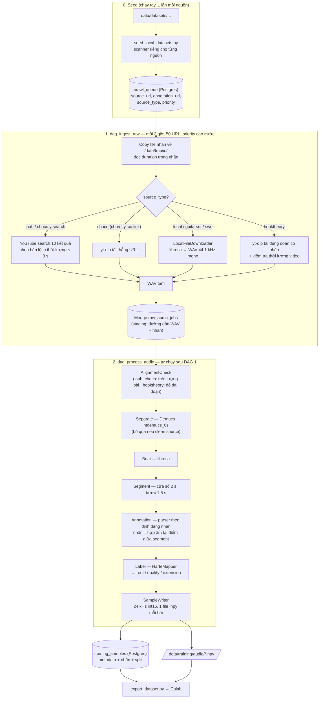

# ChordSense Pro — DE: Luồng dữ liệu hiện tại (training ETL)

> Cập nhật: 2026-10-19, theo code thật. Phạm vi: crawl + xử lý data để train AI (không gồm hệ thống BE/FE).
> **Kết luận ngắn:** lõi xử lý (Segment → Annotation → Label → SampleWriter) dùng chung cho mọi dataset.
> Mỗi dataset chỉ khác ở **4 điểm**: cách lấy audio, parser nhãn, có kiểm tra thời lượng không, có chạy Demucs không.
> Sơ đồ draw.io: [data_flow.drawio](../../latex_last_project/diagrams/data_flow.drawio).

## 1. Luồng chung

Chi tiết các bước lõi:
- **Segment:** cắt cửa sổ 2 s, bước 1,5 s (chồng 0,5 s). Điểm bắt đầu kế tiếp được hút về beat gần nhất nếu lệch < 0,1 s.
- **Annotation:** với mỗi segment lấy hợp âm đang phát ở **điểm giữa** (`start ≤ mid < end`), không có thì `N`. Riêng **Hooktheory** chỉ có nhãn cho đoạn ~20 s: segment nằm ngoài `labelled_range` để `None` (không phải `N`) và bị SampleWriter bỏ.
- **Label:** `ok` = đủ 3 head · `partial` = thiếu quality/extension (6th, power chord) · `no_chord` = `N` · `unmapped` = chưa hiểu nhãn.
- **Split:** hash của `source_url`, 70/20/10, mọi segment của một bài nằm cùng một split.

## 2. Mỗi dataset đi khác nhau ở đâu

| Nguồn | `source_type` | Lấy audio | Parser nhãn | Kiểm tra thời lượng | Demucs | Beat |
|-------|--------------|-----------|-------------|--------------------|--------|------|
| **JAAH** | `jaah` | YouTube search `artist title jazz`, chọn bản khớp thời lượng | `JaahParser` (JSON, ô nhịp → beat) | ✅ | ✅ | bắt buộc |
| **Kaggle piano_triads** | `local` | file local → WAV | *(không có file nhãn)* nhãn lấy từ **tên file** (`A_dim_2_0` → `A:dim`) | — | ❌ bỏ qua | cho phép rỗng |
| **ChoCo chordify** (50 bài) | `choco` | yt-dlp tải thẳng link trong `meta.csv` | `JamsParser` (annotator đầu tiên) | ✅ | ✅ | bắt buộc |
| **ChoCo release** (1.309 bài) | `choco` | YouTube search `performer title`, chọn bản khớp thời lượng | `JamsParser` | ✅ | ✅ | bắt buộc |
| **GuitarSet** | `guitarset` | file local → WAV | `JamsParser` (chọn track *performed*) | — | ❌ bỏ qua | cho phép rỗng |
| **SWD** | `swd` | file local → WAV | `SwdParser` (CSV `;`) | — | ✅ | bắt buộc |
| **Hooktheory** (6.028+ clip) | `hooktheory` | yt-dlp tải **đúng đoạn có nhãn** (+3 s đệm) của video YouTube | `HooktheoryParser` (JSON do seed tạo, thời gian tính theo đoạn, nhãn dạng `Root:(3,5,b7,9)`) | ✅ thời lượng **video** (lúc tải) + độ dài **đoạn** (AlignmentCheck) | ✅ | bắt buộc |

Ba cờ quyết định cách xử lý, đều nằm ở code, không nằm ở dữ liệu:

| Cờ | Ở đâu | Giá trị |
|----|-------|---------|
| Kiểm tra thời lượng | `DURATION_CHECKED` + `SECTION_CHECKED` trong `alignment_check_handler.py` | `jaah`, `choco` (cả bài) · `hooktheory` (đoạn) |
| Bỏ qua Demucs / cho phép beat rỗng | `CLEAN_SOURCES` trong `separate_handler.py` (và tuple tương ứng trong `beat_handler.py`) | `kaggle`, `local`, `pianoteq`, `guitarset` |
| Ưu tiên queue | cột `crawl_queue.priority`, đặt trong scanner | hooktheory 6–7 · guitarset 5 · swd 4 · choco 3 · billboard 1 · còn lại 0 |

## 3. Chỗ chưa nhất quán (cần biết)

| # | Vấn đề | Hệ quả |
|---|--------|--------|
| 1 | ~~Stem harmonic luôn là `piano.wav`~~ — **đã sửa (2026-10-19 d)**: `SeparateHandler` trộn piano + guitar + other thành `harmonic.wav` (bỏ drums/bass/vocals) | ~27 bài JAAH xử lý trước khi sửa vẫn dùng stem piano cũ; ChoCo release và SWD dùng bản trộn |
| 2 | Kaggle dùng `source_type = local`, dù enum có `kaggle` | Chỉ là tên; không ảnh hưởng xử lý. `local` và `kaggle` cùng nằm trong `CLEAN_SOURCES` |
| 3 | Nhãn của Kaggle nằm trong **tên file**, các nguồn khác nằm trong **file nhãn** | `AnnotationHandler` có hai nhánh riêng; Kaggle không có kiểm tra căn chỉnh nào |
| 4 | Căn chỉnh nhãn–audio chỉ kiểm tra **tổng thời lượng** | Bản YouTube cùng độ dài nhưng lệch intro vẫn lọt (option C — căn theo beat — đã hoãn) |
| 5 | `kaggle/archive1` (1.760 file) có trong ổ nhưng **chưa seed** | Chưa dùng |
| 6 | Audio **chưa chuẩn hóa biên độ** | Normalize ở phía train |
