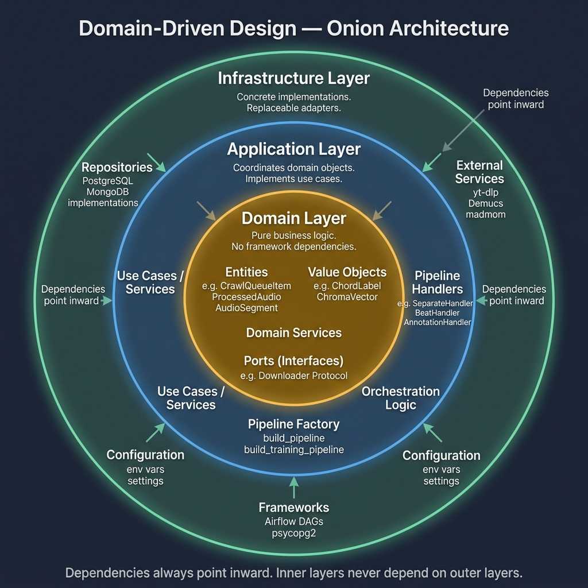

# ChordSense Pro: An AI-Powered Context-Aware System for Musician's Interactive Practice Workspace with Harmonic Analysis Support

> **Mục tiêu:** Xây dựng hệ thống AI end-to-end dành cho nhạc công: Thu thập + xử lý dữ liệu âm nhạc → fine-tune MERT-v1-330M (Cascaded 3-Head + LoRA) để nhận diện extended chord → Sheet Generation (ChordPro cho nhạc có lời, Lead Sheet cho nhạc không lời) → Web App thực hành hòa âm tương tác. Đóng góp khoa học rõ ràng trong MIR (Music Information Retrieval) với dataset VN Piano Extended Chord.

> **Bối cảnh:** GVHD gợi ý chuyển hướng sang learning technologies cho môn văn thể mỹ phổ thông sau khi nhận xét đồ án âm nhạc thuần túy (phân tích + gợi ý) không có đủ academic contribution.

> **Cập nhật:** Nhận diện hợp âm là **core feature** xuyên suốt — làm nền tảng cho cả Learning Flow (học bài yêu thích) lẫn Real-time Practice (luyện tập với feedback ngay). Hai luồng này bổ sung nhau để tạo vòng lặp học tập hoàn chỉnh.

---

## 0. Tổng Quan Dự Án

### Tên đồ án: **ChordSense Pro**
> *"Phân tích sâu — Luyện tập chuẩn — Thành thạo toàn diện."*
> **Full title (EN):** *ChordSense Pro: An AI-Powered Context-Aware System for Musician's Interactive Practice Workspace with Harmonic Analysis Support*

### Bài toán thực tế

Các giải pháp nhận diện hợp âm hiện tại (ChordAI, Chordify) đang thiếu hụt tư duy nhạc lý của một nhạc công thực thụ:
- **Không có phân tích hòa âm ngữ cảnh**: Không hiển thị chức năng bậc (I, IV, V), không gợi ý âm giai tương ứng
- **Môi trường luyện tập rời rạc**: Không có A/B Loop, metronome, speed shifting tích hợp trong cùng giao diện
- **Không có cá nhân hóa**: Không cho phép chỉnh sửa hợp âm, không lưu thư viện bản nhạc riêng
- **Không tạo được sheet nhạc**: Không xuất được ChordPro (nhạc có lời) hay lead sheet (nhạc không lời) để nhạc công dùng thực tế

### ChordSense giải quyết gì?

```
User nạp bài nhạc (YouTube URL / file MP3/WAV)
       ↓
AI phân tích: Tách nền → Beat Tracking → Chord Detection → Key Detection
       ↓
Trả về Event Timeline: [{timestamp_ms, root, bass, quality, confidence}]
       ↓
FE render Smart Grid: lưới hợp âm đồng bộ với Audio Player (sai số < 100ms)
       ↓
Harmonic Engine: map chord → Bậc (Roman numerals: I, ii, V...) → Âm giai gợi ý
       ↓
User tương tác: A/B Loop luyện đoạn | Metronome | Chỉnh sửa hợp âm | Lưu Playlist
```

### Phân chia nhân lực

| Role | Người | Trách nhiệm chính |
|------|-------|-------------------|
| **DE + AI** | Thành viên khác | Audio Feature Extraction, AI Chord Recognition Model, Source Separation, Beat Tracking pipeline |
| **BE + FE** | Bạn | Trình phát nhạc đồng bộ (Web Audio API), Client-side Harmonic Engine, UI/UX Workspace, REST API, Database (PostgreSQL/Prisma), Deployment |

---

## 0.5. 🔑 Core Feature: Chord Recognition Là Trung Tâm

> Chord Recognition không chỉ là 1 tính năng — nó là **engine** chạy xuyên suốt mọi thứ trong ChordSense.

```
                    ┌──────────────────────────────┐
                    │   CHORD RECOGNITION ENGINE   │
                    │   (MERT + LoRA Hierarchical)  │
                    └──────────────┬───────────────┘
                                   │
              ┌────────────────────┼────────────────────┐
              ▼                    ▼                    ▼
   ┌─────────────────┐  ┌──────────────────┐  ┌──────────────────┐
   │  LEARNING FLOW  │  │  REAL-TIME PRAC  │  │  ANALYTICS       │
   │  Import bài →   │  │  Gảy đàn →       │  │  Track tiến độ   │
   │  Detect chords  │  │  Nhận dạng ngay  │  │  Chord mastery   │
   │  → Sheet music  │  │  → Feedback      │  │  → Insights      │
   │  → Học từng     │  │  → So sánh với   │  │  → Teacher dash  │
   │    chord 1 by 1 │  │    target chord  │  │                  │
   └─────────────────┘  └──────────────────┘  └──────────────────┘
```

Chord recognition mạnh → cả 3 luồng đều mạnh. Đây là lý do đây là **thesis core**.

---

## 1. 🎵 Luồng Tổng Quan: Import Bài Nhạc → Phân Tích → Workspace

> **Ý tưởng cốt lõi:** User import bài nhạc yêu thích → AI phân tích chord events → FE render Smart Grid đồng bộ với audio → Harmonic Engine tự động phân tích bậc hòa âm → User luyện tập với A/B Loop, Metronome và tra cứu Chord Dictionary.

### 1.1 Luồng Tổng Quan

```
BƯỚC 1: USER IMPORT BÀI NHẠC
══════════════════════════════
Cách 1: Upload file (MP3/WAV/M4A)
Cách 2: Paste YouTube URL
         → Backend dùng yt-dlp (open source) download audio

         ↓ (Bước xử lý — ~10-30 giây)

BƯỚC 2: AI PHÂN TÍCH TOÀN BÀI (DE/AI scope)
══════════════════════════════════════════════
Pipeline:
  Audio → Source Separation (Demucs htdemucs_6s) → trộn stem harmonic (piano + guitar + other)
        → Beat Tracking (librosa) → tempo + beat positions
        → Chord Detection theo từng beat → Key Detection

Output BE trả về cho FE:
  metadata: { key: "Am", tempo: 75, time_signature: "4/4" }
  chord_events: [ {timestamp_ms, root, quality, confidence}, ... ]

         ↓

BƯỚC 3: RENDER SMART GRID & INTERACTIVE WORKSPACE
══════════════════════════════════════════════════
FE tiếp nhận Event Timeline từ BE → render lưới hợp âm đồng bộ với audio:

  ┌─────────────────────────────────────────────────────┐
  │  Bài: "Lạc Trôi" — Sơn Tùng M-TP                  │
  │  Giọng: A minor  |  Tempo: 75 BPM  |  4/4          │
  │                                                     │
  │  [Intro]       ◀ Đang phát                         │
  │  | Am ▶  | Am  | F    | C   G  |                   │
  │                                                     │
  │  [Verse 1]                                         │
  │  | Am  | Am  | F    | C   G  |                     │
  │  | Am  | Am  | Dm   | E      |                     │
  └─────────────────────────────────────────────────────┘

  Tính năng tương tác (FE — Web Audio API):
    ✅ Click vào ô nhịp → tua audio đến đúng mili-giây (sai số < 100ms)
    ✅ Quét chọn đoạn → A/B Loop: lặp lại đoạn khó khi luyện tập
    ✅ Metronome động theo BPM của bài
    ✅ Speed Shifting: 0.5x, 0.75x — không làm méo cao độ
    ✅ Basic/Precise toggle: G9sus4 → G (xử lý client-side, không gọi API)

         ↓

BUỚC 4: HARMONIC ENGINE & CHORD DICTIONARY
══════════════════════════════════════════
FE tự động phân tích ngữ cảnh hòa âm từ chord + key (rule-based, không cần server):

  Ví dụ bài ở giọng A minor:
    Am  → Bậc i   (Tonic)          → Âm giai: A Natural Minor
    Dm  → Bậc iv  (Subdominant)    → Âm giai: D Dorian
    E   → Bậc V   (Dominant)       → Âm giai: E Phrygian Dominant
    F   → Bậc VI  (Submediant)     → Âm giai: F Ionian
    G   → Bậc VII (Subtonic)       → Âm giai: G Mixolydian

  Chord Dictionary (tra cứu nhanh):
    → Click vào hợp âm bất kỳ trên Grid → mở modal tra cứu
    → Hiển thị: Fretboard (Guitar) / Phím (Piano) — nhiều voicing
    → Phát âm thanh qua Soundfont/MIDI Synth ngay trên browser

         ↓

BUỚC 5: CÁ NHÂN HÓA & LƯU TRỮ
══════════════════════════════
User chỉnh sửa và xây dựng thư viện nhạc cá nhân:

  Edit Marker:
    → Click vào ô hợp âm → mở modal chỉnh sửa Root / Bass / Quality
    → FE tính lại Bậc & Scale ngay lập tức (không gọi API)
    → Gắn cờ is_user_edited để phân biệt với kết quả AI gốc

  Playlist Management:
    → Lưu bài vào thư viện cá nhân (BE lưu PostgreSQL)
    → Tạo nhiều Playlist: "Nhạc tập", "Nhạc biểu diễn",...
```

### 1.2 Comparison: ChordSense vs Chordify vs ChordAI

| Tính năng | Chordify | ChordAI | **ChordSense** |
|-----------|----------|---------|----------------|
| Import nhạc → chord sheet | ✅ | ✅ | ✅ |
| Nhạc tiếng Việt | ⚠️ Yếu | ⚠️ Yếu | **✅ Tốt** (VN dataset) |
| Extended chords (9, 11, 13) | ❌ Thường bỏ qua | ⚠️ Limited real-time | **✅ Chuyên sâu** |
| **Phân tích Bậc (Roman Numeral)** | ❌ | ❌ | **✅ Tự động theo Key** |
| **Gợi ý Âm giai (Scale Mapping)** | ❌ | ❌ | **✅ Ionian, Mixolydian...** |
| **Smart Grid & Sync Player** | ⚠️ Cơ bản | ⚠️ Cơ bản | **✅ Click-to-seek < 100ms** |
| **A/B Loop & Metronome** | ❌ | ❌ | **✅ Web Audio API** |
| **Chỉnh sửa & Lưu cá nhân** | ❌ | ❌ | **✅ Cloud Sync + Edit Marker** |
| **Chord Dictionary có âm thanh** | ⚠️ Có | ✅ Có | **✅ Soundfont Synth** |
| Free / mở | Freemium | Freemium | **Open** |

> **Điểm khác biệt:** ChordSense không chỉ detect chord — nó **biên dịch dữ liệu thô thành kiến thức nhạc lý** (Harmonic Engine) và **cung cấp môi trường thực hành khép kín** (Smart Grid + A/B Loop + Chord Dictionary).

### 1.3 Data Flow Kỹ Thuật — Learning Flow

```
YouTube URL
    │
    ▼
yt-dlp → WAV (mono, 44.1kHz)
    │
    ▼
Demucs htdemucs_6s (Meta AI, open source, chạy GPU):
  → 6 stems: drums | bass | vocals | other | guitar | piano
  → Trộn piano + guitar + other → harmonic.wav cho chord detection (bỏ drums / bass / vocals)
    │
    ▼
Beat Tracker (librosa.beat.beat_track — thay madmom):
  → beat_times = [0.0, 0.5, 1.0, 1.5, ...]  ← downbeats mỗi 0.5s ở 120BPM
  → time_signature = 4/4
    │
    ▼
Segmenter:
  → Chia audio thành segment 2 s (bước 1.5 s), điểm bắt đầu hút về beat gần nhất
  → Mỗi segment = 1 chord prediction context
    │
    ▼
MERT + LoRA Hierarchical Model:
  → Input: waveform 24 kHz của từng segment 2 s (MERT tự trích đặc trưng)
  → Output: Root + Quality + Extension + confidence
    │
    ▼
Post-processing:
  → Smoothing: HMM (Hidden Markov Model) để loại bỏ "chord flickering"
    [C, C, Am, C, C] → [C, C, C, C, C]  (Am lẻ loi → smooth thành C)
  → Grouping: merge adjacent same chords
    [(0.0, C), (0.5, C), (1.0, Am), (1.5, Am)] → [(0.0-1.0, C), (1.0-2.5, Am)]
    │
    ▼
Section Detector (lightweight):
  → Phân biệt intro/verse/chorus dựa trên chord pattern repetition
  → Label mỗi section
    │
    ▼
Chord Sheet Generator:
  → Render dưới dạng chord chart (text + VexFlow.js)
  → Store PostgreSQL: song_analyses table
  → Generate learning plan
```

---

## 2. 🎯 Lý Thuyết: Các Vấn Đề Khó Trong Nhận Diện Hợp Âm (ACR)

> Hiểu rõ những vấn đề lý thuyết này là nền tảng để giải thích tại sao cần Hierarchical LoRA, Focal Loss, Source Separation,... thay vì một mô hình đơn giản.

### 2.1 Cơ Chế Nhận Diện Hợp Âm

```
Âm thanh thực (guitar gảy) → Sóng âm (waveform)
        ↓
Biến đổi sang miền tần số (FFT / CQT)
        ↓
Trích xuất đặc trưng (Chroma / Mel-spectrogram)
        ↓
Model phân loại → Tên hợp âm (Am, Cmaj7, G7#9,...)
```

**Vật lý cơ bản:** Khi gảy Am (A–C–E), dây đàn rung tạo ra sóng tổng hợp gồm:
- Tần số cơ bản (fundamental): A=440Hz, C=261Hz, E=329Hz
- Họa âm (overtones): 880Hz, 1320Hz,... của mỗi nốt

Model "nhìn vào" phổ tần số và học pattern: **tần số nào xuất hiện cùng nhau = hợp âm nào**.

---

### 2.2 Bảy Vấn Đề Lý Thuyết Cốt Lõi

---

#### ❶ Enharmonic Equivalence — Cùng Âm, Khác Tên

```
Về vật lý: C# = Db (cùng tần số 277Hz, cùng phím piano)

Hệ quả:
  C#maj và Dbmaj → Spectrogram GIỐNG HỆT NHAU 100%
  F#m7  và Gbm7  → Spectrogram GIỐNG HỆT NHAU 100%

→ Model không thể phân biệt bằng âm thanh đơn thuần
→ Phải dùng KEY CONTEXT (giọng bài) để chọn tên đúng

Ví dụ:
  Bài ở giọng Db major → nốt đó gọi là "Db"
  Bài ở giọng E major  → nốt đó gọi là "C#"
```

**Giải pháp trong thesis:** Key detection (detect giọng toàn bài 1 lần) → key-conditioned prediction.

---

#### ❷ Chord Inversion & Slash Chords — Đảo Hợp Âm

```
C major: nốt C–E–G

Thể gốc (root position): C ở bass → nghe rõ là C
Đảo 1 (1st inversion):   E ở bass → C/E → nghe gần giống Em7
Đảo 2 (2nd inversion):   G ở bass → C/G → nghe gần giống Gsus

Slash chord phức tạp hơn:
  D/F# = D major với F# ở bass
       = nghe gần giống Bm7 (B–D–F#–A)

→ Spectrogram rất giống nhau dù tên khác
→ Không có đáp án tuyệt đối — phụ thuộc harmonic context và style nhạc
```

**Giải pháp trong thesis:** Bass note detection riêng (spectral low-end) + harmonic context window.

---

#### ❸ Extended Chord Overlap — Hợp Âm Màu Chia Sẻ Nốt (Khó Nhất)

```
Am7  = A–C–E–G       (4 nốt)
C6   = C–E–G–A       (4 nốt)  ← CÙNG 4 NỐT VỚI Am7, chỉ khác tên root!

Dm9  = D–F–A–C–E     (5 nốt)
Fmaj7= F–A–C–E       (4 nốt)  ← Dm9 chứa toàn bộ Fmaj7 bên trong!

G13  = G–B–D–F–A–C–E (7 nốt) ← gần như toàn bộ thang âm C major

→ Về chroma vector: Am7 và C6 GIỐNG NHAU HOÀN TOÀN
→ Chỉ ngữ cảnh (root, bass, chord trước/sau) mới phân biệt được
→ Đây là lý do flat 60-class model THẤT BẠI với extended chords
```

**Giải pháp trong thesis:**

**A. Cascaded Cross-Head Conditioning** (thay vì parallel heads độc lập):
```
❌ Parallel (hiện tại):    embedding → Head1 (Root)
                           embedding → Head2 (Quality)   ← không biết root
                           embedding → Head3 (Extension)  ← không biết root+quality

✅ Cascaded (cải tiến):   embedding → Head1 → root_logits (12)
                           embedding + root_logits → Head2 → quality_logits (5)
                           embedding + root_logits + quality_logits → Head3 → extension_logits (15)

→ Head3 "biết" context từ Head1+2 → xác suất extension chuẩn hơn
→ Am7 vs C6: Head1 xác định root (A vs C) trước → Head3 dễ phân biệt hơn
```

**B. Partial Voicing Recognition** — Khi người chơi không đánh đủ nốt:
```
Ví dụ thực tế: Fadd9 = F–A–C–G
  Pianist chỉ đánh F–G (root + 9th, bỏ 3rd và 5th)
  → Spectrogram thiếu A và C
  → Flat model predict F hoặc Fsus2 (sai)

Giải pháp: Weighted Note Presence Scoring
  CHORD_TEMPLATES = {
      "Fadd9": { "F": 1.0,  "A": 0.7,  "C": 0.4,  "G": 0.9 },
      # Root=1.0 (bắt buộc), 3rd=0.7, 5th=0.4 (hay omit), 9th=0.9 (defining note)
      "F":     { "F": 1.0,  "A": 0.9,  "C": 0.7 },
      "Fsus2": { "F": 1.0,  "G": 0.9,  "C": 0.5 },
  }
  # Với input chỉ có F+G:
  score(Fadd9) = 1.0×1 + 0.7×0 + 0.4×0 + 0.9×1 = 1.9
  score(F)     = 1.0×1 + 0.9×0 + 0.7×0          = 1.0
  score(Fsus2) = 1.0×1 + 0.9×1 + 0.5×0          = 1.9
  → Tie → dùng Chord Prior (Fadd9 phổ biến hơn Fsus2 trong nhạc pop) để phân biệt

Bổ sung: HMM Chord Transition Prior
  P(Fadd9 | chord_before=C) > P(Fsus2 | chord_before=C)
  → Context progression giúp chọn đúng
```

**C. Pianoteq Synthetic Data** — Reference chord structure chuẩn:
```
Pianoteq (physical modeling synthesizer) → acoustic model cực chuẩn
Dùng 2 cách:
  1. Tham khảo note weights: overtone series của từng chord type → template weights
  2. Synthetic training data: render từng chord với label hoàn hảo
     → Am, Am7, Am9,... × nhiều velocity, reverb, register
     → Bổ sung cho dataset thực khi extended chord data ít
     → Sau đó fine-tune trên real piano recording → bridge the gap

Lưu ý: Model train trên Pianoteq synthetic sẽ có gap với piano thực
        → Cần fine-tune thêm trên real recordings
```

---

#### ❹ Timbre Variation — Âm Sắc Nhiễu Nhận Diện

```
Cùng hợp âm Am, nhưng timbre của từng nhạc cụ rất khác:
  Piano              → âm tắt nhanh (percussive), attack sharp, overtone rõ ràng
                       ← PRIMARY INSTRUMENT CỦA THESIS
  Guitar acoustic    → attack soft hơn, sustain dài, overtone dày
                       ← OPTIONAL (mở rộng sau)
  Guitar điện clean  → ít overtone, sustain rất dài
  Ukulele            → range tần số hẹp, nylon string, bright

→ Spectrogram trông RẤT KHÁC nhau dù cùng là "Am"
→ Model phải học "ignore timbre, focus on pitch intervals"
```

> ⚠️ **Quyết định scope:** Thesis tập trung vào **Piano** là nhạc cụ chính.
> - Piano có acoustic model chuẩn hơn (Pianoteq), dataset nhiều hơn (MIDI → audio dễ)
> - Chord voicing trên piano rõ ràng hơn guitar (không có partial voicing phức tạp)
> - Guitar là **optional extension** — nếu còn thời gian sau khi hoàn thiện piano model

**Giải pháp trong thesis:** MERT pretrained (đã học instrument representation) + tập trung dataset piano. Fine-tune thêm trên guitar data nếu mở rộng.

---

#### ❺ Temporal Segmentation — Phân Đoạn Thời Gian

```
Vấn đề A — CHORD BOUNDARY:
  ──────[C]──────────[Am]────[F]──────────[G]──────
  Chord thay đổi KHÔNG đúng đầu beat (guitarist chuyển sớm/muộn ±100ms)
  → Segment ở đâu? Beat boundary hay onset boundary?

Vấn đề B — CHORD FLICKERING:
  Predict theo frame 20ms → kết quả nhiễu:
  [C, C, C, Am, C, C, Am, Am, Am]
                ↑   ↑
           2 frame "lạc" → thực ra vẫn là C

  → Cần smoothing để loại "noise chord" trong chuỗi

Vấn đề C — CHORD DURATION:
  Một hợp âm kéo 4 beat → là 1 chord hay 4 observations?
  → Ảnh hưởng đến cách tính accuracy (per-frame vs per-chord)
```

**Giải pháp trong thesis:** Beat-aligned segmentation (librosa beat tracker) + HMM smoothing với chord transition probability.

---

#### ❻ Data Imbalance — Mất Cân Bằng Dữ Liệu

```
Trong mọi dataset nhạc pop/rock:
  Am, C, G, F:          10,000–15,000 samples ████████████████████
  Dm, Em, E, B7:         3,000–5,000 samples  ████████
  Am7, Cmaj7, G7:          300–500 samples   █
  Am9, G13, Cmaj#11:         20–50 samples   ▏

→ Model sau khi train: giỏi predict Am/C/G, dốt predict Am9/G13
→ Gặp G7#9 → thường predict G7 (đúng root+quality, sai extension)
→ Đây là vấn đề cốt lõi khiến ChordAI yếu với extended chords
```

**Giải pháp trong thesis:**
- Pitch-shift augmentation với label update → x12 samples cho rare chords
- Focal Loss (γ=2) → tập trung train vào hard/rare examples
- Stratified split → đảm bảo rare chords có mặt trong val/test

---

#### ❼ Polyphony — Nhiều Nguồn Âm Cùng Lúc

```
Trong bản nhạc có ban nhạc:
  Guitar: Am (A–C–E)
  Bass:   nốt A đơn
  Piano:  C–E (chord đệm)
  Vocal:  hát nốt A, C,...
  Drum:   noise broadband

→ Spectrogram = TẤT CẢ chồng lên nhau
→ Model phải đoán "guitar đang đánh chord gì"
  từ mớ âm thanh hỗn hợp này
→ Nốt 9th (B trong Am9) bị drown out bởi bass + drum
```

**Giải pháp trong thesis:** Source Separation (Demucs) → tách guitar/harmonic track riêng → predict trên track sạch.

---

### 2.3 Bảng Tổng Kết — Vấn Đề & Giải Pháp

| Vấn đề | Mức độ khó | Giải pháp áp dụng | Scope |
|--------|-----------|-------------------|-----------------|
| Enharmonic equivalence | Trung bình | Key detection → disambiguation | ✅ Core |
| Chord inversion / Slash | Cao | Bass note detection riêng | ⚠️ Optional |
| **Extended chord overlap** | **Rất cao** | Cascaded 3-Head + Partial Voicing + HMM Prior | **⭐ Contribution chính** |
| Timbre variation | Cao | MERT + tập trung piano dataset | ✅ Core (piano only) |
| Temporal segmentation | Trung bình | Beat-align + HMM smoothing | ✅ Core |
| **Data imbalance** | **Rất cao** | Focal Loss + Pitch-shift aug + Pianoteq synthetic | **⭐ Contribution chính** |
| Polyphony (ban nhạc) | Cao | Demucs source separation | ✅ Core |
| Partial voicing | Cao | Weighted Note Presence + Chord Prior | **⭐ Thêm mới** |

> **Insight báo cáo:** Vấn đề **❸ Extended Chord Overlap** và **❻ Data Imbalance** là hai vấn đề chưa được giải quyết triệt để bởi các tool thương mại. Thesis đóng góp thêm **Cascaded Head** và **Partial Voicing Recognition**.

### 2.4 Quyết Định Scope — Piano First

> **Lý do giới hạn piano làm nhạc cụ chính:**

| Tiêu chí | Piano | Guitar |
|----------|-------|--------|
| Dataset sẵn có | Nhiều (MIDI → audio, Pianoteq) | Ít extended chord data |
| Chord voicing | Rõ ràng, đủ nốt | Hay omit nốt (partial voicing) |
| Acoustic model chuẩn | ✅ Pianoteq physical modeling | ⚠️ Phụ thuộc loại guitar/string |
| Complexity của scope | Vừa phải | Cao hơn (nhiều loại guitar) |
| Kết quả demo | Sạch, dễ demo | Cần xử lý thêm nhiều case |

```
Scope thesis:
  PRIMARY:  Piano chord recognition (basic → extended: 9, 11, 13, dim, aug)
  OPTIONAL: Guitar (nếu còn thời gian sau khi piano model hoàn thiện)

Dataset strategy:
  Piano:  Hooktheory / JAAH / ChoCo (qua Demucs → stem harmonic) + Kaggle piano_triads + SWD
          + Pianoteq synthetic (render extended chords — cần license, chưa làm)
          + Tự thu âm piano (hoặc dùng digital piano/keyboard)
  Guitar: GuitarSet (360 clip, JAMS) + Kaggle (basic chords đủ dùng)
          → Chỉ dùng làm "optional fine-tune" nếu mở rộng
```

---

## 3. 🔬 Research: Thuật Toán Fine-tuning Cho Chord Recognition

> Phần này phục vụ báo cáo với GVHD về lý do chọn LoRA và so sánh với các phương pháp khác.

### 2.1 Bức Tranh Tổng Thể — Các Nhóm Phương Pháp

```
Phương pháp fine-tuning cho ACR (Automatic Chord Recognition)
├── A. Parameter-Efficient Fine-Tuning (PEFT)
│   ├── LoRA (Low-Rank Adaptation)          ← Đề xuất dùng
│   ├── Adapter Layers
│   └── Prefix Tuning
│
├── B. Full Fine-Tuning
│   └── Train toàn bộ pretrained model
│
└── C. Phương pháp Kiến Trúc / Hybrid (2024-2025 SOTA)
    ├── Conformer-based (Chordformer)
    ├── Hierarchical Decoding (BACHI)
    └── LLM-augmented ACR (Chain-of-Thought)
```

---

### 2.2 So Sánh Chi Tiết: LoRA vs Các Phương Pháp Khác

#### 📊 Bảng So Sánh Tổng Hợp

| Phương pháp | Params Train | VRAM | Accuracy (Extended) | Inference Latency | Overfitting Risk | Phù hợp thesis? |
|-------------|-------------|------|---------------------|-------------------|------------------|-----------------|
| **Full Fine-Tuning** | 100% (~330M) | ~40GB+ | Lý thuyết cao nhất | Bình thường | **Rất cao** | ❌ Không thực tế |
| **LoRA** | ~0.6% (~2M) | ~20–24GB | 90-99% của full FT | **Zero overhead** | Thấp | **✅ Lựa chọn chính** |
| **Adapter Layers** | ~1-3% | ~10GB | ~90-95% của full FT | +10-20ms/layer | Thấp | ✅ Tốt |
| **Prefix Tuning** | < 0.1% | ~6GB | 75-85% của full FT | Rất nhỏ | Thấp | ⚠️ Yếu hơn với task phức tạp |
| **Conformer/Chordformer** | Thiết kế mới | ~16GB | **SOTA 2024** | ~186ms | Trung bình | ✅ Tốt (kiến trúc phức hơn) |
| **BACHI (Hierarchical Decode)** | Task-specific | ~12GB | Tốt với complex chords | ~200-300ms | Thấp | ✅ Ý tưởng gần với thesis |
| **LLM-augmented ACR** | LLM (lớn) | ~80GB+ | +1-2.77% MIREX | Rất cao | N/A | ❌ Quá phức tạp |

---

#### 🔵 A. LoRA — Lựa Chọn Chính

**Nguyên lý:**
```
Original weight: W (frozen, không đổi)
LoRA adapter:    ΔW = A × B  (A: d×r, B: r×d, r << d)
Effective:       W_eff = W + (α/r) × A × B

Ví dụ MERT-95M:
  Mỗi attention layer: W = (768×768) = 589,824 params
  LoRA r=16:           A = (768×16) + B = (16×768) = 24,576 params
  → Giảm 96% số params cần train trong layer đó
```

**Ưu điểm:**
- ✅ **Industry standard** — dùng trong GPT, Stable Diffusion, hầu hết SOTA 2024
- ✅ **Zero inference latency**: adapter merge vào W trước khi serve
- ✅ **VRAM thấp hơn full fine-tuning**: ~20–24 GB — fine-tune trên Google Colab Pro (A100 40GB)
- ✅ **Chống catastrophic forgetting**: W gốc không bị thay đổi
- ✅ **Dễ thực nghiệm**: thay đổi rank r=8/16/32 → thesis experiments rõ ràng
- ✅ **PEFT library** của HuggingFace: 5 dòng code để gắn vào MERT

**Nhược điểm:**
- ⚠️ Có thể thua full fine-tuning 1-5% khi task quá khác biệt so với pre-training
- ⚠️ Chọn `target_modules` sai → kết quả kém (cần attention layers, không phải FFN)

**Kết luận**: LoRA là lựa chọn **thực tế và đủ mạnh** cho thesis. Chạy được trên Colab Pro (A100 40GB), dễ replicate.

---

#### 🟡 B. Adapter Layers

**Nguyên lý:**
```
Transformer Layer gốc → Adapter Module nhỏ (bottleneck) → tiếp tục
Adapter: Linear(d→r) → ReLU → Linear(r→d)  + residual connection
```

**Ưu điểm:**
- ✅ Modular: một backbone, nhiều tasks (swap adapter)
- ✅ Hiệu quả tương đương LoRA (~90-95% accuracy)

**Nhược điểm:**
- ❌ **Thêm latency**: mỗi layer phải đi qua adapter module (~10-20ms thêm)
- ❌ Phức tạp hơn LoRA để implement
- ❌ Không hỗ trợ tốt bằng HuggingFace PEFT (LoRA có ecosystem tốt hơn)

**Khi nào dùng**: Khi cần deploy một model phục vụ nhiều tasks song song.

---

#### 🟠 C. Prefix Tuning

**Nguyên lý:**
```
Input thông thường:   [audio_tokens]
Prefix Tuning:        [prefix_1, prefix_2, ..., prefix_k | audio_tokens]
                       ↑ Là vector learnable, không phải text/audio thật
```

**Ưu điểm:**
- ✅ Cực kỳ nhẹ — chỉ train thêm k×d vectors

**Nhược điểm:**
- ❌ **Unstable training** — nhạy cảm với initialization, learning rate
- ❌ Kém hơn LoRA rõ ràng trên các task classification phức tạp
- ❌ Không phù hợp cho chord recognition (continuous prediction, không phải text generation)

**Kết luận**: Không phù hợp cho bài toán này.

---

#### 🟢 D. Full Fine-Tuning

**Nguyên lý:** Train toàn bộ 95M params của MERT.

**Ưu điểm:**
- ✅ Lý thuyết đạt accuracy cao nhất

**Nhược điểm:**
- ❌ **VRAM**: cần ~40-80GB VRAM (A100/H100) — không khả thi cho cá nhân
- ❌ **Catastrophic forgetting**: MERT mất đi general music knowledge → overfit VN guitar data
- ❌ **Overfitting nghiêm trọng** khi dataset nhỏ (< 100k samples)
- ❌ Tốn thời gian train gấp 50x LoRA

**Kết luận**: Không thực tế cho thesis environment. LoRA đạt 90-99% accuracy với chi phí thấp hơn 50x.

---

#### 🔴 E. Conformer-based / Chordformer (2024 SOTA Architecture)

**Nguyên lý:**
```
Audio → CQT spectrogram
     → Conformer Encoder (CNN + Self-Attention hybrid)
     → Contextual Block Processing (look-ahead ~186ms)
     → 3 heads: Root | Quality | Bass (chord inversion)
```

**Ưu điểm:**
- ✅ SOTA 2024 trên các benchmark chuẩn (MIREX, Billboard)
- ✅ Latency thấp (~186ms) do Contextual Block Processing
- ✅ Xử lý tốt temporal context (chuyển chord mượt)

**Nhược điểm:**
- ❌ **Phức tạp hơn** — train từ đầu, không dùng được MERT pretrained
- ❌ Cần nhiều data hơn (không có MERT pretrain knowledge)
- ❌ Khó replicate cho người mới với deep learning

**Mối liên hệ với thesis:** Đây là kiến trúc mà mình có thể **so sánh** với MERT+LoRA trong experiments → 1 baseline mạnh thêm.

---

#### ⚫ F. BACHI — Boundary-Aware Symbolic Chord Recognition (2024)

**Nguyên lý:**
```
Không classify trực tiếp → Decomposed decoding:
  Step 1: Boundary detection (khi nào chord thay đổi?)
  Step 2: Root ranking (C, C#, D,... → score từng root)
  Step 3: Quality ranking (major, minor, dim,...)
  Step 4: Bass/Inversion (chord có bị đảo không?)
```

**Ưu điểm:**
- ✅ **Giống cách tai người nghe nhạc** → interpretable
- ✅ Tốt với complex chord boundaries
- ✅ Tự nhiên handle extended chords tốt hơn flat classification

**Nhược điểm:**
- ❌ Phức tạp khi implement
- ❌ Pipeline nhiều bước → latency cao hơn

**Mối liên hệ với thesis:** Ý tưởng hierarchical decoding của BACHI **giống với Hierarchical LoRA** mình đề xuất → có thể cite trong paper như inspiration.

---

#### 🤖 G. LLM-augmented ACR (Chain-of-Thought, 2025 trend)

**Nguyên lý:**
```
Audio → MIR tools (source sep, beat track, key detect) → Text descriptions
Text → LLM (GPT-4o) với music theory prompt → Refined chord labels
```

**Ưu điểm:**
- ✅ Tận dụng music theory knowledge của LLM
- ✅ +1-2.77% trên MIREX benchmark

**Nhược điểm:**
- ❌ **Chi phí API**: $0.01-0.05/bài → không scale được
- ❌ Latency: 3-10 giây/bài (GPT API round-trip)
- ❌ Privacy: audio/chord data gửi lên cloud
- ❌ Không thể deploy offline

**Kết luận:** Xu hướng hay nhưng không phù hợp cho real-time EdTech app.

---

### 2.3 Kết Luận Cho Thesis

```
Lựa chọn cuối: MERT + LoRA Hierarchical (3-Head)

Lý do:
  1. LoRA: balance tốt nhất giữa performance vs resource
  2. MERT: pretrained model tốt nhất cho chord-level MIR
  3. Hierarchical: giải quyết vấn đề extended chord recognition (contribution chính)
  4. Curriculum Learning: thêm contribution kỹ thuật

Experiments để so sánh trong thesis:
  Baseline A: Template matching (chroma cosine)
  Baseline B: CNN flat 60-class (không hierarchical)
  Baseline C: MERT zero-shot (không fine-tune)
  Baseline D: Conformer/Chordformer (2024 SOTA architecture)   ← Thêm mới
  Our Model A: MERT + LoRA Flat (không hierarchical)
  Our Model B: MERT + LoRA Hierarchical (Hooktheory + JAAH + ChoCo + GuitarSet)
  Our Model C: Model B + VN fine-tune                           ← Best model
  Commercial:  ChordAI (so sánh trên VN test set)
```

---

## 3. 🧠 Pretrained Model: So Sánh Và Lý Do Chọn MERT

### 3.1 Bảng So Sánh

| Model | Params | Pre-train Data | Pre-train Task | Chord Task Score | Deploy Cost | Verdict |
|-------|--------|---------------|----------------|-----------------|-------------|---------|
| **MERT-v1-95M** | 95M | 160k giờ nhạc | Multi-task SSL (RVQ Teacher + MFCC) | **SOTA** | Thấp | ✅ Optional (nếu hết thời gian) |
| **MERT-v1-330M** | 330M | 160k giờ nhạc | Như trên | Tốt hơn 95M ~1-2% | Trung bình | **✅ Chọn** |
| **Music2Vec** | ~95M | 1M bài nhạc | BYOL self-supervised | Tốt, kém MERT ~2-5% | Thấp | ⚠️ Backup option |
| **Jukebox** | 5B | 1.2M bài | VQ-VAE generative | Tốt nhưng tốn tài nguyên | **Rất cao** | ❌ Không thực tế |
| **MusicBERT** | ~125M | MIDI symbolic | MLM trên MIDI tokens | Tốt với symbolic, kém audio | Thấp | ❌ Không phù hợp (audio input) |
| **CLAP** | 150M | Audio + text pairs | Contrastive audio-text | Yếu hơn MERT cho local tasks | Thấp | ❌ Thiết kế cho global tasks |
| **Harmony Transformer (BTC)** | ~10M | McGill Billboard | Supervised chord | Tốt, nhưng chỉ basic chords | Thấp | ⚠️ Baseline |

### 3.2 Tại Sao MERT Là Lựa Chọn Tốt Nhất?

```
1. THIẾT KẾ CHO LOCAL-LEVEL MIR TASKS:
   MERT dùng multi-task teacher:
   - RVQ Teacher (acoustic features) → học pitch, timbre
   - MFCC Teacher (temporal features) → học rhythm, chord transitions
   → Kết hợp 2 loại thông tin → hiểu harmonic content sâu hơn CLAP

2. BENCHMARK:
   Trên MIREX chord recognition: MERT >> CLAP >> Music2Vec >> Jukebox features
   Trên beat tracking, pitch detection: MERT là SOTA trong các model < 1B params

3. THỰC TẾ:
    - HuggingFace: "m-a-p/MERT-v1-330M" — 1 dòng load
    - PEFT LoRA: 5 dòng config
    - Fine-tune trên Google Colab Pro (A100 40GB): ~6 giờ/phase
    - Inference: ~200-400ms trên CPU (sau ONNX export)

4. COMMUNITY & PAPERS:
   - MERT paper: ICLR 2024 (peer-reviewed, citable)
   - >200 citations trong năm đầu
   - Active development: m-a-p team (Music AI Platform, China)
```

### 3.3 Cấu Hình LoRA Cho MERT

```python
from peft import LoraConfig, get_peft_model

lora_config = LoraConfig(
    r=16,                    # Rank — thử 8/16/32 trong experiments
    lora_alpha=32,           # Scaling = 2×r (convention)
    target_modules=[         # Các modules trong MERT attention
        "query",
        "key",
        "value",
        "dense"              # Thêm projection layer — tốt hơn cho harmonic task
    ],
    lora_dropout=0.1,        # Regularization
    bias="none",
    task_type="FEATURE_EXTRACTION"
)

model = get_peft_model(mert_model, lora_config)
model.print_trainable_parameters()
# trainable params: ~1,982,464 || all params: ~330M || trainable%: ~0.600%
```

---

## 4. 🏆 Chiến Lược Vượt Trội ChordAI Trên Extended Chords

> **Câu hỏi báo cáo:** "Làm sao đảm bảo model mình hơn ChordAI? Đặc biệt với 9, 11, 13, dim?"

### 4.1 Gap Hiện Tại Của ChordAI (Và Chordify)

| Điểm yếu của ChordAI | Lý do kỹ thuật | Cách ChordSense giải quyết |
|----------------------|----------------|---------------------------|
| Extended chords kém trên real-time mic | Microphone noise làm mờ overtones cần cho 9th/11th | Source separation (Demucs) trước khi predict |
| Nhạc Việt kém hơn | Không có VN training data | VN dataset chuyên biệt |
| Flat classification approach | Một model cho 100+ classes → bias về common chords | **Hierarchical 3-Head**: tách Root/Quality/Extension |
| Không phân biệt voicing | Am open vs Am barre = cùng label | Voicing awareness qua spectrogram features |
| Contextual ambiguity | Am7 vs C6 (cùng notes, nghe giống nhau) | HMM smoothing + harmonic context window |
| Không giải thích được sai | Black-box | Confidence per head → user biết sai root hay extension |

### 4.2 Tại Sao Extended Chords Khó — Và Cách Fix

```
Vấn đề căn bản của extended chord recognition:

Am  = A + C + E         ← 3 notes, phân biệt dễ
Am7 = A + C + E + G     ← 4 notes, G thêm vào
Am9 = A + C + E + G + B ← 5 notes, B thêm vào

Vấn đề 1: DATA IMBALANCE
  Am:  10,000 samples trong dataset
  Am9: 50 samples trong dataset
  → Model bias, predict Am thay vì Am9

  Fix: Focal Loss + Class weights + Data augmentation aggressif cho rare chords

Vấn đề 2: SPECTRAL SIMILARITY
  Am7 (A-C-E-G) và C6 (C-E-G-A) — cùng 4 notes, khác root
  → Model khó phân biệt nếu chỉ nhìn chroma

  Fix: Temporal context — nhìn chord trước và sau để infer root
       Harmonic context window: 4 beats xung quanh

Vấn đề 3: ĐẶC TRƯNG ÂM THANH NHẠT
  9th (note 9) thường nằm ở register cao, âm nhỏ hơn root/3rd/5th
  13th (note 13) càng khó nghe hơn
  → Spectrogram thông thường không capture được

  Fix: Multi-scale spectrogram:
    - CQT (chromagram): tốt cho root + quality
    - HPSS: harmonic-percussive separation → chỉ lấy harmonic part
    - High-frequency emphasis: pre-emphasis filter để boost extensions

Vấn đề 4: DIM CHORD AMBIGUITY
  Bdim = B + D + F (symmetric intervals)
  Bdim7 = B + D + F + Ab (fully diminished — rất đối xứng)
  → Enharmonic equivalence: Bdim7 = Ddim7 = Fdim7 = Abdim7

  Fix: Key-aware disambiguation — dùng key detection output để chọn
       root đúng trong context của bài
```

### 4.3 Kỹ Thuật Đặc Biệt Cho Extended Chord Recognition

```python
# Kỹ thuật 1: Focal Loss cho class imbalance
class FocalLoss(nn.Module):
    def __init__(self, gamma=2.0, alpha=None):
        # gamma=2: focus training vào hard examples (rare chords)
        # alpha: class weights ngược với frequency

# Kỹ thuật 2: Multi-scale input
features = {
    "chroma_cqt":   librosa.feature.chroma_cqt(y, sr),          # Root info
    "chroma_cens":  librosa.feature.chroma_cens(y, sr),          # Noise-robust
    "hpss_harmonic": librosa.effects.hpss(y)[0],                 # Pure harmonic
    "mel_high":     librosa.feature.melspectrogram(y, sr,
                       fmin=2000, fmax=8000, n_mels=64),         # High extension info
}
# Concat → 4-channel input → richer feature cho MERT

# Kỹ thuật 3: Harmonic context window
# Không predict 1 chord từ 1 segment — nhìn ±2 beats xung quanh
context = [chord_t-2, chord_t-1, chord_t, chord_t+1, chord_t+2]
# → MERT encoder với positional embedding → context-aware prediction

# Kỹ thuật 4: Key-conditioned prediction
key = key_detector(full_song)  # Detect key 1 lần cho cả bài
# Concatenate key_embedding vào MERT output trước classification heads
# → Model biết bài đang ở Fm → B = Bb (không phải A#) → label chuẩn hơn
```

> **Lưu ý theo code (2026-10-19):** ETL **không** trích feature (chroma / HPSS / mel). Nó lưu waveform 24 kHz sạch vì MERT nhận waveform và tự học đặc trưng. Multi-scale feature ở trên là hướng thí nghiệm / ablation phía train hoặc inference; `FeatureHandler` vẫn còn trong code nhưng không nằm trong chain training.

### 4.4 Target Metrics — Vượt ChordAI

| Chord Category | ChordAI Accuracy (est.) | Target ChordSense | Cách đạt |
|----------------|------------------------|-------------------|----------|
| Basic triads (Am, C, G,...) | ~90% | **>92%** | MERT + VN data |
| 7th chords (Am7, Cmaj7,...) | ~75% | **>80%** | Hierarchical head |
| 9th chords (Am9, C9,...) | ~55% | **>70%** | Focal loss + multi-scale |
| 11th chords (#11, maj11,...) | ~40% | **>60%** | High-freq emphasis |
| 13th chords (G13, Cmaj13) | ~35% | **>55%** | Context window |
| Dim chords (Bdim, Bdim7) | ~60% | **>75%** | Key-aware disambiguation |
| VN guitar acoustic | ~70% | **>85%** | VN dataset fine-tune |

> **Thesis argument:** "ChordAI là commercial tool tối ưu cho số đông user. ChordSense là research model tối ưu cho extended chords và VN context — đây là research gap rõ ràng."

---

## 5. Ý Tưởng Cốt Lõi & Điểm Khác Biệt

### Tính năng chính (BE + FE)

```
Feature 1: Audio Ingestion — Nhập liệu đa nguồn
  → Upload file MP3/WAV/M4A hoặc paste YouTube URL
  → BE tạo job xử lý ngầm (chống timeout)
  → FE hiển thị progress bar qua Polling / WebSocket
  → Basic/Precise toggle: client-side down-mapping (G9sus4 → G), không gọi API

Feature 2: Smart Grid View — Lưới hợp âm đồng bộ
  → FE đọc tempo + first_beat_offset_ms → nội suy render lưới theo từng ô nhịp
  → requestAnimationFrame highlight ô nhịp hiện tại theo thời gian thực
  → Nhạc tiếng Việt tốt hơn Chordify/ChordAI (model trained trên VN data)
  → Extended chords (9, 11, 13) hiển thị chuyên sâu

Feature 3: Interactive Workspace — Không gian luyện tập
  → Click-to-Seek: nhấp vào ô nhịp → tua audio đến đúng mili-giây (sai số < 100ms)
  → A/B Loop: quét chọn đoạn → lặp liên tục để luyện tập ngón đàn
  → Metronome: Web Audio API phát click theo BPM động
  → Speed Shifting: 0.5x, 0.75x — không làm méo cao độ

Feature 4: Harmonic Engine — Phân tích hòa âm ngữ cảnh
  → Client-side rule-based engine (không cần server)
  → Tự động map chord → Roman numeral (I, ii, iii, IV, V, vi, vii)
  → Gợi ý âm giai ngẫu hứng: Ionian, Dorian, Mixolydian, Phrygian...
  → Cập nhật realtime khi user chỉnh sửa hợp âm

Feature 5: Chord Dictionary — Bách khoa hợp âm
  → Render Fretboard (Guitar) và phím Piano cho từng voicing
  → Tích hợp Soundfont/MIDI Synth: click voicing → phát âm thanh ngay trên browser
  → BE cung cấp endpoint tra cứu hàng nghìn thế bấm từ chord_dictionary

Feature 6: User UGC — Cá nhân hóa & Thư viện
  → Edit Marker: chỉnh Root/Bass/Quality tại bất kỳ timestamp nào
    → FE tính lại Bậc & Scale ngay lập tức
    → BE gắn cờ is_user_edited để phân biệt với AI gốc
  → Playlist Management: CRUD thư viện bản nhạc cá nhân (BE PostgreSQL)
```

### Academic Contribution (cho thesis)

```
1. VN Extended Chord Dataset (chưa có trong literature):
   → Basic triads (Am, C, G,...): 200 recordings × 8 chords
   → Extended chords (maj7, min7, dim, aug, sus, 9th, 11th, 13th): 100 recordings × 12 chords
   → Đặc biệt: voicing variations cho từng chord (open, barre, jazz)
   → Guitar VN đặc thù (detuned, noise) → chưa có ai làm

2. Hierarchical LoRA cho Extended Chord Recognition:
   → Mức 1: Root note (12 classes) → Mức 2: Quality (5: major/minor/dominant/dim/sus; aug quy về major + #5)
   → Mức 3: Extension (15 lớp: none/b5/#5/maj7/min7/dom7/add9/b9/nat9/#9/nat11/#11/nat13/b13/alt) → So sánh với flat 60-class approach
   → Contribution: hierarchical approach vượt trội trên extended chords

3. Harmonic Analysis Engine tích hợp client-side:
   → Song Import → ACR (server) → Event Timeline → Harmonic Engine (client)
   → First app kết hợp ACR + client-side harmonic context cho nhạc VN

4. Model Evaluation toàn diện:
   → So sánh với ChordAI (state-of-the-art commercial)
   → Đặc biệt trên extended chords — đây là chỗ ChordAI vẫn yếu
   → VN acoustic guitar test set
```

---

## 6. Kiến Trúc Tổng Thể — DE Pipeline (Actual Implementation)

> **Cập nhật 2026-10-19:** Phản ánh đúng source code hiện tại. Phạm vi DE = **crawl + xử lý data để train AI** (training ETL). Đầu ra của ETL là **segment audio sạch 2 s (24 kHz, int16) + nhãn hợp âm** — đúng thứ MERT nhận vào — chứ không còn là feature thủ công (chroma/mel/HPSS). Áp dụng Domain-Driven Design (DDD) với tách biệt domain/application/infrastructure cho từng Bounded Context. Chi tiết thay đổi: `DE/markdown/change_log.md`; luồng dữ liệu từng nguồn: `DE/markdown/data_flow.md`.

### 6.1 DDD Architecture — Bounded Contexts

> **Lý thuyết:** Kiến trúc DDD Onion (vòng tròn đồng tâm) — Dependencies luôn hướng vào trong. Domain Layer ở trung tâm chứa business logic thuần, không phụ thuộc framework. Application Layer điều phối use cases. Infrastructure Layer ở ngoài cùng chứa các adapter cụ thể (PostgreSQL, MongoDB, yt-dlp...) có thể thay thế được.



```
DE/
├── docker-compose.yml              ← 5 services: PostgreSQL ×2, MongoDB, Redis, Airflow (GPU NVIDIA)
├── Dockerfile                      ← Airflow 2.10.3 / Python 3.11 + ffmpeg + libsndfile + librosa, demucs, yt-dlp...
├── config/                         ← cookies.txt (yt-dlp, tùy chọn khi YouTube chặn 403)
│
├── dags/                           ← Airflow DAG definitions
│   ├── dag_ingest_raw.py           ← DAG 1: crawl_queue → download → MongoDB (*/2h, 50 URL/lượt, priority cao trước)
│   ├── dag_process_audio.py        ← DAG 2: MongoDB → training pipeline → PostgreSQL + .npy (trigger sau DAG 1)
│   ├── dag_analytics_rollup.py     ← DAG 3: mastery rollup (23:30) — phía hệ thống, giữ nguyên
│   └── wrapper/                    ← Thin wrappers calling Application Services
│
├── src/
│   ├── shared/                     ← SHARED KERNEL
│   │   ├── domain/                 ← BaseEntity, value_objects (Root/Quality/Extension), dataset_split.py
│   │   └── infrastructure/         ← Config, PostgreSQL client, MongoDB client
│   │
│   ├── data_ingest/                ← BC 1: Orchestration & Coordination
│   │   ├── domain/models/          ← CrawlQueueItem (pending→running→done/failed), RawAudioJob (Mongo staging)
│   │   ├── application/
│   │   │   ├── ingest_raw_service.py     ← DAG 1: annotation → duration/section → audio → MongoDB
│   │   │   └── process_audio_service.py  ← DAG 2: MongoDB → chain → training_samples
│   │   └── infrastructure/         ← crawl_queue_repository (PostgreSQL), raw_audio_job_repository (MongoDB)
│   │
│   ├── data_loader/                ← BC 2: Audio Acquisition (Extract)
│   │   ├── domain/
│   │   │   ├── models/audio_file.py       ← AudioFile (+ section) + AudioSource enum
│   │   │   ├── ports/downloader.py        ← Downloader Protocol (port)
│   │   │   └── services/audio_dispatcher.py ← Registry: source → downloader
│   │   └── application/downloaders/
│   │       ├── jaah_downloader.py         ← yt-dlp search 10 kết quả → chọn bản khớp thời lượng
│   │       ├── choco_downloader.py        ← ytsearch (ChoCo release) hoặc URL (chordify)
│   │       ├── hooktheory_downloader.py   ← yt-dlp download_ranges: chỉ tải đúng đoạn có nhãn
│   │       ├── local_file_downloader.py   ← Kaggle / GuitarSet / SWD: librosa → WAV 44.1 kHz mono
│   │       ├── _ytdlp.py                  ← helper dùng chung (cookies, JS runtime, retry)
│   │       └── mcgill / rwc / kaggle / pianoteq   ← stub, chưa có data / license
│   │
│   ├── data_processing/            ← BC 3: Audio Transform (Transform)
│   │   ├── domain/models/          ← BaseProcessingHandler (CoR), ProcessedAudio (data bag), AudioSegment
│   │   └── application/
│   │       ├── pipeline_factory.py       ← build_training_pipeline() / build_pipeline() (inference)
│   │       ├── pipeline_handlers/
│   │       │   ├── alignment_check_handler.py ← JAAH/ChoCo: thời lượng bài · Hooktheory: độ dài đoạn
│   │       │   ├── separate_handler.py   ← Demucs htdemucs_6s (GPU) → harmonic mix piano+guitar+other
│   │       │   ├── beat_handler.py       ← librosa beat tracking
│   │       │   ├── segment_handler.py    ← cửa sổ 2 s, bước 1.5 s, snap theo beat
│   │       │   ├── annotation_handler.py ← nhãn tại điểm giữa segment (+ gating theo labelled_range)
│   │       │   ├── label_handler.py      ← HarteMapper → root / quality / extension
│   │       │   ├── sample_writer_handler.py ← 24 kHz int16 → 1 file .npy / bài
│   │       │   └── summary / augment / feature   ← chỉ cho pipeline inference, KHÔNG nằm trong chain training
│   │       ├── annotation_parsers/   ← parsers.py (Jams, Jaah, Harte, Rwc, Swd, Hooktheory) + hooktheory.py
│   │       └── mappers/harte_mapper.py ← nhãn Harte/JAMS thô → (root_id, quality_id, ext_id, LabelStatus)
│   │
│   ├── training_data/              ← BC 3b: Load (Training)
│   │   └── TrainingSample + TrainingSampleRepository  ← bảng training_samples (replace_song idempotent)
│   │
│   ├── song_analysis/              ← (phía hệ thống — parked) song_analyses
│   └── user_analytics/             ← (phía hệ thống — parked) chord_attempts / mastery
│
├── scripts/
│   ├── seed_local_datasets.py      ← Seed crawl_queue: scanner riêng cho từng nguồn (--source, --hooktheory-scope)
│   ├── reset_for_recrawl.py        ← Reset có chọn lọc (--source, --priority, --truncate-samples)
│   ├── remap_labels.py             ← Map lại nhãn `unmapped` mà không crawl lại
│   └── export_dataset.py           ← Gom theo split → {train,val,test}_audio.npy + _meta.parquet (cho Colab)
│
└── init/
    └── init.sql                    ← Tạo bảng khi container start (crawl_queue, training_samples, ...)
```

### 6.2 ETL Pipeline — Data Flow

```
═══════════════════════════════════════════════════════════════════════
 DAG 1: dag_ingest_raw (Extract)          Schedule: */2h · batch = 50 URL
═══════════════════════════════════════════════════════════════════════

  PostgreSQL                                          MongoDB
 ┌───────────────┐   pick 50 theo priority         ┌──────────────────┐
 │ crawl_queue   │ ──────────────┐                 │ raw_audio_jobs   │
 │ (~8.400 mục)  │               ▼                 │ (chỉ là staging) │
 │               │     ┌────────────────────┐      │ wav_path         │
 │ status:       │     │ copy file nhãn     │      │ annotation_path  │
 │  pending ──►  │     │ đọc duration/section│     │ status           │
 │  running      │     └─────────┬──────────┘      └──────────────────┘
 │  done/failed  │               ▼                          ▲
 └───────────────┘     ┌────────────────────┐               │
                       │ AudioDispatcher    │      WAV tạm + job
                       │ (Registry)         │               │
                       │ jaah   → YouTube search, khớp thời lượng ≤ 3 s
                       │ choco  → ytsearch / URL ─────────────┤
                       │ hooktheory → yt-dlp tải ĐÚNG ĐOẠN có nhãn
                       │ local / guitarset / swd → file local (librosa)
                       └────────────────────┘

═══════════════════════════════════════════════════════════════════════
 DAG 2: dag_process_audio (Transform + Load)         Triggered by DAG 1
═══════════════════════════════════════════════════════════════════════

 MongoDB            Handler Chain (Chain of Responsibility)
┌──────────┐  ┌──────────────────────────────────────────────────────────┐
│ raw_audio│  │                ProcessedAudio (data bag)                 │
│ _jobs    │  │                                                          │
│ pick     │──│ AlignmentCheck ─► Separate ─► Beat ─► Segment            │
│ pending  │  │ (duration /       (Demucs     (librosa) (2 s, bước 1.5 s)│
└──────────┘  │  section)         htdemucs_6s,                           │
              │                   GPU; bỏ qua                            │
              │                   clean source)                          │
              │  ─► Annotation ─► Label ─► SampleWriter                  │
              │     (parser theo   (Harte   (24 kHz int16,               │
              │      định dạng)     Mapper)  1 .npy / bài)               │
              └────────────────────────┬─────────────────────────────────┘
                                       ▼
        ┌───────────────────────────────────────────────┐
        │ PostgreSQL  training_samples                  │  + /data/training/audio/{song_id}.npy
        │ (source, start/end_ms, label_raw, root/quality│    int16 (N, 48000)
        │  /ext id, label_status, split, align_status)  │
        └───────────────────────┬───────────────────────┘
                                ▼
              scripts/export_dataset.py → Colab (train MERT + LoRA)

═══════════════════════════════════════════════════════════════════════
 DAG 3: dag_analytics_rollup (phía hệ thống)          Schedule: 23:30
═══════════════════════════════════════════════════════════════════════
  chord_attempts → aggregate → student_chord_mastery (rolling 3-day)
```

**Điểm mấu chốt:** lõi xử lý (Segment → Annotation → Label → SampleWriter) **dùng chung cho mọi dataset**. Mỗi nguồn chỉ khác ở 4 điểm: cách lấy audio, parser nhãn, có kiểm tra thời lượng/đoạn không, có chạy Demucs không (bảng đầy đủ ở `DE/markdown/data_flow.md`).

### 6.3 Design Patterns

| Pattern | Where | Purpose |
|---------|-------|---------|
| Chain of Responsibility | `BaseProcessingHandler` → 7 handler (training) | Pipeline extensibility: thêm/bớt handler không ảnh hưởng handler khác |
| Registry / Strategy | `AudioDispatcher` → downloader theo `AudioSource` | Nguồn dữ liệu mới = 1 downloader + 1 dòng đăng ký (Hooktheory được thêm đúng cách này) |
| Data Bag / DTO | `ProcessedAudio` dataclass | Một object mutable đi xuyên suốt chain; `sample_rows` do SampleWriter điền |
| Ports & Adapters | `Downloader` Protocol + concrete impls | Domain không biết yt-dlp, ffmpeg, librosa |
| Parser Strategy | `get_parser()` nhận diện định dạng nhãn | JAAH JSON / JAMS / CSV / Hooktheory JSON dùng chung interface |
| Repository | `CrawlQueueRepository`, `TrainingSampleRepository` | `replace_song()` = DELETE + INSERT trong 1 transaction → chạy lại không sinh bản sao |
| Factory Method | `pipeline_factory.py` | `build_training_pipeline()` (ETL train) vs `build_pipeline()` (inference) |

### 6.4 Infrastructure Services

| Service | Container | Port | Role |
|---------|-----------|------|------|
| PostgreSQL 16 | `chordsense_postgres` | 5432 | App DB: `crawl_queue`, **`training_samples`** (dữ liệu train), `song_analyses` / `chord_attempts` (phía hệ thống) |
| PostgreSQL 16 | `chordsense_airflow_meta` | — | Airflow metadata (isolated) |
| MongoDB 7.0 | `chordsense_mongo` | 27017 | **Chỉ staging**: `raw_audio_jobs` (đường dẫn WAV tạm + nhãn) |
| Redis 7.2 | `chordsense_redis` | 6379 | Cache (chưa dùng trong training ETL) |
| Airflow 2.10.3 | `chordsense_airflow` | 8080 | DAG orchestration (standalone) + **GPU NVIDIA** (RTX 3050 4 GB) cho Demucs |

Volume: `./data/datasets` (dataset tải tay) · `./data/training` → `/data/training` (file `.npy`) · `./config` → `/etc/chordsense` (cookies). Biến môi trường chính: `INGEST_BATCH_SIZE=50`, `DEMUCS_SEGMENT`, `ALIGN_TOLERANCE_SEC=3`, `TRAINING_DIR`, `YTDLP_COOKIES`.

### 6.5 Annotation Parser Support

| Dataset | Format | Parser | Notes |
|---------|--------|--------|-------|
| Hooktheory (Sheet Sage) | JSON do seed sinh từ `Hooktheory.json.gz` (beat → giây bằng nội suy tuyến tính từng đoạn) | `HooktheoryParser` | Nhãn Harte interval-list (`G:(3,5,9)` = add9, sus2/sus4, 9/11/13, dim7); thời gian tính theo **đoạn đã tải** |
| JAAH | Custom JSON (`parts[].beats[] + chords[]`) | `JaahParser` | 113 jazz tracks |
| ChoCo | JAMS (`chord` / `chord_harte`) | `JamsParser` | chordify 50 + release 1.309 bài có audio |
| GuitarSet | JAMS (chọn track *performed*) | `JamsParser` | 360 clip guitar |
| SWD | CSV (`;`) | `SwdParser` | 48 bản thu |
| Kaggle piano_triads | Tên file (`A_dim_2_0.wav → A:dim`) | `_label_from_filename()` | 432 piano triads |
| McGill / RWC | JAMS / CSV | `JamsParser` / `RwcParser` | Parser có sẵn nhưng chưa có data |
| Harte | `.lab/.txt` tab-separated | `HarteParser` | Standard ACR format |

### 6.6 Công nghệ & quyết định xử lý chính

| Hạng mục | Quyết định | Lý do |
|----------|-----------|-------|
| Output ETL | Segment sạch 2 s · 24 kHz · int16 `(N, 48000)` / bài (`.npy`) + metadata ở Postgres | MERT nhận waveform 24 kHz; feature để model tự tính; không phình Postgres |
| Augmentation | **Không** nằm trong ETL (chỉ áp cho split `train` ở phía train) | Lưu bản gốc, tránh rò rỉ giữa split; `AugmentHandler`/`FeatureHandler` giữ lại cho inference |
| Source separation | Demucs `htdemucs_6s` chạy qua subprocess, GPU nếu có (`--segment` nhỏ cho VRAM 4 GB, OOM thì thử lại CPU) | Tách 6 stem; nguồn "clean" (Kaggle, GuitarSet) bỏ qua Demucs |
| Stem để gán nhãn | **Trộn piano + guitar + other** → `harmonic.wav` (bỏ drums/bass/vocals, peak ≤ 0.99) | `htdemucs_6s` luôn ghi `piano.wav` kể cả bài không có piano → fallback cũ không bao giờ chạy |
| Beat tracking | `librosa.beat.beat_track` (đã thay madmom) | madmom ngừng bảo trì từ 2022, lỗi build Python ≥ 3.12 |
| Segmentation | Cửa sổ 2 s, bước 1.5 s (chồng 0.5 s), start hút về beat gần nhất nếu lệch < 0.1 s | Căn theo nhịp, tăng số mẫu |
| Gán nhãn | Hợp âm đang phát ở **điểm giữa** segment; không có → `N` | Tránh nhãn lẫn ở biên chuyển hợp âm |
| Taxonomy | `HarteMapper` → 12 root · 5 quality · 15 extension; `LabelStatus` = `ok` / `partial` / `no_chord` / `unmapped` | `unmapped` vẫn lưu, `remap_labels.py` map lại mà không crawl lại |
| Kiểm tra căn chỉnh | JAAH/ChoCo: lệch thời lượng bài > 3 s → loại · Hooktheory: so độ dài đoạn + thời lượng video lúc tải | Bản YouTube khác bản gốc làm lệch toàn bộ nhãn |
| Hooktheory | Chỉ tải **đoạn có nhãn ± 3 s** (yt-dlp `download_ranges`); segment ngoài `labelled_range` bị bỏ (không gán `N`) | ~0.3–1.5 MB / clip thay vì cả video; không tạo nhãn `N` giả |
| Split | `hash(source_url)` → 70/20/10, cố định lúc ingest (Hooktheory bỏ `#ht=` trước khi hash) | Mọi segment/clip của một bài/video nằm cùng một split |
| Crawl | yt-dlp (+ deno cho YouTube JS challenge, cookies tùy chọn) · 50 URL / 2 giờ · `priority` cao chạy trước | Chạy ổn trên máy cá nhân; ưu tiên nguồn giàu hợp âm hiếm |
| Idempotent | `ON CONFLICT DO NOTHING` khi seed · `replace_song()` khi ghi · `reset_for_recrawl.py --source` | Chạy lại an toàn, reset đúng một nguồn

---

## 7. Nguồn Dữ Liệu

> **Chiến lược dữ liệu:** Không phụ thuộc API streaming thương mại. Data chia làm 3 luồng độc lập:
> - **Luồng 1 — Curriculum:** Chương trình học THCS (1 lần, static)
> - **Luồng 2 — Training Audio:** Dataset học thuật có chord label (1 lần, offline)
> - **Luồng 3 — Student Interaction:** Real-time audio từ người dùng (ongoing)

---

## 🔵 LUỒNG 1: Curriculum Data (Static, 1 lần)

### Nguồn: Chương trình GDPT 2018 — Môn Âm nhạc THCS

**URL:** moet.gov.vn / sách giáo khoa điện tử (PDF công khai)

```
Lấy ra:
  Lớp 6:  Am, C, Em, G              ← Hợp âm 3 nốt cơ bản nhất
  Lớp 7:  F, Dm, E, B7              ← Thêm hợp âm dominant
  Lớp 8:  A, D, Bm                  ← Mở rộng lên major/minor đa dạng
  Lớp 9:  Ôn tập + bài nhạc VN truyền thống

Bài hát bắt buộc theo từng lớp:
  Lớp 6:  "Mùa thu ngày khai trường", "Lí cây xanh",...
  Lớp 7:  "Tiếng ve gọi hè", "Ca ngợi Tổ quốc",...
  (Mỗi bài → xác định chord progression → tạo bài tập luyện)
```

---

## 🟢 LUỒNG 2: Training Audio Data (Offline, 1 lần)

Đây là nguồn để train AI model. Không phụ thuộc API nào.

> **Cập nhật 2026-10-19 — nguồn thực tế đã tích hợp vào ETL** (chi tiết: `DE/markdown/dataset_sources.md`):
>
> | Nguồn | Audio | Nhãn | Giá trị cho model | Số mục trong `crawl_queue` |
> |-------|-------|------|-------------------|----------------------------|
> | **Hooktheory (Sheet Sage)** ⭐ | YouTube, đoạn ~20 s | JSON hợp âm giàu | sus, add9, 9/11/13, dim/hdim, aug — **nguồn ưu tiên cao nhất cho lớp hiếm** | 6.084 clip (scope `rare`; 17.855 dùng được) |
> | JAAH | YouTube search, khớp thời lượng | JAAH JSON | 7th, dim7, aug (jazz) | 113 |
> | ChoCo (chordify + release) | YouTube search / URL | JAMS | pop/rock + extension | 1.359 |
> | GuitarSet | file local | JAMS | guitar acoustic, audio sạch | 360 |
> | SWD | file local | CSV | cổ điển (Schubert Winterreise) | 48 |
> | Kaggle piano_triads | file local | tên file | triad piano (bổ trợ) | 432 |
>
> **Không dùng được / hoãn:** HLSD (lead-sheet-dataset) — link Google Drive hết hạn, crawler TheoryTab hỏng → thay bằng `Hooktheory.json.gz` của Sheet Sage · McGill/RWC chưa có data · Pianoteq cần license · POP909 (synth MIDI) hoãn vì gần như chỉ maj/min (+ sus2/sus4, 7th) · AAM huỷ (chỉ maj/min/N.C.).
> **License:** Hooktheory là CC BY-NC-SA 3.0 (phi thương mại) — cần ghi nhận khi công bố.
> Các mô tả dataset bên dưới là kế hoạch ban đầu; số liệu/tên thực tế theo bảng này.

### Dataset 1: McGill Billboard Dataset ⭐⭐⭐ — ⚠️ chưa có data, chưa tích hợp

**URL:** `https://ddmal.music.mcgill.ca/research/The_McGill_Billboard_Project/`
**License:** Creative Commons (research use)
**Kích thước:** 1,300 bài hát pop/rock với chord annotation theo frame

```
Format: JAMS (JSON Annotated Music Specification)
→ Chord có mặt trong khoảng thời gian nào
→ Chia thành 2s segments → label từng segment
→ Chuẩn vàng của ACR research, dùng trong hàng trăm paper quốc tế
```

### Dataset 2: RWC Popular Music Database — ⚠️ chưa có data, chưa tích hợp

**URL:** `https://staff.aist.go.jp/m.goto/RWC-MDB/`
**Kích thước:** 100 bài pop Nhật với full chord annotation

### Dataset 3: JAAH — Jazz Audio-Aligned Harmony

**URL:** `zenodo.org` (CC license)
**Kích thước:** 113 jazz tracks từ Smithsonian Jazz Collection
**Thực tế:** repo chỉ có annotation; audio tải từ YouTube, chọn bản khớp thời lượng annotation (lệch > 3 s bị loại)
```
Đặc biệt: Có đầy đủ dominant 7th, maj7, min7, dim7, aug
→ Dataset quan trọng cho Head 2 (Quality) và Head 3 (Extension)
```

### Dataset 4: ChoCo — Chord Corpus

**URL:** `github.com/smashub/choco`
**Kích thước:** 20,000 bài từ 18 nguồn khác nhau
**Thực tế:** chỉ tích hợp phần có audio — chordify 50 bài (link YouTube) + release 1.309 bài (YouTube search theo performer/title)
```
Format: Harte notation chuẩn (C:maj7, G:7, A:min9)
Bao gồm: JAAH + iReal Book + nhiều jazz standards
→ Quan trọng nhất cho extended chord data (9th, 11th, 13th, alt)
```

### Dataset 5: Guitar Chord Audio Datasets (Kaggle)

```
"Guitar Chord Dataset v3" — kaggle.com/datasets/fabianavinci/guitar-chords-v3
→ (kế hoạch ban đầu) 7,000+ recordings của Am, C, D, Dm, E, Em, F, G
→ Thực tế đã dùng: Kaggle piano_triads (432 WAV, piano, 3 loại triad) + GuitarSet (360 clip guitar acoustic, JAMS)
→ Isolated chords → ideal cho real-time recognition
```

### Dataset 6: Tự Thu Âm (VN Context) ⭐ Điểm Contribution Của Thesis

```
Mục tiêu: 2,000+ recordings

Phần A — Basic chords (8 chords × 5 lần × 40 người = 1,600 recordings):
  Am, C, D, Dm, E, Em, F, G
  → Thu từ 40 sinh viên / câu lạc bộ guitar tình nguyện
  → Đàn guitar rẻ VN hay bị detuned → model robust hơn

Phần B — Extended chords (12 chords màu × 10 lần × 2 expert = 240 recordings):
  Am7, Cmaj7, Dm7, G7, Cmaj9, Am9, G13, Cmaj13
  Bdim, Bdim7, Caug, Fsus2
  → Thu từ 2 tác giả (10+ năm kinh nghiệm guitar/piano)
  → Vary voicings: open, barre, jazz voicings
  → Augmentation: pitch shift ±2 semitones, noise layers

→ Publish dataset lên Zenodo (free research repo) = thêm citation
```

---

## 🔴 LUỒNG 3: Student Interaction Data (Real-time, ongoing)

```
Học sinh gảy đàn
      ↓
WebRTC: thu 2s audio (WAV, 44.1kHz)
      ↓
POST /api/v1/recognize
      ↓
Preprocessing → Inference → Response ~500ms
      ↓
Lưu PostgreSQL: chord_attempts, practice_sessions
```

---

## 8. Chi Tiết Module AI Engine

### Module AI: `ai_engine/` — Hierarchical LoRA Chord Recognition

**Bài toán:** Input audio 2s → Output chord label với confidence score.

```
⭐ CHIẾN LƯỢC LORA: HIERARCHICAL 3-HEAD (điểm nhấn của thesis)

  MERT encoder (frozen)
         ↓
    1024-dim embedding (MERT-v1-330M)
         ↓
  Head 1 — Root (12)
         ↓ root_logits
  Head 2 — Quality (5)      ← cascaded: nhận embedding + root_logits
         ↓ quality_logits
  Head 3 — Extension (15)   ← cascaded: nhận embedding + root + quality

  Head 1 — ROOT (12 classes): C, C#, D, D#, E, F, F#, G, G#, A, A#, B
    → Accuracy target: >95%

  Head 2 — QUALITY (5 classes): major, minor, dominant, diminished, suspended  (aug → major + #5)
    → Accuracy target: >85%

  Head 3 — EXTENSION (15 classes): none, b5, #5, maj7, min7, dom7, add9, b9, nat9, #9, nat11, #11, nat13, b13, alt
    → Accuracy target: >75% (khó nhất, ít data nhất)

  Output cuối: Root + Quality + Extension → kết hợp = chord đầy đủ
    "A" + "minor" + "7th" → Am7
    "G" + "dominant" + "altered" → G7#9
    "C" + "major" + "maj7" → Cmaj7
```

**Training Pipeline:**
```
Phase 1 (5 epochs): Train Head 1 + Head 2 trên toàn bộ data
  loss = 0.5 × loss_root + 0.5 × loss_quality
  optimizer: AdamW(lr=2e-4)

Phase 2 (10 epochs): Unfreeze Head 3, train cả 3
  loss = 0.3 × loss_root + 0.3 × loss_quality + 0.4 × loss_extension
  optimizer: AdamW(lr=5e-5)
  Focal Loss cho Head 3 (class imbalance)

Phase 3 (5 epochs): Fine-tune thêm trên VN dataset
  Chỉ unfreeze LoRA adapters + Heads, freeze MERT backbone hoàn toàn

Early stopping: patience=3 trên val WCS (Weighted Chord Score)
```

**API Response:**
```json
{
  "chord": "Am7",
  "root": "A",
  "quality": "minor",
  "extension": "min7",
  "confidence": {
    "root": 0.97,
    "quality": 0.91,
    "extension": 0.78
  },
  "alternatives": [
    { "chord": "C6",  "confidence": 0.12 },
    { "chord": "Am9", "confidence": 0.08 }
  ],
  "voicing_note": "Detected open position",
  "latency_ms": 385
}
```

---

## 9. Database Schema (BE Thực Hiện)

> **Rủi ro kỹ thuật:** Tuyệt đối không lưu cấu trúc bài hát theo dạng "Lưới (Grid)" hoặc "Ô nhịp (Bar)" cứng, vì khi sửa đổi Tempo, cấu trúc này sẽ vỡ.
> **Giải pháp:** Lưu trữ theo dạng sự kiện dòng thời gian tuyệt đối (Event-based Timeline) sử dụng kiểu dữ liệu `JSONB` trong PostgreSQL để tối ưu tốc độ truy xuất Read-heavy.

### PostgreSQL

```sql
CREATE TABLE users (
    id              UUID PRIMARY KEY DEFAULT gen_random_uuid(),
    name            VARCHAR(200),
    email           VARCHAR(200) UNIQUE,
    created_at      TIMESTAMPTZ DEFAULT NOW()
);

-- Bảng lưu trữ Bài hát gốc (AI Generate) và Bản độ của User
CREATE TABLE song_charts (
    id              UUID PRIMARY KEY DEFAULT gen_random_uuid(),
    user_id         UUID REFERENCES users(id),
    source_url      TEXT,                  -- YouTube URL hoặc null
    is_customized   BOOLEAN DEFAULT FALSE, -- Phân biệt bản gốc AI và bản User sửa
    metadata        JSONB,                 -- Lưu Key, Tempo, Time Signature, Offset
    chord_events    JSONB,                 -- Mảng sự kiện: [{timestamp_ms, root, bass, quality...}]
    created_at      TIMESTAMPTZ DEFAULT NOW(),
    updated_at      TIMESTAMPTZ DEFAULT NOW()
);

-- Quản lý thư viện cá nhân
CREATE TABLE playlists (
    id              UUID PRIMARY KEY DEFAULT gen_random_uuid(),
    user_id         UUID REFERENCES users(id),
    name            VARCHAR(200) NOT NULL,
    created_at      TIMESTAMPTZ DEFAULT NOW()
);

CREATE TABLE playlist_items (
    playlist_id     UUID REFERENCES playlists(id),
    song_chart_id   UUID REFERENCES song_charts(id),
    order_index     INT,
    PRIMARY KEY (playlist_id, song_chart_id)
);

-- Kho dữ liệu tra cứu tĩnh (Phục vụ Chord Dictionary)
CREATE TABLE chord_dictionary (
    id              VARCHAR(50) PRIMARY KEY, -- VD: 'cmaj9_piano_root'
    root            VARCHAR(5),
    quality         VARCHAR(20),
    instrument      VARCHAR(20),
    fingering       JSONB,
    audio_midi      JSONB
);

-- (Legacy EdTech) Bảng học sinh và tiến độ
CREATE TABLE students (
    id          UUID PRIMARY KEY DEFAULT gen_random_uuid(),
    name        VARCHAR(200),
    class_id    VARCHAR(20),
    grade       INT,
    created_at  TIMESTAMPTZ DEFAULT NOW()
);

CREATE TABLE practice_sessions (
    id              UUID PRIMARY KEY DEFAULT gen_random_uuid(),
    student_id      UUID REFERENCES students(id),
    song_chart_id   UUID REFERENCES song_charts(id),
    started_at      TIMESTAMPTZ,
    ended_at        TIMESTAMPTZ,
    total_attempts  INT,
    correct_attempts INT,
    accuracy_rate   FLOAT
);

CREATE TABLE chord_attempts (
    id              UUID PRIMARY KEY DEFAULT gen_random_uuid(),
    session_id      UUID REFERENCES practice_sessions(id),
    student_id      UUID REFERENCES students(id),
    target_chord    VARCHAR(10),
    detected_chord  VARCHAR(10),
    confidence      FLOAT,
    is_correct      BOOLEAN,
    timestamp       TIMESTAMPTZ DEFAULT NOW()
);

CREATE TABLE student_chord_mastery (
    student_id          UUID REFERENCES students(id),
    chord               VARCHAR(10),
    date                DATE,
    accuracy_today      FLOAT,
    rolling_accuracy_3d FLOAT,
    is_mastered         BOOLEAN DEFAULT FALSE,
    mastered_date       DATE,
    PRIMARY KEY (student_id, chord, date)
);
```

### MongoDB Collections

```
raw_audio:          Binary audio từ student (TTL: 30 ngày)
mel_spectrograms:   128×T matrix (TTL: 90 ngày, dùng retrain)
training_samples:   (không dùng — dữ liệu train nằm ở PostgreSQL `training_samples` + file .npy; Mongo chỉ giữ staging `raw_audio_jobs`)
song_audio_cache:   Processed song audio (sau Demucs) — TTL 7 ngày
```

---

## 10. API Endpoints (BE Thực Hiện)

```text
# --- LUỒNG AUDIO & PHÂN TÍCH ---
POST   /api/v1/analyze/url         # Gửi link YouTube → Trả về Job ID xử lý ngầm
POST   /api/v1/analyze/file        # Upload file local → Trả về Job ID
GET    /api/v1/analyze/status/{id} # Polling trạng thái xử lý của AI

# --- LUỒNG DỮ LIỆU BÀI HÁT (CHARTS) ---
GET    /api/v1/charts/{id}         # Lấy toàn bộ JSONB của một bài hát để render Grid
PATCH  /api/v1/charts/{id}/events  # Sửa đổi/Thêm/Xóa hợp âm (Update vào mảng chord_events)

# --- LUỒNG PLAYLIST & UGC ---
POST   /api/v1/playlists           # Tạo playlist mới
GET    /api/v1/playlists           # Lấy danh sách thư viện của User
POST   /api/v1/playlists/{id}/add  # Thêm một song_chart vào playlist

# --- KHO TRA CỨU ---
GET    /api/v1/dictionary/search?root=C&quality=maj9

# --- AI REAL-TIME RECOGNITION ---
POST   /api/v1/recognize
  Body:     { "audio": "<base64 WAV, 2s>" }
  Response: { "chord": "Am", "confidence": 0.87, "alternatives": [...] }

# --- STUDENT PROGRESS (EdTech) ---
GET    /api/v1/student/{id}/progress
GET    /api/v1/class/{class_id}/dashboard
```

---

## 10.5. Đặc Tả Tính Năng Chi Tiết BE & FE

> Phần này mô tả chi tiết trách nhiệm của BE và FE theo từng module, dựa theo kiến trúc ChordSense Pro.

### Kiến Trúc Luồng Dữ Liệu (Data Flow)

Sự phân tách rõ ràng giữa phân tích AI (Server) và logic nhạc lý (Client) để triệt tiêu độ trễ:

```text
[BƯỚC 1: NHẬP LIỆU]
User nạp YouTube URL / MP3 file
       ↓
[BƯỚC 2: AI ENGINE - BE/DE]
Tách nền → Trích xuất Tempo/Key → Detect Chord Events
       ↓
(Trả về JSON: Metadata + Event Timeline tuyệt đối)
       ↓
[BƯỚC 3: HARMONIC ENGINE - FE]
Client tiếp nhận → Map Root với Key → Suy ra Bậc & Scale
Render ra Smart Grid View & Timeline
       ↓
[BƯỚC 4: TƯƠNG TÁC LUYỆN TẬP - FE]
User bật Metronome / Lặp đoạn (A/B Loop) / Giảm tốc độ (Speed Shift)
       ↓
[BƯỚC 5: CÁ NHÂN HÓA - FE/BE]
User sửa "Em7/C" thành "Cmaj9" trên lưới
FE tự động tính toán lại Scale/Bậc ngay lập tức
User lưu bản Custom Chart vào Playlist (BE lưu DB)
```

---

### Module 1: Xử lý Nguồn Audio & Phân tích Đa lớp (Audio Ingestion)

#### 1.1 Nhập liệu Đa nguồn

- **FE:** Xây dựng giao diện upload file (MP3, WAV, M4A) và input URL YouTube. Quản lý state thanh tiến trình thông qua cơ chế Polling hoặc WebSockets.
- **BE:** Tiếp nhận request, tạo job chạy ngầm xử lý tải luồng âm thanh YouTube (chống timeout/rate-limit).

#### 1.2 Chế độ hiển thị Basic / Precise

- **FE:** Triển khai hàm Down-mapping trực tiếp tại máy khách. Khi người dùng gạt switch sang "Basic", FE tự động cắt các hậu tố mở rộng của hợp âm (VD: `G9sus4` → `G`) để cập nhật UI ngay lập tức mà không gọi API.

---

### Module 2: Không gian Tương tác & Trình phát (Interactive Workspace)

#### 2.1 Lưới Hợp Âm Thông Minh (Smart Grid View)

- **FE:** Đọc `tempo` và `first_beat_offset_ms` từ DB để nội suy và render giao diện lưới theo từng ô nhịp (Bar). Sử dụng `requestAnimationFrame` để highlight ô nhịp hiện tại đồng bộ với thời gian thực của Audio Player, triệt tiêu tình trạng nghẽn Virtual DOM.

#### 2.2 Đồng bộ Tương tác (Click-to-Seek & A/B Looping)

- **FE:** Gắn event listener trên Grid. Khi người dùng nhấp vào ô nhạc, gọi API của Player để tua đến chính xác mili-giây của hợp âm đó (sai số < 100ms). Cho phép quét chọn nhóm ô nhịp để tạo vòng lặp (Loop) phục vụ luyện tập ngón đàn.

#### 2.3 Metronome & Speed Shifting

- **FE:** Khởi tạo Web Audio API để phát âm click metronome động dựa trên dữ liệu BPM. Hỗ trợ điều chỉnh tốc độ phát (0.5x, 0.75x) mà không làm méo cao độ.

---

### Module 3: Động cơ Nhạc lý & Tra cứu (Harmonic Engine & Dictionary)

#### 3.1 Client-side Harmonic Engine (Phân tích Ngữ cảnh)

- **FE:** Xây dựng Rule-based Engine tĩnh. Khi render hợp âm, tự động lấy Root của hợp âm trừ đi Key của bài hát để xác định chức năng hòa âm (Roman numerals: I, ii, V, v.v.). Map kết quả để hiển thị Âm giai ngẫu hứng (Scale: Ionian, Dorian, Mixolydian...).

#### 3.2 Ultimate Chord Dictionary

- **FE:** Render giao diện mặt đàn Guitar (Fretboard) và phím Piano. Tích hợp Soundfont/MIDI Synth trực tiếp trên trình duyệt để khi người dùng click vào một Voicing, hệ thống sẽ phát ra âm thanh của thế bấm đó.
- **BE:** Cung cấp endpoint `GET /api/v1/dictionary/search` truy xuất dữ liệu tĩnh về cấu trúc hàng ngàn thế bấm ngón từ bảng `chord_dictionary`.

---

### Module 4: Cá nhân hóa & Lưu trữ (User UGC)

#### 4.1 Chỉnh sửa Hợp âm (Edit Marker)

- **FE:** Xử lý logic ghi đè (Override). Mở Modal cho phép người dùng thay đổi Root, Bass, Quality, hoặc Voicing tại một thời điểm. Cập nhật State nội bộ để Harmonic Engine (Module 3.1) tính lại Bậc và Scale ngay lập tức.
- **BE:** Cung cấp API `PATCH /api/v1/charts/{id}/events` chỉ nhận các "điểm chạm" (những hợp âm bị thay đổi), gắn cờ `is_user_edited` để phân biệt với kết quả gốc của AI.

#### 4.2 Quản lý Thư viện (Playlist Management)

- **BE:** Xây dựng logic CRUD quản lý Playlist và các bản Custom Chart của từng tài khoản.

---

### So Sánh: ChordSense vs ChordAI / Song Master

| Tính năng | ChordAI | Song Master Pro | **ChordSense** |
| --- | --- | --- | --- |
| **Hiển thị Basic/Precise** | ✅ Có | ❌ Không | **✅ Xử lý real-time tại Client** |
| **Phân tích Bậc (Roman Numeral)** | ❌ Không | ❌ Không | **✅ Tự động theo Key gốc** |
| **Gợi ý Âm giai (Scale Mapping)** | ❌ Không | ❌ Không | **✅ Có (Ionian, Mixolydian...)** |
| **Smart Grid & Sync Player** | ⚠️ Cơ bản | ✅ Có | **✅ Click-to-seek, sai số < 100ms** |
| **Chỉnh sửa / Lưu trữ cá nhân** | ❌ Không | ✅ Có (Local) | **✅ Cloud Sync + Edit Marker** |
| **Bách khoa hợp âm & Voicing** | ✅ Có | ✅ Có | **✅ Tích hợp Audio Synth phát âm** |

---

## 11. Tech Stack

```
Layer               Technology              Lý do chọn
─────────────────────────────────────────────────────────────────
Audio Processing    Librosa 0.10.2+         Standard MIR library (beat tracking, resample, load)
                    soundfile               WAV decode/encode
                    Demucs 4.x              htdemucs_6s, chạy GPU (CUDA) qua subprocess
                    (madmom đã bỏ)          Beat tracking dùng librosa.beat_track (madmom ngừng bảo trì)
                    yt-dlp (+ deno)         YouTube download, tải theo đoạn (download_ranges) cho Hooktheory
                    numpy / pyarrow         .npy int16 24 kHz (SampleWriter) · export parquet cho Colab
AI Framework        PyTorch 2.5+            Base framework
                    HuggingFace MERT        MERT-v1-330M (transformers 4.47+)
                    PEFT 0.14+ (LoRA)       Fine-tuning adapter
                    Focal Loss              Extended chord class imbalance
Data Pipeline       Apache Airflow 2.10.3   DAG orchestration (LocalExecutor, standalone; GPU NVIDIA cho Demucs)
                      dag_ingest_raw        crawl_queue → download audio → stage vào MongoDB (mỗi 2h, 50 URL/lượt)
                      dag_process_audio     AlignmentCheck → Demucs → Beat → Segment → Annotation → Label
                                            → SampleWriter → training_samples + .npy (auto-trigger)
                      dag_analytics_rollup  Daily mastery rollup (23:30 hàng ngày)
Primary DB          PostgreSQL 16           Structured data
  DB Client         psycopg2-binary         Raw SQL — không ORM (SQLAlchemy/Alembic đã bỏ)
  DB Init           init/init.sql           Tables tự tạo lúc container start
Raw Storage         MongoDB 7.0             raw_audio_jobs staging (DAG 1 → DAG 2)
Training Data       PostgreSQL + .npy       training_samples (metadata + nhãn + split) · /data/training/audio/*.npy
Cache               Redis 7.2               Session, inference cache (chưa dùng trong training ETL)
API                 FastAPI                 Async, high performance
Real-time Audio     WebRTC (browser)        Student audio capture
Container           Docker + Compose        Dev + deploy (5 service, Airflow image 2.10.3 / Python 3.11)
Runtime / Tooling   Python 3.11 · uv        Package manager; pydantic v2, structlog, tenacity
Testing             pytest                  Unit test ETL (parser, mapper, handler, split)
Experiment Track    MLflow                  Training experiment logging
Sheet Render        VexFlow.js              Chord sheet web rendering
```

---

## 12. Timeline 2 Kỳ

### Kỳ 1 (3 tháng) — DE Focus: ETL + Data Pipeline + Learning Flow

```
Tháng 1:
  Tuần 1-2: Setup môi trường: Docker Compose, PostgreSQL, MongoDB, Airflow, Redis
             ✔ init/init.sql: auto-create tables khi container start
             ✔ psycopg2 raw SQL (bỏ SQLAlchemy/Alembic cho đơn giản)
  Tuần 3:   DDD src/ architecture: data_ingest, data_processing, song_analysis modules
  Tuần 4:   Audio processing pipeline (Demucs, yt-dlp, librosa beat / segment)

Tháng 2:
  Tuần 1:   Download datasets thủ công: JAAH (Zenodo), Kaggle piano triads, ChoCo (GitHub), Hooktheory (Sheet Sage), GuitarSet, SWD
  Tuần 1-2: seed_local_datasets.py: seed crawl_queue từ local folders (545 entries ban đầu;
             sau đó thêm GuitarSet, SWD, ChoCo release, Hooktheory → ~8.400 mục)
  Tuần 3:   dag_ingest_raw: download audio (JAAH YouTube + Kaggle WAV) → MongoDB staging
             dag_process_audio: Demucs → beat → segment → annotation → label → training_samples + .npy
  Tuần 4:   dag_analytics_rollup: daily mastery per student chord

Tháng 3:
  Tuần 1-2: Tự thu âm VN dataset: setup mic, 2 tác giả tự thu guitar/piano
  Tuần 3:   Integration test + Demo kỳ 1 cho GVHD
             Demo: Import "Lạc Trôi" YouTube → Hiện chord sheet → Plan học
  Tuần 4:   API cơ bản để BE tích hợp
```

### Kỳ 2 (3 tháng) — AI Focus: Chord Recognition Model

```
Tháng 4:
  Tuần 1-2: Học PyTorch + HuggingFace MERT cơ bản
  Tuần 3-4: Baseline A: Template matching + Baseline B: CNN flat

Tháng 5:
  Tuần 1-2: MERT zero-shot evaluation (Baseline C)
             Conformer/Chordformer baseline (Baseline D)
  Tuần 3-4: Hierarchical LoRA fine-tuning trên Hooktheory + JAAH + ChoCo + GuitarSet
             Experiments: flat vs hierarchical, rank 8/16/32, curriculum learning

Tháng 6:
  Tuần 1:   Fine-tune thêm trên VN dataset → Experiment VN improvement
  Tuần 2:   Latency optimization (ONNX export, quantization)
  Tuần 3:   Tích hợp vào API + Song Analysis pipeline → end-to-end demo
  Tuần 4:   Final demo, thesis writing, polish
             Demo: Gảy Am9 → AI nhận dạng đúng "Am9" (ChordAI fail tại đây)
```

---

## 13. So Sánh Với Hướng Gốc (MelodIQ)

| Tiêu chí | MelodIQ (Hướng A) | ChordSense (Hướng B) |
|----------|-------------------|----------------------|
| Academic contribution | ⚠️ Thấp | ✅ **Cao** (VN dataset, EdTech) |
| GVHD approval | ❌ Đã reject | ✅ GVHD gợi ý hướng này |
| ETL complexity | Cao (nhiều API streaming) | **Vừa** (dataset offline + student data) |
| AI task | Genre/Region (solved problem) | **Chord recognition** (active research) |
| Phụ thuộc API thương mại | Cao (Spotify, Deezer) | **Thấp** (CC licensed datasets) |
| Pre-trained model | CLAP | **MERT** (tốt hơn cho chord) |
| Demo impact | "Xem chart nhạc" | **"Gảy đàn → AI nhận dạng / Import bài → học ngay"** |
| Dataset đóng góp | Không | ✅ **VN guitar chord dataset** |
| Mở rộng sau thesis | Hạn chế | **Lớn** (sheet music, solfege, ear training) |


